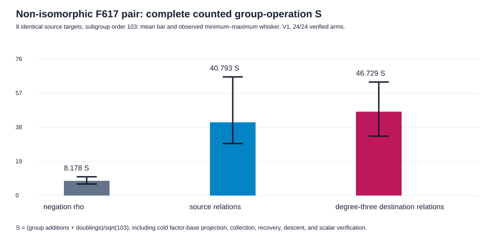

# V1 run: solver completed, timing wrapper failed

Start: 2026-10-13 17:43 UTC. Host: Darwin 25.6.0 arm64, shared, L0.
Dependency: frozen [protocol](../../PROTOCOL.md) at commit `70b119bfab`.
Release runner source SHA-256:
`72b25721734346d82e4268c54622251312b050aa2f23e573ec52616e165d60b2`;
binary SHA-256:
`cc28892bcaa8830ddc6d1c643088c715c7ad4e0c6d097a5c40d618952c277cb6`.

Command from repository root:

```sh
/usr/bin/time -l target/release/examples/isogeny_fiber_nonisomorphic_20261013 > research/isogeny_torsion_fibers_20261012/nonisomorphic_pair_20261013/raw-v1.tsv 2> research/isogeny_torsion_fibers_20261012/nonisomorphic_pair_20261013/run-v1.log
```

The native child wrote [24 verified arm rows](../../raw-v1.tsv) and its
completed summary, including 381,924 map-homomorphism pair checks. The
wrapper returned **exit 1** after the child completed because the restricted
host denied `sysctl kern.clockrate`; [stderr](../../run-v1.log) retains the
error. No wall-time result is admitted from the wrapper. The graph below is
derived from the v1 rows and reports only counted group operations. The
same-source-target group-operation totals were rho 664, source relations
3,312, and destination relations 3,794. Its [summary](../../summary-v1.tsv)
and [phase table](../../phase_summary-v1.tsv) are native derivations from the
raw TSV. A [clean direct execution](../run-20261013T1744Z/README.md) followed
the separately committed [remediation](../../REMEDIATION_V2.md).



The [run PDF](report.pdf) embeds this graph. The result
[report](../../REPORT.md) carries the independent checker and interpretation.
