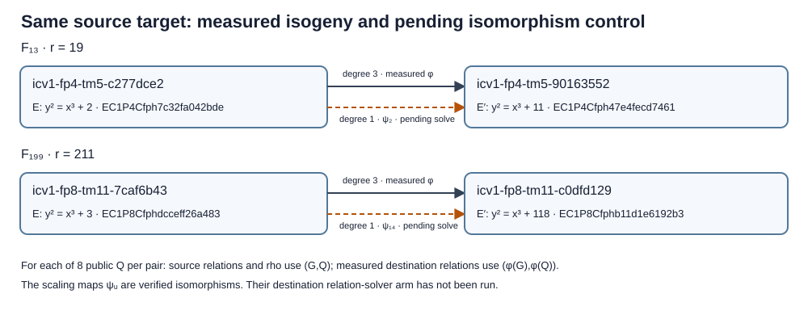
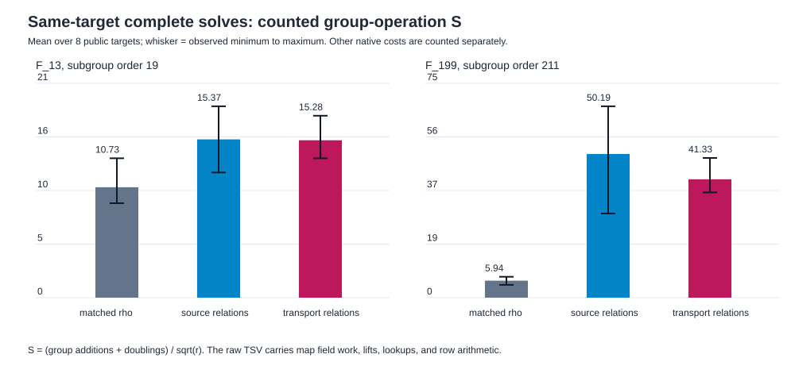

# Explicit isogeny transport: same-target relation solves and matched rho

**Date:** 2026-10-12 local (final run 2026-10-13 02:00 UTC). **Status:**
bounded native complete-solve control, with counted group operations and
unpriced native work retained separately. **Classification:** measured
coordinate and relation-collection diagnostic on two small public groups;
no admitted end-to-end speed result or scaling result. The frozen
[protocol](PROTOCOL.md), [raw final records](raw-v4.tsv),
[phase summary](phase_summary-v4.tsv), [run report](reports/run-20261013T0200Z/README.md),
[transport diagram](transport.svg), [counted-cost graph](group_ops-v4.svg), and
[PDF](report.pdf) are the evidence for this round. Earlier run versions are
retained below.

## Exact models and question

The question is whether transporting a source target through the explicit
degree-three isogeny changes a complete relation solver's cost. The source
and destination use the same field and group order. The geometric kernel
has order 3 and the rational kernel has order 1 on both pairs. The formula
is `φ(x,y)=((x³+4b)/x², y(x³−8b)/x³)` for nonzero `x`; it sends the
identity to the identity. See the preceding [map protocol](../MAP_PROTOCOL.md)
and Shumow's [isogeny construction](https://arxiv.org/abs/0910.5370).
Because the rational kernel is trivial, this round tests transport and
coordinate-dependent relations, not enumeration of a multi-point rational
torsion fiber.

**Structural correction found during final review:** Both destination
models are already `F_p`-isomorphic to their sources. The public scaling
map `ψ_u(x,y)=(u²x,u³y)` sends `y²=x³+b` to `y²=x³+u⁶b`.
For `(p,b,b')=(13,2,11)`, `u=2`; for `(199,3,118)`, `u=14`.
The independent verifier checked `u⁶b=b'`, bijectivity, and every
ordered-pair group law on both source groups (44,882 pairs). On the
rational groups it also checked `φ=ψ_u∘[m]` point by point, with
`m=10 mod 19` and `m=29 mod 211`, respectively. Those small-group
scalars were found by an exhaustive public-generator check and are not
a cost bound for finding a corresponding scalar at larger order.
The degree-three map remains explicit and valid, but this round has no
isomorphism-only relation arm to identify an effect specific to the
degree-three map.

| field and direction | source ICV1 / EC1 | destination ICV1 / EC1 | generator image | verified checks |
|:--|:--|:--|:--|--:|
| `F₁₃`, `b=2 → 11` | `icv1-fp4-tm5-c277dce2` / `EC1P4Cfph7c32fa042bde` | `icv1-fp4-tm5-90163552` / `EC1P4Cfph47e4fecd7461` | `(1,4) → (9,5)` | 361 ordered pairs |
| `F₁₉₉`, `b=3 → 118` | `icv1-fp8-tm11-7caf6b43` / `EC1P8Cfphdcceff26a483` | `icv1-fp8-tm11-c0dfd129` / `EC1P8Cfphb11d1e6192b3` | `(1,2) → (13,153)` | 44,521 ordered pairs |

The [model and generator record](curves.json) gives the full tuple and
subgroup order. The curve registry and alias map add these four models.
For each field, eight distinct nonidentity public source points `Q` are
generated by the protocol's fixed stream; no target logarithm is supplied
to a solver. Source relations and matched negation rho receive `(G,Q)`;
destination relations receive `(φ(G),φ(Q))`. All three arms solve the
**same source target**, and the runner independently checks each answer.

## Result in the repository's counted group-operation unit

`S = (group additions + doublings)/√r`, including factor-base pair-table
setup, relation collection, target descent, and checked recovery for the
relation arms. The rho row includes its native walk and a runner check.
The selected negation-class rho has a walk-step floor of
`√(π/4) ≈ 0.88623` in this `S` normalization. The curves also admit
the rational order-three automorphism `(x,y) ↦ (ζx,y)`, with `ζ=3` in
`F₁₃` and `ζ=92` in `F₁₉₉`; both values satisfy `ζ³=1` and `ζ≠1`.
Together with negation this gives six rational automorphisms and the
lower six-class generic walk-step floor `√(π/12) ≈ 0.51166`.
The existing rho implementation uses only negation, so it is an exact-target
matched control but is not established as the strongest rho available on
these curves. The table's floor ratios use the **selected two-class rho
floor**, not the six-class curve floor. Both floors concern walk steps;
the rows count additional setup and verification. Ranges are observed
minima and maxima across eight targets, not confidence intervals. Ratios
use sums over the same eight
target indices, equivalent to ratios of means because sample counts match.

| group order | arm | verified / 8 | mean `S` (observed range) | mean `S` / matched rho | mean `S` / two-class floor |
|--:|:--|--:|--:|--:|--:|
| 19 | matched negation rho | 8 | 10.725 (9.177–13.536) | 1.000 | 12.102 |
| 19 | source relations | 8 | 15.371 (12.159–18.583) | 1.433 | 17.344 |
| 19 | transported relations | 8 | 15.285 (13.536–17.665) | 1.425 | 17.247 |
| 211 | matched negation rho | 8 | 5.938 (4.475–7.297) | 1.000 | 6.700 |
| 211 | source relations | 8 | 50.186 (29.396–66.846) | 8.452 | 56.629 |
| 211 | transported relations | 8 | 41.332 (36.762–48.810) | 6.961 | 46.638 |

For the six-class curve floor, multiply the last column by `√3`;
the order-211 values become 11.605, 98.085, and 80.779, respectively.
This boundary correction changes no raw record or group-operation ratio.

At order 211, the recorded source/transport group-operation totals are
5,832 / 4,803 = **1.21424**. At order 19 they are 536 / 533 = **1.00563**.
These are counted-group-operation ratios on the stated workloads. They
do not price every native operation and do not establish a complete-cost
advantage. Because `ψ_u` already reaches the same destination curve,
the observed source/transport gap may be reproduced with a degree-one
coordinate change. Both relation arms use more counted group operations than rho
on these workloads. The [SVG graph](group_ops-v4.svg) and its
[150 dpi PNG](group_ops-v4.png) show the measured means and ranges.

## Phase and native-work accounting

The pair-table has 10 entries at order 19 and 78 at order 211. Every
relation arm reached full rank (4 or 12) and verified every factor-base
log and recovered target. The 16 independent target workloads produced
48 verified arm records. The principal order-211 means per target are:

| arm | setup GAE | collection GAE | target descent GAE | verification GAE | rho GAE | relation trials | accepted rank | recorded modular row products | target descent trials |
|:--|--:|--:|--:|--:|--:|--:|--:|--:|--:|
| matched rho | 0 | 0 | 0 | 8.50 | 77.75 | 0 | 0 | 0 | 0 |
| source relations | 78.00 | 525.25 | 23.25 | 102.50 | 0 | 61.50 | 12 | 404.125 | 2.750 |
| transported relations | 78.00 | 387.75 | 23.125 | 111.50 | 0 | 44.875 | 12 | 313.375 | 2.625 |

The collection difference is the observed source of the group-operation
gap at order 211: 61.50 versus 44.875 relation probes on average. Each
probe computes a fresh known multiple and checks a two-point factor-base
sum, yielding an exact equation. This is a fixed pair-table relation
method; the table and its group additions are charged in setup. The
incremental rank filter and back substitution are counted as modular
row products and inversions. The raw `row_mul_subs` field includes
elimination and back-substitution multiply-subtracts **and** the
modular products used to normalize each pivot row and right-hand side;
its name is historical and is not a pure multiply-subtract count.
Back substitution always uses
`B(B−1)/2 = 66` such operations at order 211 and 6 at order 19; the
remaining row operations belong to collection rank reduction. The
destination row at order 211 also has mean 21 factor-base lift attempts,
44.875 relation lookups, 2.625 descent lookups, and 12 modular inversions
in the row solver. The source has 23, 61.50, 2.750, and 12 respectively.
These native counts are in [phase_summary-v4.tsv](phase_summary-v4.tsv).

Each transported workload performs two explicit map evaluations for `G`
and `Q`: **10 field multiplications, 4 field squarings, and 2 field
inversions** in this formula implementation. The raw records separately
give field operations behind every prime-curve group law. Square roots
for factor-base lifts, pair-table lookups, modular row operations, and
the rho distinguished-point table do not have pinned conversions to the
group-operation unit here. They are reported as counts where exposed;
rho table probes are explicitly **unpriced and uncounted** by the
underlying library. Thus the `S` table is a diagnostic, not a full-cost
ecbench comparison. The two maps were public and fixed; map discovery or
construction from a hidden kernel is outside this run. Full rational
point enumeration and homomorphism checks are validation, outside the
per-target solver interval, and their exact counts are in `run-v4.log`.

## Reproducibility and run history

The final [native example](../../../examples/isogeny_fiber_pair_20261012.rs)
was built with `cargo build --release --example isogeny_fiber_pair_20261012`
and executed exactly as in the [run report](reports/run-20261013T0200Z/README.md).
It uses the library's counted `PrimeCurve` operations and
`rho_walk_with(..., NegationClasses, RhoWalk::negation())`. Raw final TSV
SHA-256 is `995b7bcc33f5584d7b4fc6102b7ade2b3f19c7e5b39cb406b0b1c33dc7af11ad`;
the same-host replay has identical bytes and the map logs compare equal.
This is a deterministic replay on the same host, not independent-host
validation. The source SHA-256 before the final commit is
`ad476e1b4cffad8fdd74935b99673db9c233a22ae45bcfb5e8ddea6834baa935`.
The separate native [arithmetic verifier](verify.rs) uses its own
extended-Euclid inversion and point law. It directly recounts the four
models, rechecks `φ(Q)`, `[d]G=Q` for every row, source/transport/rho
agreement, all 48 phase sums, and row widths. Its [receipt](validation/independent_arithmetic_v4.log)
reports 48 records and 16 distinct source targets passing. It runs on
the same host and is an independent code path, not an independent-host
cost replay. The verifier also checked the cubic automorphism on all
89,764 ordered pairs across the four curve models, including preservation
of the group law and order three on every nonidentity rational point.
It checked the scaling isomorphism on another 44,882 ordered pairs and
the exact `φ=ψ_u∘[m]` identities on all rational source points.

The [local validation receipt](validation/README.md) separates the first
full release-library run (3,996 passed, 13 failed, 113 ignored under
restricted loopback access and high host load) from the controlled
two-thread, loopback-accessible full run (4,009 passed, 0 failed,
113 ignored). All four solver tests that failed in the first run passed
alone and in the controlled full run; the affected networking group
passed 37/37 outside the restricted sandbox. Both full logs are retained.

### Formal proof map for the automorphism boundary

The pinned [Lean module](../lean/CubicAutomorphism.lean) compiled with
`lake build`; its [build receipt](../lean/cubic_full_build.log) includes
`#print axioms` output. `lean4checker` was unavailable locally.

| report fact | Lean declaration | exact statement and status |
|:--|:--|:--|
| named cubic roots | `zeta13`, `zeta199` | `3³ mod 13 = 1` and `92³ mod 199 = 1`; checked, no axioms |
| equation preservation | `cubicPreservesEquation` | over any commutative ring, `ζ³=1` and `y²=x³+b` imply `y²=(ζx)³+b`; checked with standard `propext`, `Classical.choice`, `Quot.sound` |
| named sixth-power scalings | `scaling13`, `scaling199` | `2⁶·2 mod 13 = 11` and `14⁶·3 mod 199 = 118`; checked, no axioms |
| scaling equation preservation | `scalingPreservesEquation` | over any commutative ring, `y²=x³+b` implies `(u³y)²=(u²x)³+u⁶b`; checked with standard `propext`, `Classical.choice`, `Quot.sound` |
| full elliptic-curve group automorphism | no Lean declaration | the core-only Lean project lacks a formal point/group law and finite-field bridge; the exact finite models instead have exhaustive independent arithmetic checks of 89,764 ordered pairs. A general Lean group-action theorem remains open. |
| full elliptic-curve scaling isomorphism | no Lean declaration | the exact two finite pairs have independent exhaustive group-law checks on 44,882 ordered pairs and bijective images; a general Lean group-isomorphism theorem remains open. |

The first [run](reports/run-20261013T0146Z/README.md) verified the
answers but put rho's full ledger under `setup_gae`. The second
[run](reports/run-20261013T0156Z/README.md) separated that phase but
emitted a zero in a rho lookup column the library does not measure. The
third [run](reports/run-20261013T0159Z/README.md) removed that value
without removing its header, giving inconsistent row width. The final
v4 runner asserts header and row widths and retains the true measured
counters. Every earlier raw file, source snapshot where available, and
derived graph is preserved. Only v4 is used for the result table.

## Interpretation and next test

The rational fibers are singletons on these pairs, yet coordinate choice
changes this fixed relation method's yield at order 211. The destination
isomorphisms mean that this is a coordinate observation, not an isolated
degree-three isogeny effect. The complete
same-target algebraic path, including relation collection, linear
recovery, target descent, and verification, is demonstrated on these
small public groups. The admissible full-cost comparison is still open:
this dedicated runner is not an isolated ecbench session, lacks native
operation conversion for all work, and has only same-host replay. The
existing [problem record](../../../problems/nonrational-isogeny-fiber-dlp-cost-gap.md)
tracks those gates.

The cheapest immediate mechanism check is the [preregistered
isomorphism control](NEXT_TEST_PROTOCOL.md), a fourth
relation arm on the same 16 source targets**. Use the public scaling
isomorphisms `ψ_2` and `ψ_14` to transport both `G` and each exact `Q`;
run the same destination factor base, pair table, seeds, caps, rank
collection, recovery and verification as v4. Charge both scaling map
evaluations. Re-run the original three arms for the same-target receipt.
If the isomorphism arm matches the degree-three arm's yield and cost,
the current coordinate difference needs no degree-three map to reproduce.
If they differ, the difference is tied to their distinct point action
within the same destination model and still needs full-cost accounting.

The next reference check adds a six-class rho arm. Canonicalize the orbit
under `P ↦ (ζx,y)` and negation, retain the scalar-coefficient transform,
and charge orbit evaluation, canonicalization, table work, setup and
verification. Require each recovered scalar to agree with all three v4
arms and pass `[d]G=Q`. A lower rho cost would widen the measured
group-operation gap; a failed or unpriced six-class implementation would
leave the strongest-reference comparison open. The v4 records and frozen
protocol remain unchanged.

The later performance test is to add a paired-target isogeny transport
method to native ecbench or an equivalently audited counted runner,
register at least four increasing prime-order subgroup pair sizes,
including a base-field non-isomorphic pair if a degree-three-specific
effect is the question, freeze eight
or more public targets per size and five interleaved rounds, pin the
conversion for map, lift, lookup and modular work, and run the same
source target under transported relations, source relations, matched
negation rho, and a six-class automorphism-aware rho control. Charge map
construction/evaluation, relation setup and collection, algebra, target
recovery, verification, failed attempts, and memory. Require exact
independent-host replay and report per-size
paired intervals. A target-coupled complete-cost ratio below matched
rho at increasing sizes would support a measured crossover; a relation
yield difference alone would remain a stage observation. No canonical
scoreboard or isogeny-class cost edge is updated from this round.

## Requirement status

| requested element | status | evidence or remaining gate |
|:--|:--|:--|
| explicit isogeny and same-target transport | verified complete for two named pairs | map checks and `raw-v4.tsv` |
| relation collection, rank, recovery, verification | verified complete for 16 public workloads | 48 verified records; `phase_summary-v4.tsv` |
| matched negation rho on exact source targets | verified complete in counted group operations | `rho_negation` rows in `raw-v4.tsv` |
| six-class rho on the same targets | not attempted | required for comparison to the full rational automorphism boundary |
| isomorphism-only destination relation arm | not attempted | both exact pairs admit `ψ_u`; this control is required to isolate the degree-three map's role |
| multi-point rational torsion fiber | not attempted | the tested maps have rational kernel order one; a separate registered pair and fiber enumeration are needed |
| fully priced cold `S` and speed comparison | partial | map, roots, lookups, row work lack pinned conversions; no ecbench admission |
| independent verification and replay | partial | separate native arithmetic verifier and byte-identical same-host replay pass; separate-host cost receipt absent |
| scaling or deployed-curve conclusion | not attempted | two small public groups, no scaling protocol |

Canonical graphs checked and left unchanged: `docs/index-calculus-scoreboard.html`,
`docs/ic-current-state.html`, and the existing `docs/curves/` cost diagrams.
The four exact model/representation identities are added to the curve
registry, but no cost claim or isogeny-class performance edge is added.
The result's transport diagram and both rendered copies now show the
verified isomorphisms as a pending solver arm. The `group_ops-v4` graph
remains the original three-arm measurement because no isomorphism-only
solver counts were collected.
