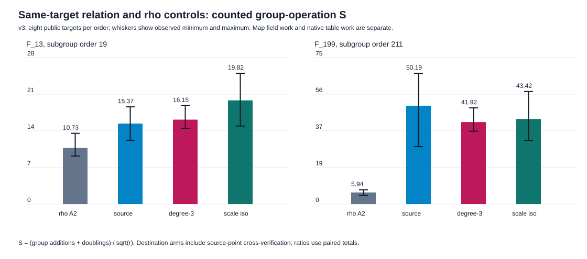
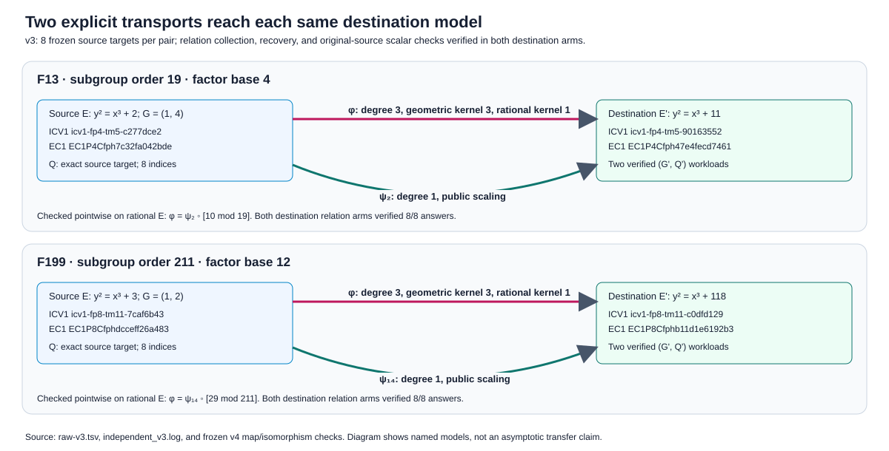
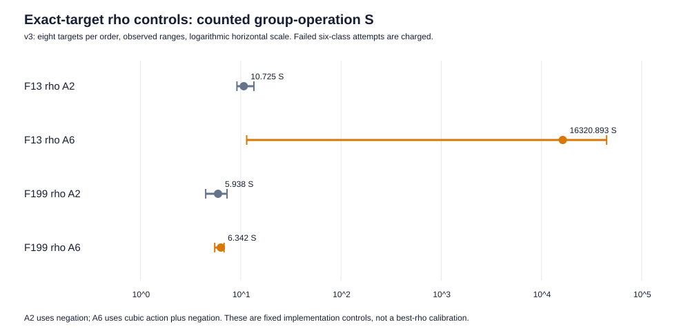

# Isomorphism-only transport and six-class rho controls

**Date:** 2026-10-13 local. **Conductor:** T-2372. **Status:** v3 is a
bounded same-target complete-solve control with 80/80 independently checked
answers. V1 and v2 remain failed six-class control runs. **Classification:**
measured coordinate/relation diagnostic and charged fixed-rho controls;
complete native-work cost and scaling remain open.

## Question, exact inputs, and evidence

The [pre-run protocol](PROTOCOL.md) asks whether the destination relation
yield seen after the explicit degree-three isogeny is reproduced by the
public base-field scaling isomorphism to the *same* destination curve.
The [v2 adjustment](REMEDIATION_V2.md) and [v3 restart schedule](RESTART_V3.md)
were committed before their respective runs. The target coordinates are the
16 source rows in the frozen [v4 raw file](../raw-v4.tsv), SHA-256
`995b7bcc33f5584d7b4fc6102b7ade2b3f19c7e5b39cb406b0b1c33dc7af11ad`.
The two source groups have orders 19 and 211; their generators are `(1,4)`
over `F13`, `y²=x³+2`, and `(1,2)` over `F199`, `y²=x³+3`. Destination models
have `b'=11` and `b'=118`. The degree-three map is
`φ(x,y)=((x³+4b)/x², y(x³−8b)/x³)`; the degree-one control is
`ψ_u(x,y)=(u²x,u³y)` with `u=2` or `14`.

The native [v3 runner](../../../../examples/isogeny_fiber_iso_control_20261013.rs)
uses the v4 relation path, first-lifted-point factor bases of size 4 or 12,
the same pair table and streams, and 10,000-trial collection/descent caps.
Each of the 16 source targets is solved in five arms: source relations,
degree-three destination relations, scaling-isomorphism destination
relations, source negation rho, and source six-class rho. Every result is
checked against the original source `(G,Q)`; each destination relation arm
also checks its own transported `(G,Q)`. The independent
[Rust checker](verify.rs) uses its own point law and extended-Euclid inverse.

The final [raw v3 TSV](raw-v3.tsv), [replay](replay-v3.tsv),
[run log](run-v3.log), [phase table](phase_summary-v3.tsv),
[summary table](summary-v3.tsv), [independent receipt](independent_v3.log),
[relation graph](relation_group_ops-v3.svg), [rho graph](rho_group_ops-v3.svg),
[explicit transport diagram](transport-v3.svg),
the [artifact digest manifest](ARTIFACTS.sha256), and [PDF](report.pdf) are
the result record. The two TSVs and logs compare
byte for byte. The separate [run report](reports/run-20261013T1634Z/README.md)
records commands, source and binary hashes, host, and output status.

## Measured result

The unit is `S = (counted group additions + doublings)/sqrt(r)`. It includes
relation pair-table setup, collection, factor-base recovery verification,
target descent, source cross-verification for destination arms, and rho's
charged setup and walks. Each row below has eight verified source targets;
ranges are observed minima–maxima, not confidence intervals. The floor
ratios in [summary-v3.tsv](summary-v3.tsv) use the two-class walk-step floor
`sqrt(pi/4)` and six-class floor `sqrt(pi/12)` separately. Neither floor is a
lower bound for this full native pipeline.

| order | arm | verified / 8 | mean `S` (range) | total counted group ops / matched negation rho |
|--:|:--|--:|--:|--:|
| 19 | negation rho | 8 | 10.725 (9.177–13.536) | 1.000 |
| 19 | six-class rho, charged restarts | 8 | 16,320.893 (11.471–44,694.314) | 1,521.735 |
| 19 | source relations | 8 | 15.371 (12.159–18.583) | 1.433 |
| 19 | degree-three relations | 8 | 16.145 (14.453–18.812) | 1.505 |
| 19 | scaling-isomorphism relations | 8 | 19.816 (14.912–25.006) | 1.848 |
| 211 | negation rho | 8 | 5.938 (4.475–7.297) | 1.000 |
| 211 | six-class rho | 8 | 6.342 (5.507–6.815) | 1.068 |
| 211 | source relations | 8 | 50.186 (29.396–66.846) | 8.452 |
| 211 | degree-three relations | 8 | 41.917 (37.244–49.154) | 7.059 |
| 211 | scaling-isomorphism relations | 8 | 43.423 (32.494–57.553) | 7.313 |

At order 211, degree-three and scaling-isomorphism relations took **359 and
358 trials** across the same eight targets. Their collection group operations
were **3,102 and 3,107**; both reached rank 12 and verified all factor-base
logs. Their complete counted group-operation totals were **4,871 and 5,046**,
so isomorphism/degree-three is `5,046/4,871 = 1.035927` in that unit. The
destination arms include the same source cross-check overhead. At order 19,
the respective totals were **563 and 691**, ratio `691/563 = 1.227353`, and
relation trials were **73 and 88**. The exact measured relationship therefore
depends on this field and target set; no equality of trajectories is claimed.

The isomorphism arm reproduced a destination relation workload close to the
degree-three arm at order 211, while using the same factor base and curve
model. The maps act differently on the chosen generator: on rational points
the earlier checker established `φ=ψ_u∘[m]`, with `m=10 mod 19` and
`m=29 mod 211`. Thus identical scalar streams need not visit identical
destination points. This control leaves any degree-three-specific relation
effect unisolated. These exact ratios are observations over eight targets,
not a distributional estimate or exponent claim.

At order 211, six-class rho took 737 counted group operations versus 690 for
negation rho on the same eight source targets, `737/690 = 1.068116`; all 16
six-class answers verified in v3. At order 19, the fixed stride-start walk
repeatedly reached its cap on three targets. V3 solved those on attempt 2 of
the frozen seed schedule; **every failed first attempt is charged**, yielding
569,129 counted operations versus 374 for negation rho. This is a property
of the tested walk configuration on these instances, not a general
six-class-rho lower bound. The six-class canonicalization additionally used
recorded field multiplications and point negations outside the graph's group
operation unit. The runner selects the correct cubic multiplier from the two
roots of `λ²+λ+1=0 mod r`, charging that public generator check per target.

## Failed runs, checks, and limits

The [v1 raw file](raw-v1.tsv) has 25 rows: 24 verified, one six-class cap
failure at `F13` target 4; the runner stopped before the remaining targets.
The [v2 raw file](raw-v2.tsv) has all 80 rows: 77 verified, with six-class
cap failures at `F13` targets 4, 5, and 6 after setting every class point
distinguished. The [v1](verification-v1.svg) and [v2](verification-v2.svg)
verification graphs and separate run reports show failures and targets not
reached without folding them into v3. V1/v2 did not meet the all-arm
acceptance gate. Their raw TSVs and logs are retained. A
[native reconstruction receipt](validation/historical_replay.md) records
byte-identical stdout/stderr replay for both; v1's reconstructed source
matches its pre-run hash exactly, while v2's original source and binary
hashes were not recorded.

The v3 independent checker verified all 80 scalars, the frozen v4 source
targets, destination map images and map-operation counters, all phase sums,
the per-attempt seed schedule and aggregate rho counters. It checked the
cubic automorphism on 89,764 ordered point pairs and the scaling maps on
44,882 pairs. Its six-class orbit/multiplier check covered 1,840 repeated
point checks across the 16 workloads. The `mapped_qx/y` columns for source
relations and negation rho retain the v4 companion `φ(Q)` image; their working
target is the `qx/qy` source point. For six-class rho `mapped_qx/y` is `Q`.
For both destination arms it is the actual destination target.

The six-class coefficient update has a checked conditional Lean proof in
[SixClassCoefficients.lean](../../lean/SixClassCoefficients.lean), with
[build and axiom receipt](../../lean/six_class_build.log):

| report statement | Lean declaration | exact hypotheses and status |
|:--|:--|:--|
| applying an additive automorphism to `aG+bQ` multiplies both coefficients by `λ` | `SixClassCoefficients.endomorphismWalkCoefficients` | assumes an abstract additive map compatible with scalar action and `σ(G)=[λ]G`, `σ(Q)=[λ]Q`; compiled, no axioms |
| the represented scalar value scales with those coefficients | `SixClassCoefficients.scaledCoefficientValue` | abstract commutative ring; compiled using standard Lean foundations |
| point negation negates both coefficients | `SixClassCoefficients.negatedCoefficientValue` | abstract commutative ring; compiled using standard Lean foundations |

The actual `PrimeCurve` point law and cubic map are not formalized as Lean
instances of those hypotheses. Their named finite-group action is checked
exhaustively by the independent Rust verifier. Thus the Lean module is a
faithful conditional component, not a full formal proof of the concrete
curve implementation. `lean4checker --fresh` was unavailable locally.

The group-op `S` excludes map field work (degree-three: 10M, 4S, 2I per
target; scaling: six field multiplications including cold constants),
factor-base square roots, lookups, row arithmetic, rho hashes and table
probes, and memory. Curve-specific discovery of the explicit maps and the
exhaustive preflight map checks are also outside each target's counted
solve; a cold-start construction cost is therefore not established. The
host is shared Darwin arm64, L0; no admitted wall
comparison is made. Replay is on the same host. Both maps have trivial
rational kernels, so this test does not enumerate a multi-point rational
torsion fiber. A stronger mechanism test needs more seeds/targets and a
base-field non-isomorphic pair; a full performance test needs complete native
pricing, four growing sizes, and independent-host replay. The
[open problem record](../../../../problems/nonrational-isogeny-fiber-dlp-cost-gap.md)
retains those obligations.

| requested element | status | evidence or remaining gap |
|:--|:--|:--|
| explicit degree-three and isomorphism transport | verified complete on both named pairs | 80-row checker, map checks, v3 raw |
| relation collection, recovery, scalar verification | verified complete on 16 frozen targets | v3 raw, phase table, independent checker |
| exact-target negation and six-class rho controls | verified complete for the fixed implementations | v3 raw and charged restart log; tuning/scaling open |
| full-cost method comparison | partial | native field, lookup, row, and memory work lack a pinned common conversion |
| multi-point rational torsion fiber and non-isomorphic transfer | not attempted in this run | both present pairs have rational kernel size one |
