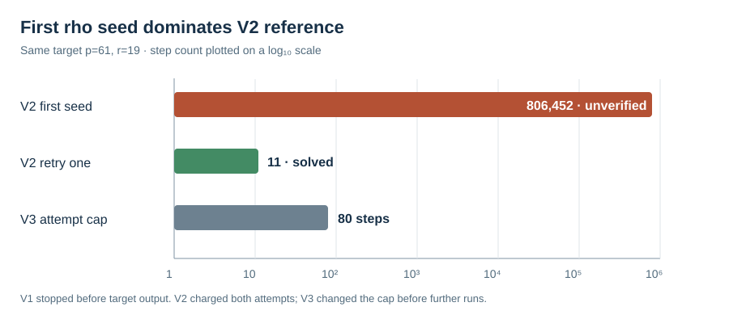

# Pairing batch V1 failure and V2 charged retry

Runs: V1 first attempt and V2 diagnostic on frozen `(p,r)=(61,19)`,
round zero, 18 distinct nonidentity public targets. Host: Darwin arm64,
macOS 26.6, shared L0. Inputs and code are pinned in
[`RUN_SPEC_V1.json`](../../RUN_SPEC_V1.json) and the pre-rerun
[`AMENDMENT_V2.md`](../../AMENDMENT_V2.md).

V1 wrote one setup record, then exited 101 when its first rho reference
did not verify under seed `0x4241544348001000`. This is an incomplete
reference run. V2 retained that seed and charged all retries. On target
zero, retry zero ran 806,452 rho steps and 386,302,417 current-thread CPU
ns without a verified answer; retry one solved the same target in 11 steps
and 32,292 ns. V2 then completed 18 pairing targets. Its reference total
is dominated by the failed first walk, so its apparent pairing/rho ratio is
a diagnostic of the reference stopping rule, not a method crossover.

V1 raw: [`RUN_61_R0.jsonl`](../../RUN_61_R0.jsonl), SHA-256
`175c1ad24d0d43090a3fe5e737880c2f5b5450bf74153a98cb28cb615a084017`,
plus matching stderr. V2 raw: [`RUN_61_R0_V2.jsonl`](../../RUN_61_R0_V2.jsonl),
SHA-256 `20cc208f41a2dda7d3ee6dae1822d64eebde91d56a06ccb8ccae09884bb9e000`,
plus matching stderr. The [V3 protocol amendment](../../AMENDMENT_V3.md)
froze a subgroup-sized step cap and a separate six-class rho control before
the subsequent paired runs. No failed record was overwritten. The study's
canonical performance graph was left unchanged because V1 has no completed
comparison and V2 has an unrepresentative, uncapped reference walk.
