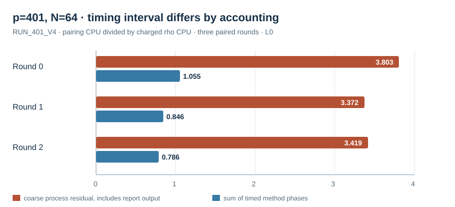

# Native batch V3/V4 phase and replay ledger

Runs: V3 on `(p,r)=(61,19),(271,61)` and V4 on `(401,67)`, three rounds
each. Host: Darwin arm64, macOS 26.6, shared L0. Protocols and exact native
source hashes are in [`RUN_SPEC_V3.json`](../../RUN_SPEC_V3.json) and
[`RUN_SPEC_V4_401.json`](../../RUN_SPEC_V4_401.json). Public Q lists contain
18, 60 and 66 distinct nonidentity targets; the answer files were absent
from solver input. The 401 cell uses a degree-two evaluation field and
passed order, nondegeneracy and bilinearity checks at scalars 1, 2, 3 and 5.

All pairing scalars and charged negation-rho scalars agreed. The native
independent checker replayed 54/54, 180/180 and 198/198 target records,
respectively. V3 also charged six-class rho on the two `j=0` subgroups where
the automorphism preserves the subgroup. The 401 generator lies in `F_401`
with nonzero x-coordinate; its order-three automorphism leaves that
prime-field subgroup, so six-class rho is inapplicable there.

| Cell and feasible prefix | Median coarse pairing/rho CPU ratio | Median coarse pairing/six-class ratio | Replayed target rows |
| --- | ---: | ---: | ---: |
| `p=61,r=19,N=16` | 411.05 | 199.31 | 54/54 at full `N=18` |
| `p=271,r=61,N=60` | 37.59 | 31.00 | 180/180 |
| `p=401,r=67,N=64` | 3.42 | inapplicable | 198/198 at full `N=66` |

The coarse pairing CPU removes timed rho calls from process time but still
contains repeated JSON reporting. The phase sum excludes input and some
between-phase work. At the 401 cell's `N=64`, their paired ratios to rho
diverged as graphed. Neither is a clean whole-method comparison by itself;
the [V5 compact protocol](../../AMENDMENT_V5.md) was frozen before a run
without per-target output. All V3/V4 field construction, H searches,
Miller/final exponentiation, finite-field BSGS, failed attempts, scalar
checks, native primitive counts, CPU, wall and memory remain in each raw
record. The `N=64` distinct workload is now executed on the added order-67
cell; it is unavailable on the original groups by cardinality.

Raw: [`RUN_61_V3.jsonl`](../../RUN_61_V3.jsonl), SHA-256
`f77508edb018433f04cdbc0fd059c725785cf34077cb5db8c8a1dc11088a1b1b`;
[`RUN_271_V3.jsonl`](../../RUN_271_V3.jsonl), SHA-256
`35c1d0d4e4c34c0ba0f9479ae2c95e7b7027a2840811e749e301652c9cb1af0f`;
[`RUN_401_V4.jsonl`](../../RUN_401_V4.jsonl), SHA-256
`c4ac091859c4d09dd40cdb462c46d38255007f41beef930d362dbe060e406c5f`.
Replays: [`REPLAY_61_V3.json`](../../REPLAY_61_V3.json),
[`REPLAY_271_V3.json`](../../REPLAY_271_V3.json), and
[`REPLAY_401_V4.json`](../../REPLAY_401_V4.json). Individual round files
and stderr are retained. The canonical ECDLP scoreboard remains unchanged:
these runs are L0, and V3/V4 do not provide a clean complete-cost CPU ratio.
