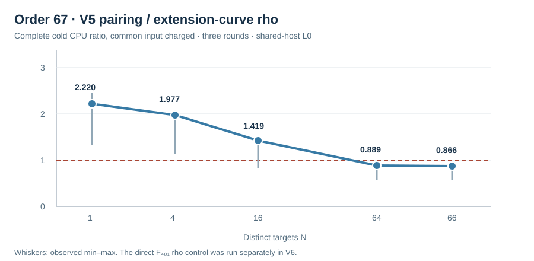

# Compact batch V5 against extension-curve rho

Run start: 2026-10-15 17:29 UTC. Host: Darwin arm64, macOS 26.6,
shared L0; a release library test suite was running on the host. The
[frozen V5 spec](../../RUN_SPEC_V5.json) pins the native source, three
public target lists, selection receipts, prefixes and alternating order.
It removes per-target JSON from the timed intervals. Public-input reading
and subgroup validation were measured once and added equally to both
complete cold method totals. Pairing timers include field construction,
irreducibility, failed H search, alpha, reusable finite-field BSGS table,
every beta and finite-field solve, and scalar checks. Rho timers include
every charged restart. Separate arithmetic replay checked 108, 360 and
396 scalar outputs, respectively, with no mismatch.

| Group and prefix | Median pairing CPU (ms) | Median extension-rho CPU (ms) | Median paired pairing/rho ratio |
| --- | ---: | ---: | ---: |
| `p=61,r=19,N=16` | 128.772 | 0.474 | 261.81 |
| `p=271,r=61,N=60` | 40.138 | 1.216 | 33.60 |
| `p=401,r=67,N=64` | 1.275 | 1.703 | 0.889 |

At the order-67 cell, the paired ratios at `N=64` were 0.889, 0.563 and
0.960 over the three rounds. The graph gives all feasible prefixes with
the full three-round range. This is a **representation-specific L0
observation**: the source generator and targets lie in `F_401`, while
this rho control used generic `F_(401²)` point arithmetic. The
[pre-registered V6 arm](../../AMENDMENT_V6.md) prices direct prime-field
rho on the exact same targets; this V5 row does not establish a generic
ECDLP speed advantage. Shared-host CPU and wall variation is substantial,
and no counted-unit conversion or scaling inference is claimed.

Raw compact rows: [`COMPACT_61_V5.jsonl`](../../COMPACT_61_V5.jsonl), SHA-256
`3543009530351640a2ee670468189aea70c6dcee19e58b59aee6e6e18fc55481`;
[`COMPACT_271_V5.jsonl`](../../COMPACT_271_V5.jsonl), SHA-256
`8802b1b831ef48cb0dde7b90e29ea3938130c1aa6019bf7ad3907f3d42fe741a`;
[`COMPACT_401_V5.jsonl`](../../COMPACT_401_V5.jsonl), SHA-256
`5c6a927cf5e1d6b570b80c009367e8cd98f1a84778c6b1ccd1441e6c8125d8eb`.
Replay receipts are the matching `COMPACT_REPLAY_*_V5.json` files. Each
round's raw JSONL and stderr remain retained. The canonical ECDLP graph was
not promoted because direct prime-field rho had not yet been priced.
