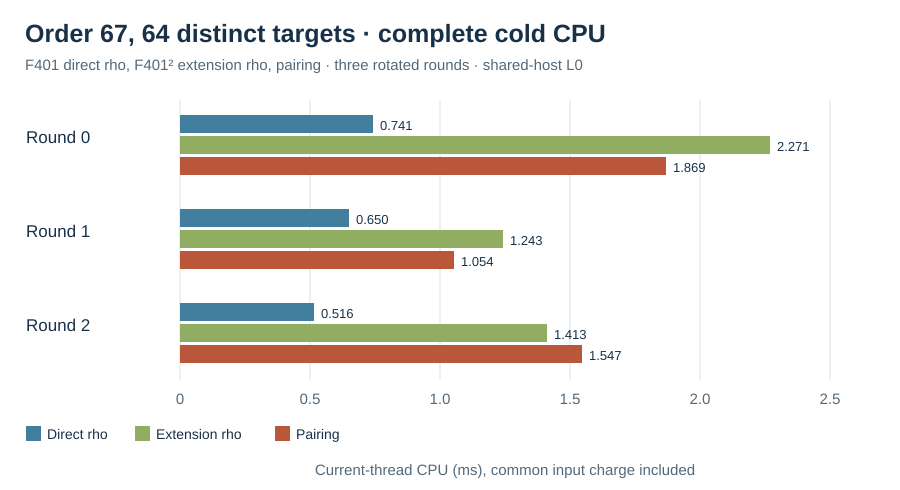

# V6 compact batch against direct prime-field rho

Run: 2026-10-15 17:40 UTC. Host: Darwin arm64, macOS 26.6, shared L0;
the release library test suite was concurrently active. The
[frozen V6 spec](../../RUN_SPEC_V6.json) fixes the 66 public, distinct
order-67 targets, three rotated arm orders, five prefixes, the native source
hash, rho cap and retries. It follows the [V5 observation](../run-20261015T1729Z/REPORT.md)
that extension-curve rho is a weaker implementation control on this
prime-field rational subgroup.

All three arms include their cold setup, failed attempts, solution and scalar
checks. Public-input reading and subgroup validation were timed once per
round and charged equally to each arm. The pairing arm includes field
construction, failed H search, the Miller and final exponentiation calls,
the reusable finite-field BSGS table and every finite-field target solve.
The direct rho arm performs curve arithmetic in `F_401`; extension rho uses
`F_(401²)`. Each returned scalar was independently replayed on the source
curve: [594/594 checked](../../COMPACT_PRIME_REPLAY_401_V6.json), zero
mismatches. The supplied solver inputs omit the answer fixture.

At `N=64`, the complete charged current-thread CPU values were:

| Arm | Round 0 ms | Round 1 ms | Round 2 ms | Median ms |
| --- | ---: | ---: | ---: | ---: |
| Direct prime-field negation rho | 0.741 | 0.650 | 0.516 | 0.650 |
| Extension-field negation rho | 2.271 | 1.243 | 1.413 | 1.413 |
| Pairing, including reusable setup | 1.869 | 1.054 | 1.547 | 1.547 |

Paired pairing/direct-rho ratios were **2.523, 1.620, 3.000** (median 2.523).
Paired pairing/extension-rho ratios were 0.823, 0.848, 1.095. The direct
prime-field control was faster in all three rounds. At `N=66`, the paired
pairing/direct ratios were 2.545, 1.624, 2.983. The graph plots the three
`N=64` rows in a single unit, with complete cold CPU on the horizontal axis.

The order-67 prime subgroup has only 66 nonidentity distinct targets, so this
cell exhausts the requested distinct-target range. It tests reuse of one
pairing input and one finite-field table under the natural same-group direct
rho baseline. The three rounds are shared-host L0 observations; concurrent
testing and arm-order effects limit wall-time inference. Counts of field and
group primitives, attempts, wall time and peak RSS are retained in each raw
row. A counted-unit `S` conversion and isolated cross-size scaling test remain
open, so the canonical ECDLP frontier graph is unchanged.

Raw [combined V6 records](../../COMPACT_PRIME_401_V6.jsonl), SHA-256
`fef2ab3733bd1912c2de0a144a8dd83f4f7c6563544db4ad6a78e70ed1742f24`;
the [independent replay receipt](../../COMPACT_PRIME_REPLAY_401_V6.json),
SHA-256 `af26814d85377ef24487818b61571cd725972f4563bbf312f4fee825dc0775e9`.
Individual round JSONL, stderr and build outputs are preserved beside these.
The earlier coarse V4 and compact V5 records remain separate, without
replacement by this amended run.
