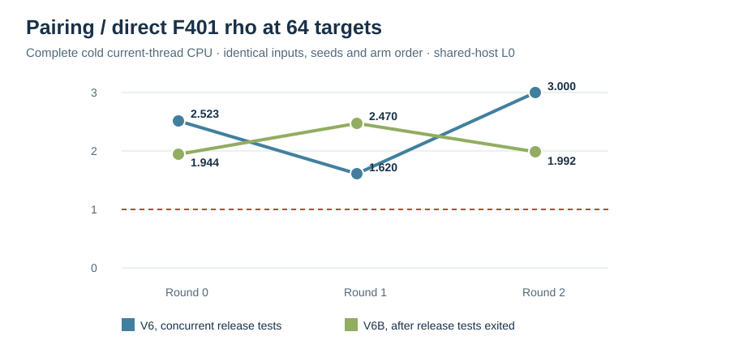

# V6B same-input repeat after release test exit

Run: 2026-10-15 17:52 UTC. Host: Darwin arm64, macOS 26.6, shared L0.
The concurrently running release library test suite had exited before
these measurements. This repeat follows the
[pre-run record](../../REPEAT_V6B.md) and the [V6 spec](../../RUN_SPEC_V6.json):
same public 66 distinct order-67 targets, source SHA-256, pairing H,
finite-field table construction, three rotated arm orders, prefixes,
seeds, step cap and retry bound. The V6 source/binary was unchanged.

The first invocation in this repeat mistakenly chose cell index zero.
It failed the `p=401` assertion before timing; its empty JSONL and
[stderr](../../COMPACT_PRIME_401_R0_V6B_INDEX0_FAILURE.stderr) are
preserved. `INPUTS_V4.jsonl` has the `p=401` cell at index two. The
corrected three invocations completed, and the separate arithmetic
checker replayed **594/594** returned scalars with zero mismatches.

All costs below include public-input reading and subgroup validation,
cold H search, field construction, reusable finite-field BSGS and every
pairing target solve, or rho setup, charged restarts and scalar checks.
No per-target JSON was emitted within timed intervals. At `N=64`:

| Arm | Round 0 ms | Round 1 ms | Round 2 ms | Median ms |
| --- | ---: | ---: | ---: | ---: |
| Direct `F_401` negation rho | 0.595 | 0.492 | 0.473 | 0.492 |
| Extension-field negation rho | 1.315 | 1.475 | 1.265 | 1.315 |
| Pairing with reused H and finite-field table | 1.157 | 1.214 | 0.942 | 1.157 |

Paired pairing/direct-rho ratios were **1.944, 2.470, 1.992** (median
1.992); direct prime-field rho was faster in all three rounds. Pairing
beat extension-field rho in all three rounds, with paired ratios 0.880,
0.823, 0.745. At `N=66`, pairing/direct-rho ratios were 1.946, 2.468,
1.949. The graph shows the paired direct-rho ratio by round for both the
[earlier concurrent-test V6](../run-20261015T1740Z/REPORT.md) and V6B.

At the full `N=66` endpoint of V6B round zero, the recorded pairing field
ledger has 9,727 extension multiplications, of which 5,265 are tagged as
squarings, and 152 extension inversions. The direct rho ledger has 67
charged attempts, 2,334 point additions, 1,932 doublings, 14,251 base-field
multiplications, 6,125 base-field squarings and 4,124 inversions. The
process peak RSS is 7,045,120 bytes. Counts use different field primitives
and are not silently added into one counted `S` unit. The
[V4 phase ledger](../run-20261015T1725Z/REPORT.md) separately records
field construction, unsuccessful H search, Miller work, final exponentiation,
BSGS table setup and per-target beta/finite-field solves.

The repeat confirms the same ordering against the natural direct-field
reference on this fixed workload. It is still shared-host L0, with only
three rounds and no whole-core reservation; differing CPU times between
V6 and V6B cannot be assigned solely to test-suite contention. Every
round's raw JSONL, stderr, field/group primitive ledger, attempts, wall
time and RSS remain next to the combined file. There is no portable
counted-`S` conversion or increasing-size crossover result.

[Combined V6B raw](../../COMPACT_PRIME_401_V6B.jsonl), SHA-256
`d047dc2444f28955023cbb90f0dfbff3afd66f6a28a36e25d0797d7f8b05d3d0`;
[independent replay](../../COMPACT_PRIME_REPLAY_401_V6B.json), SHA-256
`af26814d85377ef24487818b61571cd725972f4563bbf312f4fee825dc0775e9`.
The V6, V5 and V4 raw records are retained as separate versioned runs.
The canonical ECDLP frontier graph remains unchanged.
