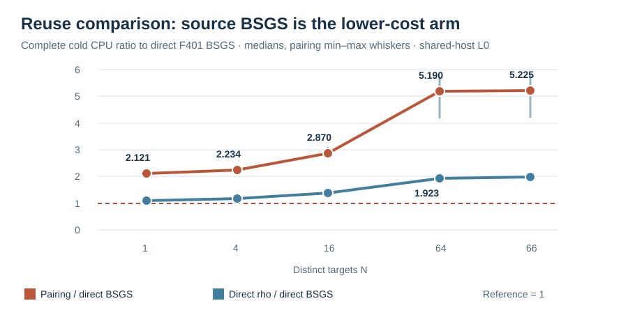

# V7 pairing against reusable source-group BSGS and direct rho

Run: 2026-10-15 18:05 UTC. Host: Darwin arm64, macOS 26.6, shared L0;
the controlled release library suite was running concurrently. The
[pre-run V7 spec](../../RUN_SPEC_V7.json) pins the native source and binary
hashes, public order-67 target list, H selection, 9-entry source baby
table, caps, prefixes and three rotated arm orders. The same 66 distinct
nonidentity targets were fed to pairing, direct `F_401` negation rho and
direct `F_401` elliptic-curve BSGS. The answer fixture was absent from all
three solvers.

Every arm returned all 66 scalars in all three rounds. A separate arithmetic
checker replayed **594/594** scalar outputs against `[k]G=Q`, with zero
mismatch. Complete cold CPU includes public-input reading and subgroup
validation, pairing field construction/H search/Miller/final exponentiation/
finite-field BSGS and target solves, charged rho retries, and direct source
BSGS table construction, all lookups and candidate checks, and final scalar
verification. The direct source table had 9 baby entries and 283 total
lookups for the full 66-target list in each round, with zero false
candidates. It was built anew in every round.

| Arm at N=64 | Round 0 CPU ms | Round 1 CPU ms | Round 2 CPU ms | Median CPU ms |
| --- | ---: | ---: | ---: | ---: |
| Direct source-group BSGS, reusable 9-entry table | 0.300 | 0.435 | 0.303 | 0.303 |
| Direct prime-field negation rho | 0.577 | 0.915 | 0.558 | 0.577 |
| Pairing with reused H and finite-field BSGS | 1.558 | 1.816 | 1.740 | 1.740 |

The paired pairing/direct-BSGS ratios at `N=64` were **5.190, 4.178,
5.749** (median 5.190). Direct rho/direct-BSGS ratios were 1.923,
2.105, 1.842. The median paired pairing/BSGS ratio rose from 2.121 at
`N=1` to 5.225 at `N=66` on this fixed group. The graph shows all five
prefixes; whiskers cover the three observed rounds. The multi-target
reference is the cheaper complete direct method at each prefix, which
was source BSGS throughout this run.

At the full `N=66` endpoint, the direct BSGS ledger recorded 488 point
additions, 552 doublings, 132 scalar multiplications, 3,726 base-field
multiplications, 1,586 squarings and 1,032 inversions in every round;
the public generator order check is recorded separately. The counted
primitives include table setup, every target walk and scalar checks.
Pairing and rho primitive ledgers, wall time, attempts and RSS are in
each raw row. The three CPU rounds are shared-host L0 observations with
concurrent tests; no isolated wall-time, portable counted-`S` or
increasing-order conclusion is established. The canonical ECDLP frontier
is unchanged. The earlier V6/V6B results remain separate.

[Combined V7 raw](../../COMPACT_BSGS_401_V7.jsonl), SHA-256
`7da080bc0e3a1702b58ae9659564fed57f58c65f5662b628ae6d683270271694`;
[independent replay](../../COMPACT_BSGS_REPLAY_401_V7.json), SHA-256
`68aa6cc8e9c3ee48ce1d7135da7326c08ac2345dd94d647124606d3c6376994d`.
Individual round JSONL, stderr and build outputs are retained beside them.
