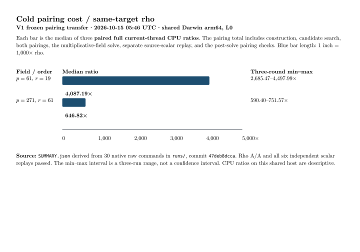

# V1 run receipt: exact pairing transfer

Status: 30/30 frozen commands exited zero, 2026-10-15 05:46:11–05:46:14 UTC. The command schedule is [`../../RUN.sh`](../../RUN.sh); the public, answer-free inputs and point selections were already committed at `6576c90907`. The run commit is `47deb8dccaff455c41500a00b99bf208c5ab2a0c`. The source SHA-256 was `a9ffa68da164d7d3fb72f48665f935971c2a340f59d70b6d9f5a76d0ee7c4ff1`, and the release binary SHA-256 was `ba39e9fc96fd8c82c912c4dd57f90423a3a867ac0cae0fe4215214a7805d2a9a`. Rust 1.93.1 ran on shared Darwin 25.6.0 arm64 at L0 isolation. Exact host and timestamps are in [`RUN_META.txt`](../../runs/RUN_META.txt).

The two cells were the frozen public `E:y²=x³+1` subgroups over `F_(p²)`, `(p,r)=(61,19)` and `(271,61)`. Three rounds per cell executed pairing, separate source-scalar verification, pairing checks at `[2]G,[3]G,[5]G`, negation rho, and duplicate negation rho, in that order. All six pairing solves returned the fixture scalar only after the solve: `12` and `10`, respectively. Six separate arithmetic replays checked `[k]G=Q`; all 18 public-multiple pairing checks passed. All 12 rho controls returned and verified the same scalar. The [status file](../../runs/RUN_STATUS.tsv) and all stderr files record no failures.

| `(p,r)` | Pairing total CPU, median [min,max] | Negation rho CPU, median [min,max] | Paired pairing/rho CPU, median [min,max] | Sample |
|:--|--:|--:|--:|--:|
| `(61,19)` | 115.974 [115.139, 118.072] ms | 28.375 [26.250, 42.875] µs | 4,087.19 [2,685.47, 4,497.99] | 3 |
| `(271,61)` | 26.117 [23.716, 26.322] ms | 36.666 [34.750, 44.584] µs | 646.82 [590.40, 751.57] | 3 |

The pairing total includes the timed cold run plus separate scalar replay and the three post-solve bilinearity checks. The ratio is computed within each round before taking the median, so it need not equal the ratio of displayed medians. [`SUMMARY.json`](../../SUMMARY.json) gives every phase and primitive count. V1 measures search and both pairings as one selection phase. Setup, selection, multiplicative DLP, scalar replay, and bilinearity are all included in the total, but Miller and final exponentiation are not separated in V1. This is the reason for the preregistered [V2 amendment](../../AMENDMENT_V2.md), not a correction of the V1 raw output.

The SVG and 150 dpi PNG came from [`GRAPH_V1.typ`](GRAPH_V1.typ), using the measured values in `SUMMARY.json`. [V1 raw JSON and stderr](../../runs/) and [`SHA256SUMS`](../../SHA256SUMS) are frozen. Current-thread CPU excludes input-file parsing, output serialization, and the calibration loop; the same convention applies to both arms. The min–max spans only three shared-host rounds and is not a confidence interval. No cross-size or isolated wall-performance inference is made from this run.
