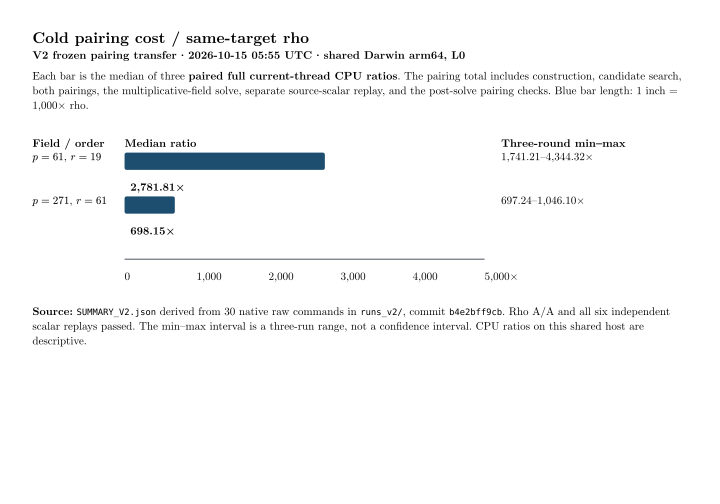

# V2 run receipt: separated pairing phases

Status: 30/30 frozen commands exited zero, 2026-10-15 05:55:25–05:55:32 UTC. The [V2 amendment](../../AMENDMENT_V2.md), [freeze](../../FREEZE_V2.md), and [exact driver](../../RUN_V2.sh) were committed before the run at `b4e2bff9cb753bf8412e62c1a7e090ceb56e27f8`. The source SHA-256 was `382ea60f8746c5145ebffe6d25f6809a520b09974f9f5e294da9d96b96d82de7`; the release binary SHA-256 was `9daceafea0dce4811299ff87a6f4ed3818dc1b49ed5410dffb2133fa56af804d`. Rust 1.93.1 ran sequentially on shared Darwin 25.6.0 arm64 at L0 isolation. The exact host and timestamps are in [`RUN_META.txt`](../../runs_v2/RUN_META.txt).

The frozen public cells were `(p,r)=(61,19)` and `(271,61)` on `E:y²=x³+1` over `F_(p²)`. The selected pairing point was regenerated in every cold row from the original deterministic stream. The irreducibility certificate, H, both pairing values, scalar answer, and deterministic primitive totals matched the frozen selections and V1 records. Three rounds per cell ran pairing, separate scalar replay, checks at `[2]G,[3]G,[5]G`, negation rho, and rho A/A. All six pairing scalars (`12` or `10`) passed independent `[k]G=Q` replay; all 18 pairing checks and all 12 rho controls passed. The [status file](../../runs_v2/RUN_STATUS.tsv) and stderr receipts contain no failures.

| `(p,r)` | Full validation CPU, median [min,max] | Negation rho CPU, median [min,max] | Paired full/rho CPU, median [min,max] | Sample |
|:--|--:|--:|--:|--:|
| `(61,19)` | 108.490 [105.532, 109.334] ms | 39.000 [24.292, 62.792] µs | 2,781.81 [1,741.21, 4,344.32] | 3 |
| `(271,61)` | 25.681 [24.610, 34.608] ms | 35.250 [33.083, 36.833] µs | 698.15 [697.24, 1,046.10] | 3 |

The full validation interval is cold pairing plus separate source-scalar replay plus the additional pairing checks. Medians of the new current-thread phase ledger, in microseconds, are:

| `(p,r)` | Setup | Candidate search | Miller | Final exponent | Pairing order checks | Field DLP | Scalar replay | Extra pairing checks |
|:--|--:|--:|--:|--:|--:|--:|--:|--:|
| `(61,19)` | 30.167 | 101,723.959 | 969.000 | 759.625 | 35.000 | 48.917 | 2.167 | 4,497.833 |
| `(271,61)` | 38.125 | 23,873.166 | 209.833 | 143.333 | 13.001 | 19.334 | 2.875 | 1,362.042 |

The phase CPU medians come from independently sorted three-round columns and therefore need not sum to the total median. Every row also records the unclassified timer residual, base-field multiplications/inversions, extension multiplications/squarings/inversions, and peak process RSS. The native [accounting summary](../../SUMMARY_V2.json) reconciles every selection-phase primitive count with the aggregate phase and verifies all scalar, status, and seeded rho controls. In all six rows, V1 and V2 had exactly the same recovered scalar, base-field operation total, extension multiplication phase totals, and rho counted GAE. Candidate search consumed `26,469/27,169` selection-phase extension multiplications at `p=61` and `39,115/39,673` at `p=271`. The corresponding full pairing-process peak RSS values were 6.57–6.64 MB; every process stayed below the 512 MiB cap.

The SVG and 150 dpi PNG came from [`GRAPH_V2.typ`](../../GRAPH_V2.typ) using the measured values in `SUMMARY_V2.json`. [V2 raw JSON and stderr](../../runs_v2/) and [`SHA256SUMS_V2`](../../SHA256SUMS_V2) are retained; the [V1 run](../run-20261015T0546Z/RUN_REPORT.md) remains a separate record. Current-thread CPU excludes input-file parsing, output serialization, and the calibration loop; the same exclusion applies to both arms. The min–max spans three shared-host rounds and is not a confidence interval. No isolated wall-performance or scaling inference is drawn here.
