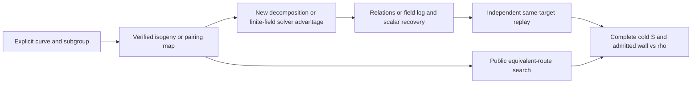

# Where the fiber and pairing experiments fit in the ECDLP program

The target is a **cold, single unknown scalar** on a public subgroup: return
`k` from `(E,G,Q=[k]G)` and independently check `[k]G=Q`. A candidate changes
the frontier only if its complete portable `S = work/sqrt(r)` and admitted
isolated wall cost beat the best same-target generic control over a credible
size trend. Multi-target reuse is a secondary, explicitly charged setting.
The [ecbench accounting contract](../../../docs/ecbench/README.md) and
[open cost problem](../../../problems/nonrational-isogeny-fiber-dlp-cost-gap.md)
remain the acceptance boundary. [Shoup's generic-group lower bound](https://www.shoup.net/papers/dlbounds1.pdf)
explains why an advantage must use structure or extra access; it does not
rule out a structure-specific algorithm.

| Route | Current observation | Missing discriminating gate | What a positive gate would establish |
| --- | --- | --- | --- |
| Degree-three isogeny transport | Different-`j`, non-isomorphic pairs and exact three-point rational fibers passed independent finite checks. The [order-1,201 inverse-Vélu oracle](inverse_velu/RESULTS.md) selected the same eight image columns after 29 destination-point checks instead of a 1,531,275-point source census; 255 paired relation rows and all 1,275 scalar outputs checked. At 64 targets `S_group=151.595` inverse versus `4.071` rho and `1.315` BSGS. | Complete the disjoint portable price and independent-host L2 timing for the inverse oracle. Separately, construct a `χ` decomposition resultant/root oracle and exhaustively check its returned pairs before another complete solve. | Whether base construction can be fully priced below controls, and separately whether a new oracle improves relation yield per priced work. |
| Pairing to a multiplicative group | The [exact pairing transfer](../pairing_transfer_20261015/RESULTS.md) recovered both frozen scalars; torsion-input search dominated its two cold runs. | Price a reusable `H` and pairing base for a declared target count, together with an appropriate finite-field DLP, then compare with same-target direct rho. Keep cold and amortized rows separate. | Whether input-search reuse or a finite-field solver makes the transfer competitive for that field and target count. |
| Torsion-fiber algebra | `χ` and quotient-coordinate tests found structurally distinct support, but the first full-image support increase at order 229 did not persist in the three larger cells. | Prove and implement the direct polynomial oracle, including exceptional fibers and multiplicities, with a faithful curve-level Lean bridge where feasible. | Whether the coordinate geometry yields more useful relations per *fully priced* unit of work. |
| Hidden-witness isogeny route | No secret map or asymmetric construction is supplied by these public experiments. | Specify the withheld witness, designer setup and evaluation cost, public reconstruction cost, and cheaper equivalent routes, each on an exact family and subgroup; then price transfer and destination DLP. | A scoped assessment of asymmetric access, separate from a public universal attack. |

The direct inverse-Vélu cubic now removes the source census from image-base
construction on the [selected order-1,201 cell](inverse_velu/RESULTS.md),
but its 255 paired relation rows match the full-image baseline exactly.
The most useful next *algorithm* experiment is therefore the direct `χ`
decomposition resultant. It must output a *complete, independently checked*
set of factor-base pairs and exceptional cases, then demonstrate any
changed useful rank per fully priced operation on unseen public targets.
The selected [full-fiber audit](reports/run-20261015T2335Z-fibers/REPORT.md)
counted 1,531,275 source points, 510,425 rational images and
1,442,401 subgroup pair identities; its full-image/destination-direct
support was 122/128 keys. The oracle's
reference is direct source BSGS and rho on the same 64 frozen targets,
with the existing seven-arm panel retained. [Semaev's summation-polynomial
construction](https://eprint.iacr.org/2004/031.pdf) supplies a public
algebraic control; the missing step is a useful `χ` specialization with
an executable root process, measured cost, and recovery.
[Joux and Vitse's cover/decomposition work](https://eprint.iacr.org/2011/020)
is another structural comparison, especially for composite-degree
extensions; it does not supply the missing `χ` oracle for these exact
quadratic-extension cells.

The selected fifth order extends the measured full-image range from 229
to 1,201 (5.24×), with three cells clustered near 430 and varying field primes
and cofactors. This is a larger-order count observation, not a stable
exponent estimate. The next size experiment should keep the construction
and factor-base shape fixed where possible while varying subgroup order
more broadly. Preregister at least four geometrically spaced orders,
one unseen public target per cell plus a 64-target reuse panel, a common
512 MiB memory ceiling, and the same rho/BSGS controls. A cap or memory
failure is a censored cost result, not an absent curve or failed theorem.
This experiment is distinct from the completed five-order descriptive
full-image count panel; the inverse-Vélu construction has been measured
at only order 1,201. The [ordered next tests](inverse_velu/NEXT_TESTS.md)
separate the portable price, new decomposition oracle, isolation and
larger-order inverse trend.

The [five-order frozen price-sensitivity result](sensitivity_five/RESULTS.md)
shows that at 64 targets the omitted rho work would need to add
112.973, 303.573, 334.844, 288.595 and 1,390.865 group-addition
equivalents per observed step across orders 229, 421, 433, 457 and
1,201 to tie the full-image group-count lower bounds *if omitted
full-image work were free*. This is an algebraic threshold, not a
measured native price. The **pricing gate** is a pinned conversion from every counted native
category (field arithmetic outside group calls, square roots, hash/table
work and modular rows) to the same group-addition equivalent. The current
`S_group` and separate Fp axes in [TREND_V1.json](TREND_V1.json) are
portable, but `complete_portable_S` is explicitly unpriced. Instrument
missing operations, derive and freeze conversion intervals on at least
the measurement host and an independent host, and report a sensitivity
range. A componentwise loss across the priced axes may settle this
implementation's ranking without a fragile point estimate, while an
axis trade needs the conversion.

The **performance gate** is an interleaved L2-or-better session on a
reserved physical core, including rho A/A and exact resource receipts.
The [access follow-up](ISOLATION_ACCESS_V2.md) identifies zero Standard
On-Demand and Spot vCPU quotas in five checked regions, plus the
denied quota-increase request. The [independent Linux replay](reports/run-20261016T0050Z-linux-host/REPORT.md)
has now checked all 252 arithmetic/answer rows on a separate hosted VM;
its N64 CPU full-image/rho medians at orders 421/433/457 are
68.750/56.331/59.050, with rho A/A near one. This is descriptive
cross-host evidence and cannot substitute for physical isolation. The
separate [order-1,201 Linux replay](reports/run-20261016T0550Z-linux-order1201/REPORT.md)
completed 84/84 children, 1,785 scalar replays and 12,486 relation
witness checks, with every arithmetic vector matching Darwin. Its N64
CPU full-image/rho median was 722.485 and rho A/A 1.003. The new
inverse-Vélu panel itself still needs independent-host replay. No
canonical frontier or security claim follows from these timings.
