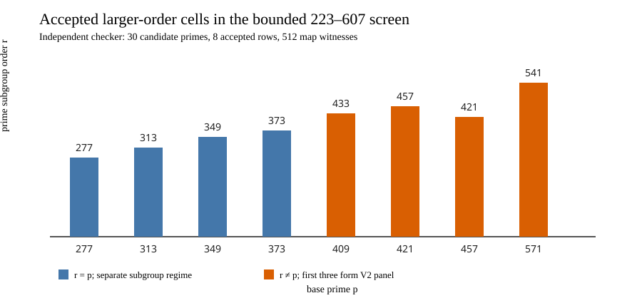

# Portable counted axes and bounded order screen, V1

**Status:** both V1 programs completed with zero exit codes and empty stderr.
The order-229 analysis re-derived 84 cold-child rows and 1,785 scalar outputs
from the independently checked prior run. The bounded screen checked 30
eligible primes and accepted eight distinct-`j` rows; a separate Rust field
and curve implementation replayed 512 map witnesses. The
[frozen protocol](PROTOCOL_V1.md), [source/binary manifest](FREEZE_V1.json),
[portable data](PORTABLE_V1.json), [screen rows](SCREEN_V1.jsonl), and
[screen checker](SCREEN_CHECK_V1.json) identify the exact inputs and commands.
These are committed as a new, unreviewed study result; PR and CI status are
tracked separately.

## Portable order-229 count

The reference is direct source negation rho on the same public targets;
reusable source BSGS is the memory control. The two-class generic collision
floor is `sqrt(pi/4)=0.886226925`. Here `S_group` is the cold total of
additions and doublings, including common/setup, all query work and final
verification, divided by `N sqrt(229)`. It follows the repository's counted
group-operation convention. It is a **lower bound on complete portable
cost**, because map arithmetic outside group calls, field additions, hash
and table work, row arithmetic, allocations, startup and I/O lack a pinned
conversion. The Fp multiplication and inversion axes are separate and
overlap the group work, so they are not added to `S_group`.

Each number below is the median of three complete cold children. All rows
used the same target prefix and verified every returned scalar.

| Arm | `S_group`, N=1 | N=4 | N=16 | N=64 |
| --- | ---: | ---: | ---: | ---: |
| Source projected relations | 91.39 | 72.00 | 61.55 | 58.28 |
| Isogeny-image relations | 101.50 | 79.79 | 68.15 | 64.56 |
| Destination-direct relations | 77.98 | 73.83 | 64.84 | 69.56 |
| Full rational-image relations | 5981.66 | 1534.12 | 428.12 | 148.49 |
| Reusable source BSGS | 4.10 | 2.45 | 1.97 | 1.76 |
| Source negation rho | 8.06 | 6.74 | 6.54 | 6.64 |
| Rho A/A repeat | 8.06 | 6.74 | 6.54 | 6.64 |

At `N=64`, paired full-image/BSGS `S_group` ratios were 85.200,
83.618 and 84.147; paired full-image/rho ratios were 23.402, 21.544 and
22.355. Full-image exceeded both direct controls in **each** of the three
counted arithmetic axes, in each of three rounds at **every** frozen prefix.
At `N=64`, its median base-field counts per `N sqrt(r)` were 5305.73
multiplications and 148.31 inversions, versus rho's 165.74 and 6.55,
and BSGS's 44.72 and 1.69. Exact pairwise ratios and each child's memory
are in [PORTABLE_V1.json](PORTABLE_V1.json). This componentwise finding is
portable for the fixed implementation; it does not price the uncounted
native work or admit an isolated wall-time claim. The prior [L0 whole-child
CPU result](../different_j_order_batch_20261015/RESULTS.md) remains a
different measurement axis.

## Bounded larger-order screen

The screen evaluated every eligible prime `223 <= p <= 607` in ascending
order. It found eight accepted rows and 512 independently replayed
homomorphism witnesses. Its first three V1 selections had `r=p`. Their
arithmetic checks passed, but characteristic-order subgroups are a different
comparison domain from the order-229 reference. The original selection and
all rows remain frozen. The subsequent [V2 panel protocol](PANEL_PROTOCOL_V2.md)
explicitly excludes `r=p` before any new target generation or timing.

| `p` | `r` | cofactor | source/destination `j` | V2 use |
| ---: | ---: | ---: | --- | --- |
| 277 | 277 | 279 | 268 / 264 | distinct regime |
| 313 | 313 | 315 | 260 / 26 | distinct regime |
| 349 | 349 | 351 | 136 / 281 | distinct regime |
| 373 | 373 | 375 | 258 / 198 | distinct regime |
| 409 | 433 | 387 | 84 / 368 | first new cell |
| 421 | 457 | 387 | 55 / 176 | second new cell |
| 457 | 421 | 495 | 119 / 57 | third new cell |
| 571 | 541 | 603 | 8 / 60 | reserve candidate |

Every accepted row has an explicit degree-three rational-kernel map and
different source/destination `j`; the checker independently recomputed
orders, factorization, curves, kernel, maps and homomorphism samples. The
screen did **not** enumerate full rational fibers for these new cells or run
their relation solves. Those are the next execution gates, not inferred
from the bounded screen.

## How this connects to the larger ECDLP goal

The concrete research question is whether a structural oracle lets a
public, single-target ECDLP method beat direct rho after all construction,
relation, algebra and recovery work is counted. A degree-three isogeny gives
an exact transport of a prime-to-degree subgroup, but transport alone does
not make the destination DLP easier. In this implementation the full-image
base changed relation support at order 229, while its complete cold
arithmetic costs exceeded direct controls. The next possibility is to obtain
useful fiber columns **without** enumerating the entire rational source:
test the direct chi-coordinate resultant/root oracle against exhaustive pair
enumeration, then measure its complete solve cost. Semaev's summation
polynomial route likewise makes the equation-solver cost an explicit
condition, rather than an automatic speedup
([Semaev, 2004](https://eprint.iacr.org/2004/031.pdf)).

The separate pairing route transfers ECDLP to a multiplicative subgroup;
its relevant comparator is the complete finite-field DLP plus pairing input
search and map costs, against direct source rho. The classical finite-field
transfer is the MOV reduction
([Menezes–Okamoto–Vanstone, 1991](https://doi.org/10.1145/103418.103434)).
Generic group lower bounds explain why a structural gain must use field or
curve information beyond a black-box group encoding
([Shoup, 1997](https://www.shoup.net/papers/dlbounds1.pdf)); they do not
rule out such a gain. The actionable milestones are (1) exact oracle and
subgroup transport, (2) verified unknown-scalar recovery on frozen public
targets, (3) cold complete portable `S` below same-target rho with memory
and failed attempts charged, and (4) an isolated, independent-host trend
across comparable orders. Reusable setup is reported for its exact target
count and cannot stand in for a single-target result.

## Acceptance status and limits

| Obligation | Status | Evidence or remaining work |
| --- | --- | --- |
| Re-derive order-229 counted group and field axes | verified complete | 84 rows, 1,785 scalar checks, source-hash and replay-hash gate in `PORTABLE_V1.json` |
| Complete portable `S` price | partial | hash/table/row/field-addition/alloc/I/O conversion and independent metering remain open |
| Bounded larger-order candidate screen | verified complete | 30 rows, eight accepts, 512 independent map witnesses in `SCREEN_V1.jsonl` and `SCREEN_CHECK_V1.json` |
| Prime-to-characteristic four-order relation trend | protocol frozen, unexecuted | full-fiber audits and 64-target paired solves at three new orders are next |
| Isolated timing and independent-host performance replay | unexecuted | no current L2 session or second-host performance receipt; L0 timing remains descriptive |
| Direct chi-coordinate resultant and faithful curve-level Lean bridge | open in prior work | separate protocols and problem records retain these obligations |

No canonical frontier graph was updated: the counted result is bounded by
unpriced work and the new orders have not completed a solve panel. This
report's graph and PDF record the bounded study without promoting it.
