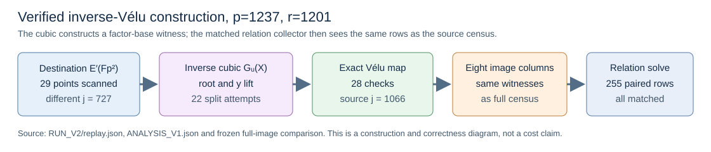

# Direct inverse-Vélu image-base construction at order 1,201

**Status:** The frozen V2 Rust panel completed with verified scalar
recovery on every public target. Its counted group result is a lower
bound on complete portable `S`; its process CPU measurements are L0
descriptive. The earlier V1 base-field split failed and remains in the
record. The [V1 protocol](PROTOCOL_V1.md),
[V2 correction](PROTOCOL_V2.md), [hashed run spec](RUN_SPEC_V2.json),
[raw 60-child run](RUN_V2/), [independent replay](RUN_V2/replay.json),
and [native analysis](ANALYSIS_V1.json) define this result.

## Question and result

The source is `y²=x³-21x+37` over `F_(1237²)`, with subgroup order
`r=1201`, cofactor `h=1275`, and rational order-three kernel
`T=(3,1)`. Its degree-three Vélu destination has different `j`
(`1066` versus `727`). The public input fixes 64 distinct targets and
eight full-image factor-base columns; the checker scalars are separate.
The question was whether solving the inverse-Vélu cubic directly could
construct those eight columns without the source-point census and
still recover the same target logarithms through complete relation
collection.

The inverse polynomial is

`G_u(X)=X³-(u+6)X²+(6u+21)X-(9u+32)`.

The V2 oracle scans destination points in key order, computes the
`F_(p²)` rational-root gcd with `X^(p²)-X`, splits with 32 capped
extension-field shifts `[i,1]`, lifts a candidate source point, and
accepts it only after evaluating the complete Vélu map. On this cell,
it examined **29 destination points** and made **29 polynomial calls**,
with **22 split attempts**, **10 no-root rejections**, **28 exact map
checks**, and **19 accepted image points** before selecting the eight
columns. The eight raw columns, projected columns, and canonical
source witnesses match the frozen full-source census exactly. That
census examined **1,531,275 source points**. The V1 `[i,0]` shift
schedule exited 101 at its 32-shift cap. Base-field shifts cannot
distinguish roots that all lie in the base field, a mechanism consistent
with that failure; the exact failing cubic was not retained. The
[failed receipt](SMOKE_R0_N1_V1_REPLAY.stderr) and V2 change are
preserved.

All **60/60** frozen cold children exited zero at prefixes 1/4/16/64
over three rounds. The independent Rust checker replayed
**1,275/1,275** recovered scalars and **6,126** relation witnesses.
The analyzer matched all **255 inverse/full target relation rows**,
including support keys, trials, rank, witness pairs, and recovered
scalars. Each recovered scalar was checked independently on source
and destination. All **368** raw files in `RUN_V2` passed its SHA-256
manifest. The run held the 512 MiB child limit; the maximum inverse
child RSS was **9,125,888 bytes** at `N=64`.

## Boundary and one-unit comparison

The generic signed-rho floor fixed in the protocol is
`sqrt(pi/(2*2))≈0.886` in `S_group`, where
`S_group=(all counted group additions+doubles)/(N sqrt(1201))`.
The table uses that one counted unit throughout. Values are medians
of three cold, paired rounds. Setup, relation collection, row solve,
transfer, and scalar replay group calls are included. `N=64` reuses
setup within a child and is secondary to the cold `N=1` result.

| arm | `N=1` `S_group` | `N=64` `S_group` |
| --- | ---: | ---: |
| inverse-Vélu factor base + relations | 149.645 | 151.595 |
| full source-census image base + relations | 88,514.859 | 1,532.302 |
| source BSGS | 2.972 | 1.315 |
| source negation rho | 5.107 | 4.071 |
| source negation rho A/A | 5.107 | 4.071 |

At `N=64`, the paired full-image/inverse ratio is **10.108** in counted
group operations. Inverse/rho is **37.235**, and inverse/BSGS is
**115.266** in that same counted group unit. At `N=1`, full/inverse
is **591.501**, while inverse/rho is **29.299**. The construction
phase alone fell from **3,063,003** to **667** counted group
additions/doubles in round zero, but the matched relation search
remains the same and dominates the new total.

The disjoint native price is still open. At `N=64`, the inverse arm's
median total is **9,191,218 base-field multiplications** and
**337,889 inversions**, versus rho's **220,419** and **8,964**.
Those are paired ratios **41.699** and **37.694**; the polynomial
arithmetic is counted in these field totals, while `sqrt_mod` internals
and table/hash work remain unpriced. The full-image arm used
134,574,154 multiplications and 3,398,408 inversions. A group-only
improvement over the census is therefore real for this implementation,
but neither `S_group` nor a stage ratio is a complete portable speed.

The same-host whole-child process CPU ratios at `N=64` were
**43.664** full/inverse (three-round range 40.195–47.286),
**9.159** inverse/rho (7.767–9.210), and **11.380** inverse/BSGS
(10.433–11.554). Rho A/A ranged **0.823–1.054** with median 0.863,
showing substantial shared-host noise. These L0 measurements do not
meet the isolated wall gate. The [run report](reports/run-20261016T0605Z-v2/REPORT.md),
graph, and PDF preserve all phase and resource links.

## Algebra and proof scope

The map x-coordinate for a nonkernel source point is
`u=2(y²+1)/(X-3)²-X-12`. Substituting
`y²=X³-21X+37`, then cross-multiplying, yields `G_u(X)=0`.
The [identity certificate](INVERSE_CUBIC.identity.certificate.json)
`IDC1h9003f11809fd7a8f` checks the polynomial identity modulo
`2^61-1` at 32 issue points plus 32 independent-stream points. The
integer identity itself is proved by the [Lean module](lean/InverseVelu.lean),
which builds under pinned
Lean 4.34.1; `#print axioms` lists only `propext` and `Quot.sound`.

| report statement | Lean declaration | exact scope |
| --- | --- | --- |
| Expanded cubic equals negative cross-multiplied map equation | `InverseVelu.cubicIdentity` | all integer `x,u` |
| Cross-multiplied equation implies a cubic root | `InverseVelu.cubicOfCrossMultiplication` | all integer `x,u` satisfying that equation |
| Source ordinate equation and map equation imply a cubic root | `InverseVelu.cubicOfSourceOrdinate` | all integer `x,y,u` satisfying both equations |

The Lean module does not yet define `F_(p²)`, the curve, the map as a
morphism, exceptional fibers, or completeness of the polynomial root
oracle. The finite run checks the actual field arithmetic, 29 candidate
points, eight witnesses, and all target relations, but does not prove
the general curve-level statement. The missing formal bridge is
recorded in the [open problem](../../../../problems/nonrational-isogeny-fiber-dlp-cost-gap.md).

## Next discriminating gates

1. Price every disjoint native category under
   [`PRICE_PROTOCOL_V2.md`](../PRICE_PROTOCOL_V2.md), including square-root
   branches, polynomial gcd/splits, table/hash work, row arithmetic,
   construction, verification, failed candidates, and calibration
   intervals on two hosts. Keep `N=1` and reuse counts separate.
2. Run the same oracle on at least four more widely spaced subgroup
   orders, with one unseen public target per cell plus a 64-target
   reuse panel, the same relation and memory caps, and matched rho,
   BSGS, and A/A controls. The current single order does not determine
   a scaling exponent.
3. Execute an L2-or-better interleaved physical-core session with
   exact replay and A/A admission. The existing AWS account's
   On-Demand and Spot vCPU quotas screened in five regions are zero;
   an authorized isolated runner or capacity change is needed.
4. Implement the separate nonfactorable `χ` decomposition polynomial
   oracle. The inverse-Vélu cubic improves image-base construction;
   it leaves the observed relation rows and yield unchanged. That
   second oracle must be checked exhaustively against direct pair
   enumeration before a same-target complete solve.

The [research roadmap](../RESEARCH_ROADMAP_V1.md) places this result
between verified map transport and a possible relation-oracle change.
No canonical ECDLP frontier or deployed-curve claim is promoted.
