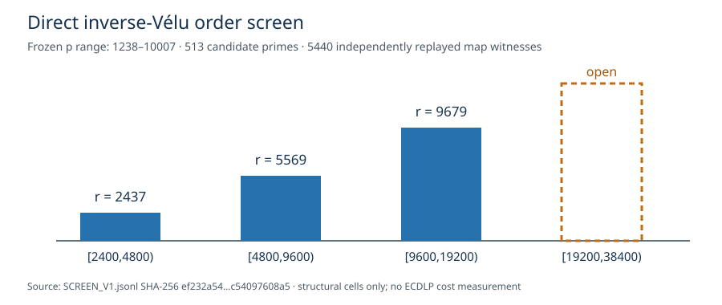

# Four-bin direct inverse-Vélu order screen, V1

**Status:** bounded structural screen complete; independent arithmetic
replay passed. This is an input-selection result for the requested order
trend. No new relation solve or performance measurement is included.

The [frozen protocol](FOUR_GATE_PROTOCOL_V1.md),
[source/binary freeze](SCREEN_FREEZE_V1.json),
[513 candidate rows](SCREEN_V1.jsonl),
[independent Rust replay](SCREEN_V1.check.json), and
[screen/checker exits](SCREEN_V1.exit) are the evidence. The raw JSONL is
1,931,092 bytes, SHA-256
`ef232a54b22938239819fd6b14182d1e49de5778e9c00542ce257c54097608a5`.
Both stderr files are empty. The source and checker binaries were built
with `cargo build --release --offline` on Darwin before this run.

The program scanned every eligible prime `1238≤p≤10007`, `p≡1 (mod 3)`
in `E:y²=x³−21x+37` with kernel `T=(3,1)`, independently counted the
source and quotient over `F_p`, checked distinct `j`, factored
`#E(F_(p²))`, and checked 64 sampled group-law/degree-three map
identities for each accepted cell. The independent checker recalculated
the base-field counts, factors, curve and map arithmetic and replayed
all **5,440** sampled map witnesses. It accepted all **513** rows,
including **85** rows with at least one eligible order.

| frozen order bin | first eligible `p` | selected `r` | cofactor | status |
| --- | ---: | ---: | ---: | --- |
| `[2400,4800)` | 2,473 | 2,437 | 2,511 | checked screen cell |
| `[4800,9600)` | 5,521 | 5,569 | 5,475 | checked screen cell |
| `[9600,19200)` | 9,619 | 9,679 | 9,561 | checked screen cell |
| `[19200,38400)` | — | — | — | no eligible cell in this bounded `p` range |



Each selected row satisfies the screen conditions and 64 sampled map
checks. Exact subgroup generators, all rational fibers, public target
files, N1/N64 solves, complete primitive price, and independent scalar
replay remain to be run for these cells. The fourth bin's blank entry
states only the result of this finite prime range. A separately frozen
range extension will continue the ascending scan before selecting that
bin.

Commands, from the repository root:

```sh
cargo build --release --offline --example different_j_inverse_trend_screen --example different_j_inverse_trend_check
timeout 3600 target/release/examples/different_j_inverse_trend_screen screen-inverse-trend > research/isogeny_torsion_fibers_20261012/portable_order_trend_20261015/inverse_velu/SCREEN_V1.jsonl 2> research/isogeny_torsion_fibers_20261012/portable_order_trend_20261015/inverse_velu/SCREEN_V1.stderr
target/release/examples/different_j_inverse_trend_check research/isogeny_torsion_fibers_20261012/portable_order_trend_20261015/inverse_velu/SCREEN_V1.jsonl > research/isogeny_torsion_fibers_20261012/portable_order_trend_20261015/inverse_velu/SCREEN_V1.check.json 2> research/isogeny_torsion_fibers_20261012/portable_order_trend_20261015/inverse_velu/SCREEN_V1.check.stderr
```

This structural screen changes no canonical performance graph or
frontier: there is no new complete DLP cost row. It does add the
input-selection graph below. The result is unmerged until its PR lands.
