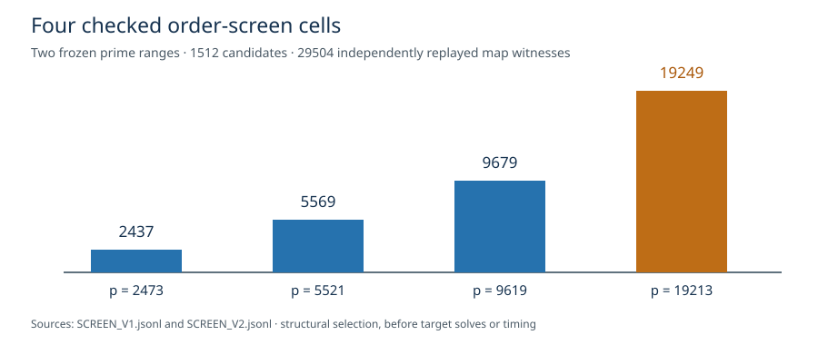

# Fourth-bin range extension: complete four-cell input screen

**Status:** the preregistered nonoverlapping V2 range completed and
independent native replay passed. Together with V1 it supplies four
geometrically spaced structural cells for the planned direct
inverse-Vélu trend. It does not supply four complete ECDLP solve rows.

The [V2 range protocol](SCREEN_RANGE_EXTENSION_V2.md),
[source/binary freeze](SCREEN_FREEZE_V2.json),
[999 raw candidate rows](SCREEN_V2.jsonl), and
[independent checker](SCREEN_V2.check.json) are the new evidence.
The V2 JSONL is 8,692,697 bytes, SHA-256
`71c1926fee540df9566537ae60b063fc276f93b6b6d6c5f24ce8d69225305afa`.
Both stderr files are empty. The checker recomputed each base-field
curve count and factorization and replayed all **24,064** sampled
group-law/map witnesses from **376** accepted rows. Both exit receipts
are zero.

V2 inspected every prime `10009≤p≤30011`, `p≡1 mod 3`, without
revisiting or replacing the V1 cells. The first eligible fourth-bin
cell was `p=19213`, `r=19249`, cofactor `19179`. The complete selected
input panel is now:

| bin | `p` | subgroup order `r` | cofactor | selection receipt |
| --- | ---: | ---: | ---: | --- |
| `[2400,4800)` | 2,473 | 2,437 | 2,511 | V1 |
| `[4800,9600)` | 5,521 | 5,569 | 5,475 | V1 |
| `[9600,19200)` | 9,619 | 9,679 | 9,561 | V1 |
| `[19200,38400)` | 19,213 | 19,249 | 19,179 | V2 |



Across both frozen ranges, the screen checked **1,512** candidate
primes, **461** accepted cells and **29,504** sampled map identities.
These are finite structural checks. The selected subgroup generator,
full fiber identities, public target custody, N1/N64 solve panels,
complete portable price, and independent scalar replay are still open.
At `p=19213`, the full group has roughly `p²` points, so the full
source census must retain its frozen 300-second/512 MiB cap and may be
censored; that prospect is not a measured failure.

Exact commands, from the repository root:

```sh
cargo build --release --offline --example different_j_inverse_trend_screen --example different_j_inverse_trend_check
timeout 3600 target/release/examples/different_j_inverse_trend_screen screen-inverse-trend-extension > research/isogeny_torsion_fibers_20261012/portable_order_trend_20261015/inverse_velu/SCREEN_V2.jsonl 2> research/isogeny_torsion_fibers_20261012/portable_order_trend_20261015/inverse_velu/SCREEN_V2.stderr
target/release/examples/different_j_inverse_trend_check research/isogeny_torsion_fibers_20261012/portable_order_trend_20261015/inverse_velu/SCREEN_V2.jsonl check-extension > research/isogeny_torsion_fibers_20261012/portable_order_trend_20261015/inverse_velu/SCREEN_V2.check.json 2> research/isogeny_torsion_fibers_20261012/portable_order_trend_20261015/inverse_velu/SCREEN_V2.check.stderr
```

The pre-existing five-order graph concerns different, completed
full-image runs, so it is left unchanged. This new chart identifies
inputs only; no canonical performance frontier changes.
