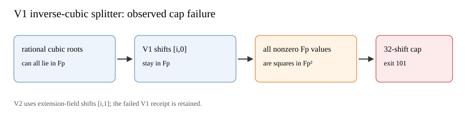

# First inverse-Vélu split attempt: retained failure

The [V1 protocol](../../PROTOCOL_V1.md) fixed base-field shifts
`[i,0]`, `i=0..31`, for quadratic-character splitting of a rational
factor of the inverse cubic. The first `p=1237,r=1201`, round-zero,
one-target smoke child used the public input SHA-256
`24f2c56a9ba56f91c954f38b7752edf24fee5ed027b49b1ac0747771945099c4`.
The exact V1 source and binary hashes are in
[`BUILD_SHA256_V1.txt`](../../BUILD_SHA256_V1.txt). The child panicked
at `inverse-Velu polynomial split cap` before producing a result row;
an unchanged-binary retry preserved [exit 101](../../SMOKE_R0_N1_V1_REPLAY.exit)
and [stderr](../../SMOKE_R0_N1_V1_REPLAY.stderr). The first shell wrapper
also failed to record its exit because `status` is read-only in `zsh`;
the initial stderr and empty stdout remain beside the retry. No
relation solve or scalar output was obtained in V1.

When three rational roots lie in the base field, a base-field shift
also leaves each nonzero shifted root in the base field. Every nonzero
`F_p` element is a square in `F_(p²)`, so the quadratic-character
partition is constant and cannot split that polynomial. This is a
possible explanation of the cap failure; the exact failing cubic was
not retained. The failure does not show the
inverse cubic is wrong or that no rational fiber exists. The
[frozen V2 correction](../../PROTOCOL_V2.md) uses `[i,1]` shifts with
the same 32-attempt cap and preserves this failure separately.

This failed diagnostic has no paired CPU or `S_group` comparison. The
canonical ECDLP graph remains unchanged because V1 produced no
verified target row. Its own diagram and PDF preserve the run status.
