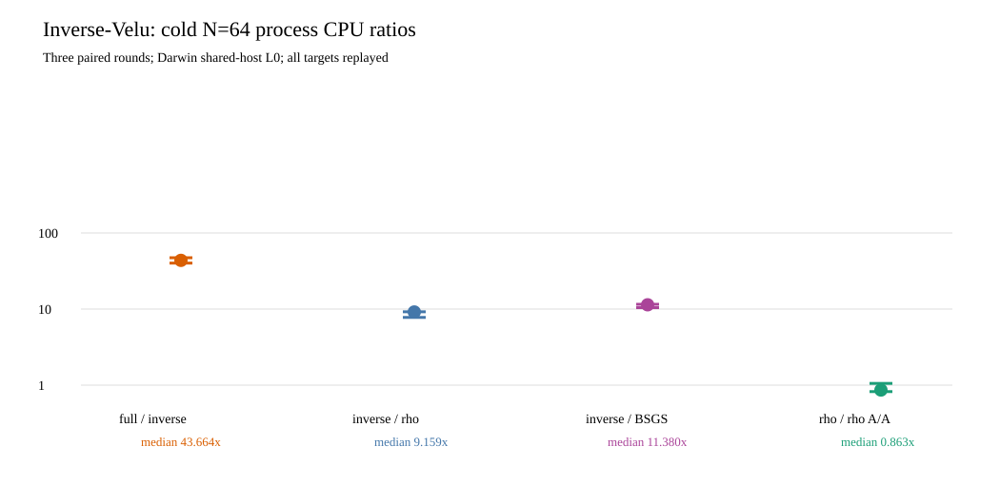

# Direct inverse-Vélu fiber oracle: frozen V2 run

**Status:** The 60-child native panel completed, and an independent
checker replayed its scalar and relation outputs. The host was shared;
process CPU is descriptive. The complete portable addition-equivalent
price and isolated wall comparison remain open.

The [V1 protocol](../../PROTOCOL_V1.md), retained
[V1 failure](../run-20261016T0556Z-v1/REPORT.md),
[V2 split correction](../../PROTOCOL_V2.md),
[frozen run spec](../../RUN_SPEC_V2.json), and
[60-child raw directory](../../RUN_V2/) define this experiment.
Its source and binary hashes are in the run spec and
[`build-sha256.txt`](../../RUN_V2/build-sha256.txt). The public target
and checker input hashes are in the spec. The [native runner](../../../../../../examples/different_j_inverse_velu_oracle.rs),
[independent checker](../../../../../../examples/different_j_inverse_velu_check.rs),
[analyzer](../../../../../../examples/different_j_inverse_velu_analyze.rs),
and [identity certificate issuer](../../../../../../examples/different_j_inverse_velu_identity.rs)
are Rust. The [analysis JSON](../../ANALYSIS_V1.json) and
[source-linked study result](../../RESULTS.md) retain the full table.

The source curve is `y²=x³-21x+37` over `F_(1237²)` with subgroup
order 1,201, cofactor 1,275, and rational order-three kernel
`T=(3,1)`. Its different-`j` destination has `j=727` against source
`j=1066`. The oracle solved the inverse x-coordinate cubic
`G_u(X)=X³-(u+6)X²+(6u+21)X-(9u+32)` over the working field and
checked each accepted preimage against the complete degree-three map.
The [pipeline diagram](../../PIPELINE.svg) distinguishes this witness
construction from the subsequent relation solve.
It scanned 29 destination points, made 29 polynomial calls and 22
split attempts, rejected ten no-root candidates, checked 28 maps,
and accepted 19 image points before selecting the same eight columns
and canonical source witnesses as the 1,531,275-point source census.

The frozen panel paired five arms on the same 64 public targets:
inverse-Vélu base, full-image census, source BSGS, source signed rho,
and rho A/A. Prefixes 1/4/16/64 ran in three rotated rounds under an
8r relation-trial cap per target, 32 rho restarts of at most 20r steps,
300-second child wall cap and 512 MiB child RSS cap. All **60/60**
children exited zero. The [checker receipt](../../RUN_V2/replay.json)
replayed **1,275/1,275** scalars and **6,126** relation witnesses.
The analyzer matched **255/255** inverse/full target relation rows,
including support keys, pair entries, trials, rank, witness pairs and
recovered scalars. The [368-file manifest](../../RUN_V2/ARTIFACT_FILES.sha256)
passed SHA-256 verification. Peak inverse-child RSS at `N=64` was
9,125,888 bytes; the full-image arm reached 204,701,696 bytes.

The table uses `S_group = (counted additions + doublings)/(N sqrt(1201))`
for the complete child through scalar replay. These are lower bounds on
complete portable `S`: native square roots, tables, hashing and other
non-group operations have no common addition-equivalent price yet.

| arm | cold `N=1` `S_group` | reuse `N=64` `S_group` |
| --- | ---: | ---: |
| inverse-Vélu base plus relations | 149.645 | 151.595 |
| full-image census plus relations | 88,514.859 | 1,532.302 |
| source BSGS | 2.972 | 1.315 |
| source signed rho | 5.107 | 4.071 |
| source signed rho A/A | 5.107 | 4.071 |

At `N=64`, paired counted-group full/inverse was **10.108**,
inverse/rho **37.235**, and inverse/BSGS **115.266**. The inverse arm
used a median 9,191,218 base-field multiplications and 337,889
inversions against rho's 220,419 and 8,964; those axes give paired
ratios **41.699** and **37.694**. Polynomial arithmetic is counted
within them, but the `sqrt_mod` internals and nonarithmetic native
work are not fully instrumented. The complete portable `S` is unset.

At `N=64`, paired whole-child process-CPU median ratios were
**43.664** full/inverse (range 40.195–47.286), **9.159**
inverse/rho (7.767–9.210), and **11.380** inverse/BSGS
(10.433–11.554). Rho A/A was **0.863** (0.823–1.054). The
[host receipt](../../RUN_V2/host.txt) lacks a CPU model because
`sysctl machdep.cpu.brand_string` was denied in this sandbox; it
retains date, OS and toolchain. This is shared-host L0 CPU evidence,
not physical-core L2 wall admission. The canonical ECDLP frontier
graph is unchanged because no complete portable or isolated crossover
was established.

The [Lean integer identity](../../lean/InverseVelu.lean) built with
Lean 4.34.1 and no project axioms beyond `propext` and `Quot.sound`;
the [native identity certificate](../../INVERSE_CUBIC.identity.certificate.json)
checks 64 evaluation points modulo `2^61-1`. They establish the stated
cross-multiplied cubic identity, while the general `F_(p²)` morphism,
exceptional-fiber and oracle-completeness bridge remains unformalized.
The next tests and their acceptance criteria are in
[`NEXT_TESTS.md`](../../NEXT_TESTS.md). This report and the graph have
rendered PDF copies beside the raw records, outside `RUN_V2`.
