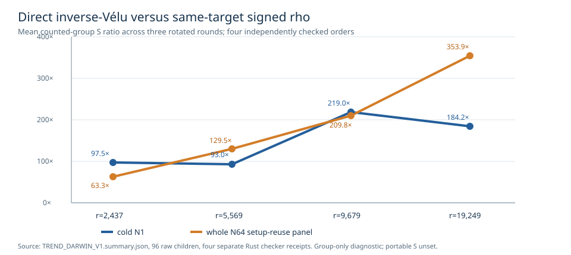

# Four-order direct inverse-Vélu trend: native subgroup solves

**Status:** the frozen four-cell structural screen led to four checked
64-target public inputs. The Darwin L0 panel completed its 96 planned
children for inverse-Vélu, source BSGS, signed rho and rho A/A at N1
and N64 in three rotated rounds. A separately implemented Rust
field/curve checker replayed all **3,120** returned target scalars and
**9,565** relation witnesses, including the random trial streams,
row recovery and source-to-destination transport. No child exhausted
the 300-second limit or observed 512 MiB RSS ceiling. Full-image
census, complete portable pricing, independent Linux replay and L2
isolated wall admission remain open.

The source/binary/input freeze is [`TREND_RUN_SPEC_V1.json`](TREND_RUN_SPEC_V1.json),
the four source/image target files and scalar-only checker files are
`P{2473,5521,9619,19213}_PUBLIC.json` and `*_CHECKER.json`.
The independent target-freeze receipts `P*.check.json` replay
**36,930** nonidentity subgroup map identities
(`2436+5568+9678+19248`) and **768** selected-target fiber
identities (`4×64×3`). The raw children, meters, stderr and exit
receipts are in [`darwin_v1/`](darwin_v1/); their
[hash manifest](DARWIN_V1.artifacts.sha256), [group summary](TREND_DARWIN_V1.summary.json),
four `P*.meter_summary.json` files and four `P*.panel.check.json`
receipts bind the panel. [`CHECKER_FREEZE_V1.json`](CHECKER_FREEZE_V1.json)
pins the independent checker versions.

The generic two-class floor is `S_group=√(π/4)=0.886227`.
Each table cell below is the mean complete-child *counted-group*
operations divided by `√r`, across three rounds. It includes
validation, setup, collection or reference search, recovery, and
verification. This is a lower bound on a complete portable primitive
`S`; field arithmetic outside group calls, allocation, table work,
process startup and I/O are not converted into that counted unit.

| subgroup order | arm | cold N1 `S_group` | whole N64 `S_group` |
| ---: | --- | ---: | ---: |
| 2,437 | inverse-Vélu | 314.049 | 14,345.338 |
| 2,437 | signed rho | 3.221 | 226.492 |
| 2,437 | rho A/A | 3.221 | 226.492 |
| 2,437 | source BSGS | 2.512 | 69.096 |
| 5,569 | inverse-Vélu | 341.857 | 23,342.699 |
| 5,569 | signed rho | 3.676 | 180.224 |
| 5,569 | rho A/A | 3.676 | 180.224 |
| 5,569 | source BSGS | 2.760 | 60.475 |
| 9,679 | inverse-Vélu | 611.278 | 33,284.863 |
| 9,679 | signed rho | 2.792 | 158.661 |
| 9,679 | rho A/A | 2.792 | 158.661 |
| 9,679 | source BSGS | 2.460 | 54.085 |
| 19,249 | inverse-Vélu | 730.064 | 50,007.138 |
| 19,249 | signed rho | 3.964 | 141.321 |
| 19,249 | rho A/A | 3.964 | 141.321 |
| 19,249 | source BSGS | 1.636 | 52.522 |

The inverse/rho counted-group ratios are respectively **97.505,
92.994, 218.951, 184.163** at N1 and **63.337, 129.521,
209.787, 353.855** for the entire N64 panels, in ascending order.
These are measured lower-bound ratios on four selected small
subgroups, not an exponent estimate. Whole-child CPU and RSS
are retained in the meter summaries. For example, at order 19,249,
mean N1 whole-child CPU was 26.463 ms inverse versus 5.363 ms rho;
at N64 it was 1,371.701 versus 13.976 ms. Shared-host CPU and
wall are descriptive and have no isolation admission.

**Full-image census:** the implementation allocates a square lookup
over every element of `F_(p²)` before enumerating source points.
That first allocation alone scales from over 6.1 million to over
369 million field elements across these four cells. Darwin rejected
both attempted process memory limits with `EINVAL`, so launching
the larger full-image children here would lack the frozen 512 MiB
enforcement. Each full-image row is retained as an unexecuted
resource-gated row, not a zero-yield or mathematical failure.
The Linux job with `RLIMIT_AS` remains the next admissible test.

The independent Linux order-1201 V2 replay has a workflow prepared.
Its exact historical runner and checker are preserved as
[`FROZEN_RUNNER_V2.rs`](../FROZEN_RUNNER_V2.rs) and
[`FROZEN_CHECKER_V2.rs`](../FROZEN_CHECKER_V2.rs);
their hashes match the immutable V2 spec. L2 whole-core host
admission is unavailable in this environment. The previous
five-order plot used different constructions and targets, so it
was left unchanged; this chart shows only this direct-inverse
four-order panel.
