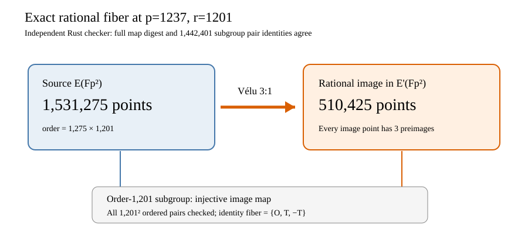

# Selected order-1201 full rational-fiber audit

The frozen [selector](PROTOCOL_V1.md) chose `(p,r,h)=(1237,1201,1275)`
before this audit. The exact native commands were:

```sh
gtimeout 300 target/order-batch-check/release/examples/different_j_trend_fiber audit 1237 1201 1275 > FIBER_1237_1201_V1.json 2> FIBER_1237_1201_V1.stderr
gtimeout 300 target/order-batch-check/release/examples/different_j_trend_fiber_check FIBER_1237_1201_V1.json > FIBER_1237_1201_V1.check.json 2> FIBER_1237_1201_V1.check.stderr
```

Both exited **0** and both stderr files are empty. The
[runner receipt](FIBER_1237_1201_V1.json) and
[independent checker](FIBER_1237_1201_V1.check.json) agree on 1,531,275
source points, 510,425 rational image points, exactly three source
preimages per image point, the kernel fiber `{O,T,-T}`, an order-1201
source/image subgroup, and all 1,442,401 ordered subgroup map-law
checks. The independent checker reconstructed the full map digest
`6e886787b5e857dc625f71e16720ac272c9883e93ad7fd4c0a7640856e41a3fa`
and subgroup digest
`d96cf362d53d177b60678e68afae771e4e619a66dab66cef684ee8ca94a59134`.
Runner peak RSS was 199,163,904 bytes; checker peak RSS was
367,984,640 bytes, both below 536,870,912 bytes.

SHA-256: runner receipt
`6888b794cc5fc17992d36fd6077443708b669d2de88573ff52e642529a624927`;
checker receipt
`fe02b3c5087b0f6f00614fb278858527ed1de98f28207248983609e5bf8b1cd1`.
Native sources are
[`different_j_trend_fiber.rs`](../../../../examples/different_j_trend_fiber.rs)
and [`different_j_trend_fiber_check.rs`](../../../../examples/different_j_trend_fiber_check.rs);
their source hashes and the binary hashes are preserved in the run
record below: runner source
`a6e433e718f82806641c1c289626a61ba3055934f90f0a952a9fef50fc58741b`,
runner binary
`d328ca4665751f2ba5b409bcdfd03f6749417995a89c338f30d1839c22594207`,
checker source
`b9a06cca73923e683e14b9e598d3c19a3ac2d8add45a4979da2bcda56642345b`,
and checker binary
`2b367efe117562030a1a36f03c4a726ce7cf0a90a0579857163f891af92d352d`.
The [diagram](FIBER_V1.svg),
[PNG](FIBER_V1.png), and [PDF](FIBER_RUN.pdf) are this audit's visual
record.



The fiber geometry is a correctness gate. Its practical cost and any
ECDLP comparison depend on the subsequent cold seven-arm target solves
and complete native pricing.
