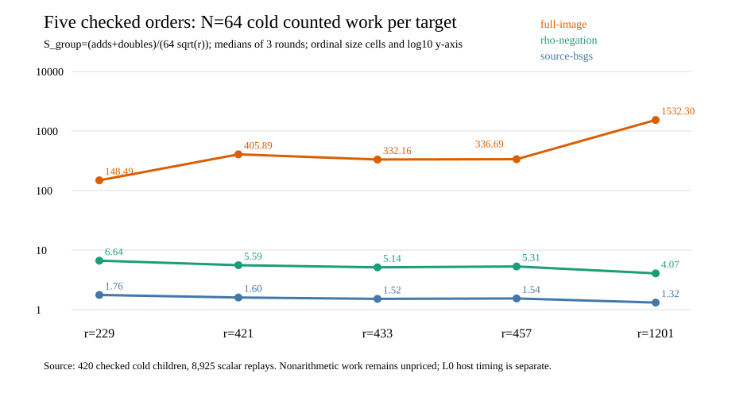

# Order 1,201: complete recovery and five-order counted trend

The preregistered first accepted cell from the extended screen is
`p=1237, r=1201, h=1275`, with different source and destination `j`
values `1066` and `727`. The [screen](SCREEN_RUN.md),
[complete rational-fiber audit](FIBER_RUN.md), [public target and run
spec](RUN_SPEC_V2.json), [all cold child outputs](BATCH_1237_1201_V2.run.jsonl),
and [independent replay](BATCH_1237_1201_V2.replay.json) establish the
finite construction and target solves. All 84 children finished, all
1,785 scalar outputs passed replay, and 12,486 relation witnesses were
checked. The earlier failed target freeze and the corrected V2 run are
described in [BATCH_RUN.md](BATCH_RUN.md).

## One counted unit and direct controls

The generic negation-orbit collision floor is `sqrt(pi/4)=0.886226925`
per target. For every arm, `S_group=(all cold additions + doublings)/
(N sqrt(r))` includes common checks, setup, target query and final
verification. The table is **one unit throughout**, the median of three
rotated cold children at `N=64`. Direct source rho uses the identical
public targets; reusable source BSGS is the memory control. `S_group` is
a lower bound on complete portable `S`, since some native operations
outside group calls have no pinned addition-equivalent price.

| Arm | Order-1,201 median `S_group` per target |
| --- | ---: |
| Source projected relations | 153.842 |
| Isogeny-image relations | 162.213 |
| Destination-direct relations | 139.075 |
| Full rational-image relations | 1,532.302 |
| Reusable source BSGS | 1.315 |
| Source negation rho | 4.071 |
| Rho A/A repeat | 4.071 |

The three matched N64 **full-image/rho group-count ratios** have median
`376.364`; full-image/BSGS median is `1,165.090`. The full-image arm
exceeds both direct controls in each recorded arithmetic axis—group
adds/doubles, Fp multiplications and Fp inversions—in every prefix and
every round. These overlapping axes must not be added together. At
`N=1`, full-image `S_group=88,514.859` versus direct rho `5.107`; its
cold source census is paid by one solve. The largest N64 full-image
RSS was 206,864,384 bytes, below the common 512 MiB limit.

The [five-order native derivation](TREND_FIVE_V2.json) rechecks **420
cold children and 8,925 scalar outputs** across orders 229, 421, 433,
457 and 1,201. At N64, full-image `S_group` medians are 148.49,
405.89, 332.16, 336.69 and **1,532.30**, while direct rho is 6.64,
5.59, 5.14, 5.31 and **4.07**. The first four cells are preserved in
the [earlier report](../RESULTS_V2.md); this adds a 5.24-fold increase
in subgroup order from 229 to 1,201. The field prime and cofactor also
change, and three cells cluster near 430. These five points do not
support a stable exponent estimate or a family-wide crossover.

## Relation support, cost, and the next mechanism test

At order 1,201, full-image/destination-direct support was **122/128**
two-sum keys. Across the three N64 rounds, full image found
2,316 relations in 23,413 trials; destination direct found 2,328 in
21,653. Every relation arm reached the rank needed for scalar recovery.
The full-image table was built by enumerating all **1,531,275** rational
source points in every cold child, then selecting eight columns. This
implementation's counted setup cost grew with the field and did not
produce a relation-support increase at the selected larger order.

Shared-host median N64 process CPU was 2.724 seconds for full image,
3.784 milliseconds for rho and 0.954 milliseconds for BSGS; these are
L0 descriptions with no isolation receipt. The portable operation
comparison remains **partial** until field work outside group calls,
square-root branches, hash/table work, rows, allocation and I/O receive
disjoint counts and pinned common prices. The [four-order sensitivity
result](../sensitivity/RESULTS.md) gives a missing-price threshold, not
that conversion. The independent Linux replay and physical-core timing
have their own admission gates.

The next structural test is the direct `chi`-coordinate
resultant/root oracle: construct the same useful destination columns
without enumerating the full rational source, exhaustively compare its
decomposition set with an independent pair enumerator, then run complete
same-target relation recovery against these rho/BSGS controls. A changed
support set alone does not establish lower complete cost. The pairing
route instead needs its complete finite-field DLP and torsion-input
search priced against direct source DLP. The [research
roadmap](../RESEARCH_ROADMAP_V1.md) keeps these mechanisms and the
hidden-witness hypothesis separate.
