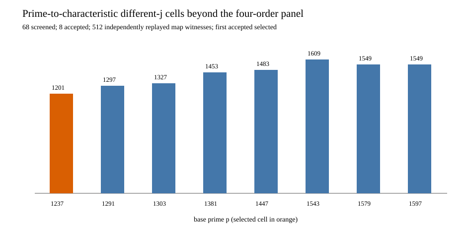

# Extended order screen: run and independent replay

**Host/date:** Darwin arm64 shared L0, 2026-10-15. The
[committed pre-run protocol](PROTOCOL_V1.md) fixed the prime range,
selection rule, 600-second wall cap, 512 MiB resident cap and native
screen source/binary hashes before this run. Exact command:

```sh
gtimeout 600 target/order-batch-check/release/examples/different_j_extended_screen screen-larger > SCREEN_V1.jsonl 2> SCREEN_V1.stderr
target/order-batch-check/release/examples/different_j_extended_screen_check SCREEN_V1.jsonl SCREEN_V1.svg > SCREEN_CHECK_V2.json 2> SCREEN_CHECK_V2.stderr
```

Both commands exited **0** ([screen](SCREEN_V1.exit),
[checker](SCREEN_CHECK_V2.exit)); both stderr files are empty. The
original successful independent checker receipt is also retained as
[V1](SCREEN_CHECK_V1.json). The native independent checker reconstructed
all 68 candidate decisions, accepted eight rows, verified 512 seeded
map-law witnesses and reproduced the frozen first-selection rule.
The selected public cell is `p=1237, r=1201, h=1275`, with
`#E(F_p)=1275`, `#E(F_(p²))=1,531,275`, source `j=1066`, destination
`j=727`, and `r≠p`.

Source-linked artifacts: [all candidate rows](SCREEN_V1.jsonl),
[checker receipt](SCREEN_CHECK_V2.json), [SVG](SCREEN_V1.svg),
[PNG](SCREEN_V1.png) and [PDF](SCREEN_RUN.pdf). SHA-256 of the raw
screen rows:
`f277cf23ad87e1f24e77f069464e7cb1eb131c8c4dc9bb52b5b9ceb5ad2ed939`;
checker V2 receipt:
`c54bb90e578076086c5b9fc564737f90f73ef5b9643935a7167b210d07af7514`;
SVG: `84f4c7e90e32bc5ff28046892333bd926d1fafede484b82e91090c3fca9a24b0`.
The independent checker source is
[`examples/different_j_extended_screen_check.rs`](../../../../examples/different_j_extended_screen_check.rs).

This screen establishes only a bounded construction and selection. The
selected cell must pass exhaustive fiber and subgroup checks, then
cold complete-solve comparison and separate pricing/timing gates.


