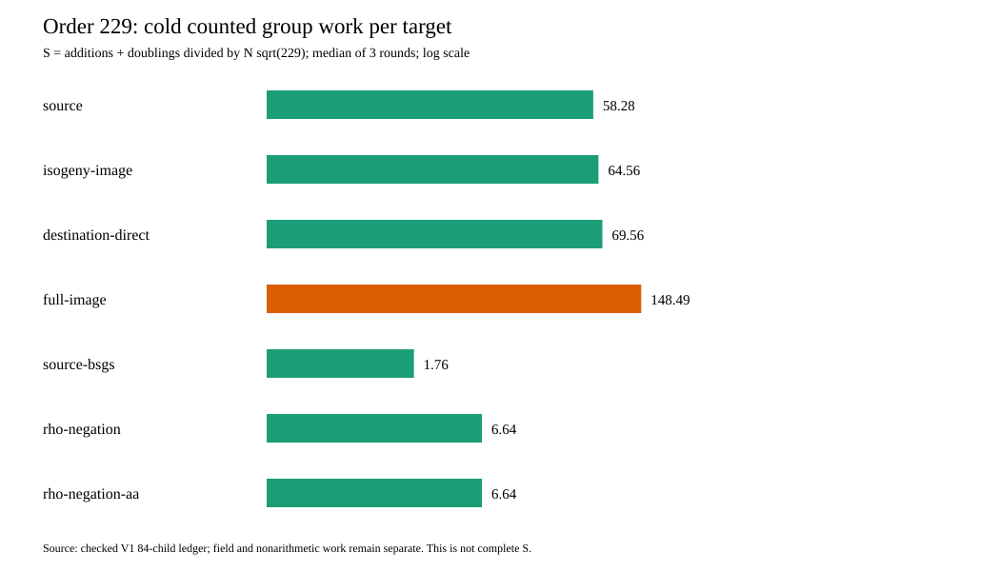

# V1 portable-count derivation run

Start: 2026-10-15 23:29 UTC. Host: Darwin arm64, shared L0. This is a
deterministic count derivation, so host timing is not an outcome. The
[frozen source and binary hashes](../../FREEZE_V1.json) identify the Rust
analyzer. Exact command from the checkout root:

```sh
target/order-batch-check/release/examples/different_j_order_portable research/isogeny_torsion_fibers_20261012/different_j_order_batch_20261015/RUN_V1.jsonl research/isogeny_torsion_fibers_20261012/different_j_order_batch_20261015/REPLAY_V1.json research/isogeny_torsion_fibers_20261012/portable_order_trend_20261015/PORTABLE_V1.json research/isogeny_torsion_fibers_20261012/portable_order_trend_20261015/PORTABLE_V1.svg
```

Requested/completed: one analysis of 84 prior cold children, 84/84 checked
keys and 1,785/1,785 prior independent scalar checks. Exit 0; empty stderr.
The analyzer checks the prior run digest, replay status, every arm/round/
prefix key, target count, scalar value and verified flag. Its output
[`PORTABLE_V1.json`](../../PORTABLE_V1.json) holds every child and paired
arithmetic-axis ratio. The SVG/PNG plot shows median `S_group` per target
for N=64 over three complete children per arm; bars use log-transformed
lengths and are labeled with exact values. `S_group` is a counted-group
lower bound with unpriced native work, not a complete portable cost.



The source [result report](../../RESULTS_V1.md) contains the decision and
limits. No prior frozen run file was changed.
