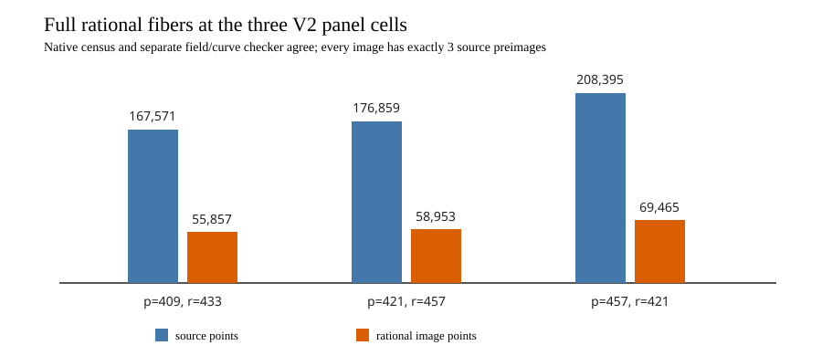

# V2 three-cell full rational-fiber audit run

Start: 2026-10-15 23:35 UTC. Host: Darwin arm64, shared L0. This run
performed exact point/map enumeration, not DLP timing. The source and binary
digests and three frozen cells are in [FIBER_FREEZE_V1.json](../../FIBER_FREEZE_V1.json),
committed before execution. Exact command per `(p,r,h)` in its listed order:

```sh
gtimeout 300 target/order-batch-check/release/examples/different_j_trend_fiber audit P R H > FIBER_P_R_V1.json 2> FIBER_P_R_V1.stderr
gtimeout 300 target/order-batch-check/release/examples/different_j_trend_fiber_check FIBER_P_R_V1.json > FIBER_P_R_V1.check.json 2> FIBER_P_R_V1.check.stderr
```

Requested/completed: 3/3 native audits and 3/3 separate checker replays,
all exits zero and stderr empty. Every source point was enumerated, every
rational image had exactly three preimages, the identity fiber was checked,
and all `r²` ordered subgroup homomorphism pairs passed for each cell. The
checker independently recomputed the field, curve, point set, map and the
full-map and subgroup-map digests.

| `p,r` | source points | image points | subgroup pair checks | runner/checker peak RSS bytes |
| --- | ---: | ---: | ---: | ---: |
| 409,433 | 167,571 | 55,857 | 187,489 | 58,310,656 / 58,359,808 |
| 421,457 | 176,859 | 58,953 | 208,849 | 60,948,480 / 61,046,784 |
| 457,421 | 208,395 | 69,465 | 177,241 | 71,991,296 / 72,122,368 |

Raw receipts are [`FIBER_409_433_V1.json`](../../FIBER_409_433_V1.json),
[`FIBER_421_457_V1.json`](../../FIBER_421_457_V1.json), and
[`FIBER_457_421_V1.json`](../../FIBER_457_421_V1.json), each with a
`.check.json`, `.exit`, and `.stderr` companion. The graph plots the checked
point counts; exact source/image ratios are 3 in each cell. These records
admit target generation and paired solve measurement, but do not measure a
DLP cost themselves.


