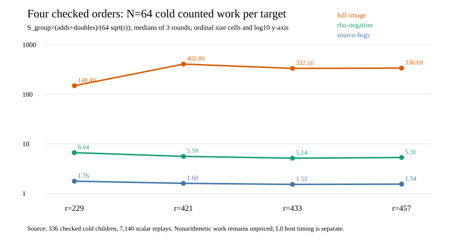

# V2 complete three-cell target panel run

Start: 2026-10-15 23:41 UTC. Host: Darwin arm64, macOS shared L0. The
[frozen run spec](../../BATCH_RUN_SPEC_V1.json) fixes three different-`j`
prime-to-characteristic cells, 64 distinct public targets each, seven arms,
three rotated rounds, prefixes `N=1,4,16,64`, exact source/binary/input
hashes, relation and rho caps, and the 512 MiB/300-second child ceilings.
Exact orchestration command from the checkout root:

```sh
zsh research/isogeny_torsion_fibers_20261012/portable_order_trend_20261015/run_batch_v1.zsh
```

Requested/completed: 252/252 fresh child processes, all exits zero, and
5,355/5,355 recovered scalars. The independent Rust checker verified
12,332, 12,206 and 12,523 relation witnesses at `(p,r)=(409,433)`,
`(421,457)` and `(457,421)` respectively. Each replay receipt has status
`pass`; their stderr files are empty. The wrapper stdout/stderr and
every child stdout, stderr, meter and exit are preserved under
[`raw-batch-v1`](../../raw-batch-v1/). The three combined
[`409/433`](../../BATCH_409_433_V1.run.jsonl),
[`421/457`](../../BATCH_421_457_V1.run.jsonl) and
[`457/421`](../../BATCH_457_421_V1.run.jsonl) JSONL files and meter
files are convenient indexes, with SHA-256 digests pinned by each
`BATCH_*_V1.replay.json`.

The graph includes the earlier checked order-229 reference and plots
median complete cold counted group work at N=64 from the
[native derivation](../../TREND_V1.json). Three measured rounds per arm/cell
provide min–max rows in that JSON; the graph uses an ordinal x-axis because
the three new subgroup orders are close. The group counts are exact under
the `ecbench.gae` convention, with native work still unpriced. Local CPU
and wall meters are descriptive at L0. This run alone admits no isolated
wall-time or exponent claim.



The source [result report](../../RESULTS_V2.md) gives the paired ratios,
relation support, interpretation and remaining gates. The full-fiber
audit's own report remains separate.
