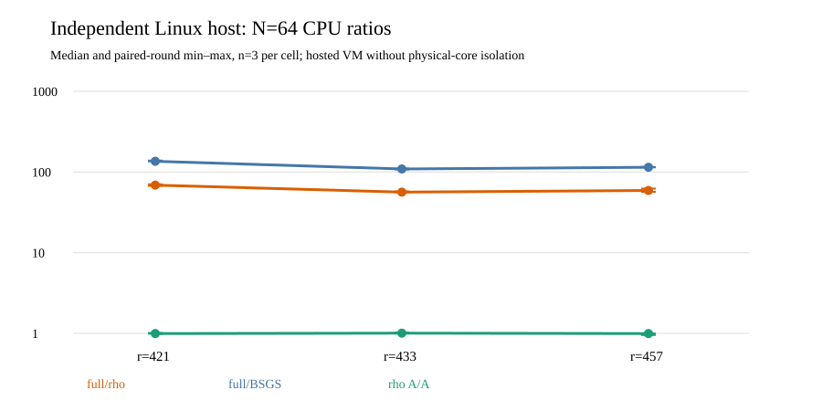

# Independent Linux replay of the four-order isogeny fiber panel

**Run:** [GitHub Actions 38831567671](https://github.com/aburan28/crypto/actions/runs/38831567671),
job 2026-10-16 00:50–00:54 UTC, commit
`de340fa2161088a5188b841ec82278f5067f8aed`. The
[frozen protocol](../../INDEPENDENT_HOST_PROTOCOL_V1.md),
[input/run spec](../../BATCH_RUN_SPEC_V1.json),
[durable raw archive and 1,533-file verification](../../linux_host_v1/README.md),
and [native comparison source](../../../../../examples/different_j_host_performance.rs)
define this run. The [comparison JSON](../../linux_host_v1/COMPARISON_V1.json)
and [three independent replay receipts](../../linux_host_v1/) preserve the
derived values and correctness checks.

The host was a GitHub `ubuntu-24.04` virtual machine with four AMD EPYC
9V74 vCPUs, Microsoft hypervisor, Linux x86-64, and Rust 1.99.1. It had
no reserved physical core. The Linux workflow built fresh native binaries
from the frozen source and ran the same seven arms, three rotations and
1/4/16/64 public-target prefixes in each of the three `r=421/433/457`
cells. All **252/252** cold children exited zero. The independent Rust
checker replayed **5,355/5,355** scalar outputs and **37,061** relation
witnesses. The host analyzer matched all 252 counted arithmetic vectors,
including recovered scalars, against the Darwin records. No targets,
caps or failed children were replaced. The maximum recorded child RSS
was **28,332,032 bytes**, below the 512 MiB child limit.

The table uses one unit: **ratio of whole-child process CPU microseconds**
at `N=64`. Each median is from three paired rotated rounds; parentheses
give the observed minimum–maximum, not a confidence interval. `rho A/A`
is the same-target negation rho arm divided by its repeated rho arm.
The numerator in the first two columns is the full rational-image arm.

| subgroup order | full-image/rho | full-image/BSGS | rho/rho A/A |
| ---: | ---: | ---: | ---: |
| 421 | 68.750 (67.444–70.399) | 135.798 (135.456–138.695) | 0.994 (0.991–1.012) |
| 433 | 56.331 (56.135–57.398) | 109.094 (107.545–110.535) | 1.006 (0.998–1.027) |
| 457 | 59.050 (56.778–62.343) | 114.506 (114.171–115.601) | 0.994 (0.954–0.997) |

These are **L1 descriptive** CPU comparisons on one hosted VM. The
matching arithmetic counts support portability of the implementation's
measured work and independent-host scalar recovery. The CPU ratios vary
with architecture, compiler and placement; they do not establish an
isolated wall-time ratio or a complete portable addition-equivalent `S`.
The order-1,201 cell has its own separately frozen Linux protocol and
will be assessed on its own artifact. The main
[four-order results report](../../RESULTS_V2.md) and
[research roadmap](../../RESEARCH_ROADMAP_V1.md) preserve the remaining
pricing and isolation gates. The canonical frontier graph is unchanged:
this replay adds a new host observation, without changing the admitted
ECDLP boundary.
