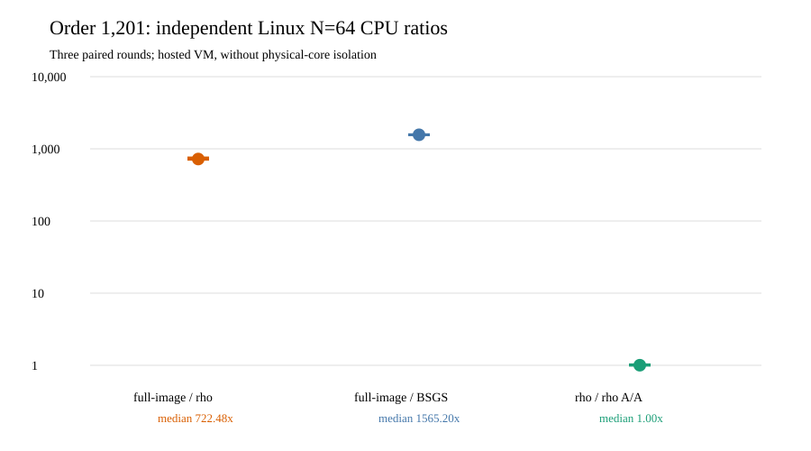

# Order-1,201 independent Linux replay and descriptive CPU comparison

**Run:** [GitHub Actions 38838302462](https://github.com/aburan28/crypto/actions/runs/38838302462),
2026-10-16 02:08–02:13 UTC, on commit
`a5d81db3d47abd2ea9bdf3cfb471e357b1f4f12d`.
The artifact was downloaded and analyzed at 05:50 UTC. The
[frozen host protocol](../../order1000/INDEPENDENT_HOST_PROTOCOL.md),
[run spec](../../order1000/RUN_SPEC_V2.json),
[preserved 515-file artifact](../../linux_host_order1201_v1/README.md),
and [native comparison source](../../../../../examples/different_j_order1201_host_performance.rs)
define the comparison. The [JSON result](../../linux_host_order1201_v1/COMPARISON_V1.json)
contains all three per-round values for each prefix.

The host was a GitHub `ubuntu-24.04` Microsoft Azure virtual machine
with four Intel Xeon 6973P-C vCPUs, Linux x86-64, and Rust 1.99.1.
There was no reserved physical core. All **84/84** cold children exited
zero. The independent Rust checker replayed **1,785/1,785** scalar
outputs and **12,486** relation witnesses. The native analyzer matched
all 84 child arithmetic vectors to the Darwin records, including
recovered scalars, before deriving CPU ratios. No target, trial cap, or
failed child was replaced. Peak child RSS was **189,353,984 bytes**
against the 512 MiB cap. The downloaded archive is **497,778 bytes**,
SHA-256 `b4ad7314d73b79b5e6573e5890a6a06066c80cafa10698737dc9115c812f773f`;
all 515 downloaded files passed the manifest check.

At `N=64`, the table's single unit is **whole-child process CPU ratio**.
Each value is the median of three paired rotated rounds; the range is
the observed minimum–maximum, not a confidence interval. The first
two numerators are the full rational-image construction plus target
solve, divided by the matched reference. The A/A ratio compares two
identical signed-rho implementations.

| comparison | median process CPU ratio | three-round range |
| --- | ---: | ---: |
| full-image / rho-negation | 722.485 | 716.116–748.995 |
| full-image / source-BSGS | 1,565.199 | 1,564.428–1,569.442 |
| rho-negation / rho-negation-A/A | 1.003 | 1.003–1.017 |

These are **L1 descriptive** CPU ratios on an unreserved hosted VM.
They establish independent-host execution, exact counted-arithmetic
agreement, and scalar/relation replay for this selected order. They do
not give a physical-core L2 wall comparison or a complete portable
addition-equivalent `S`; [the five-order price gate](../../PRICE_PROTOCOL_V2.md)
remains open. The [order-1,201 counted result](../../order1000/RESULTS.md)
retains its distinct `S_group` lower-bound table. The canonical
frontier graph is unchanged: this host replay adds no admitted
ECDLP cost crossover or new curve relation.
