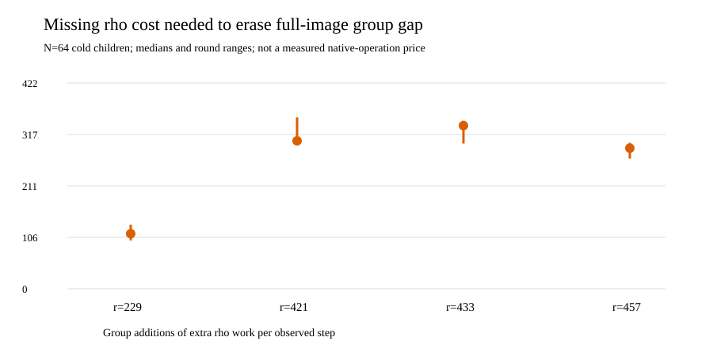

# How large is the missing rho price?

**Status:** verified sensitivity calculation on frozen complete-solve
records. The 48 paired rows in [SENSITIVITY_V1.json](SENSITIVITY_V1.json)
cover orders 229, 421, 433 and 457; target prefixes 1, 4, 16 and 64;
and three rotated rounds. [RUN.md](RUN.md) gives the command, inputs and
verification checks. The source is the native
[`different_j_price_sensitivity` example](../../../../examples/different_j_price_sensitivity.rs).

Let `G_full` and `G_rho` include all group additions and doublings in a
cold child, from public-input checks and setup through every target and
final verification. Let `rho_steps` sum all observed walk steps, including
restarts. For each matched prefix and round, the analyzer computes

`W_break = (G_full - G_rho) / rho_steps`.

This is the *additional unpriced rho cost per observed step* that would
tie the full-image group's counted lower bound **if every omitted
full-image cost were zero**. A positive omitted full-image cost increases
the charge required of rho. `W_break` is not the measured price of a
hash, table lookup, field square root or relation row, and it is not a
complete `S` or speed ratio. It is sensitive to the chosen target count
because the full-image source census is rebuilt cold for each child.

| Order `r` | N64 median `W_break` (GAE/step) | Round minimum | Round maximum |
| ---: | ---: | ---: | ---: |
| 229 | 112.973 | 99.105 | 131.619 |
| 421 | 303.573 | 302.425 | 351.781 |
| 433 | 334.844 | 297.947 | 344.670 |
| 457 | 288.595 | 267.223 | 299.550 |

The minimum over **all 48** rows is 99.105 GAE/step at N64, order 229;
the maximum is 46,594.667 GAE/step at N1, order 421, where the cold
source census is charged to a single solve. Those are accounting
thresholds, not calibrated native-operation prices.

The counted N64 full-image/rho `S_group` ratios were 22.355, 72.401,
64.275 and 63.389 respectively in the [parent complete-solve
report](../RESULTS_V2.md). The source BSGS memory control is also in
that report. Separate `Fp` multiplication/inversion axes and memory
remain separate because those field counts overlap the group calls.
This sensitivity test cannot supply the still-missing disjoint native
operation counts or a host-independent conversion factor. The
[complete-price protocol](../PRICE_PROTOCOL_V2.md) requires those,
second-host calibration, and independent operation-trace coverage before
setting a complete portable `S`.

**Next decision:** if an instrumented full-cost run produces a measured
extra rho price below `W_break` with all omitted full-image work charged,
the observed group-count disadvantage persists for that matched child.
If it exceeds the threshold, the complete charged totals decide the
ordering; this threshold alone does not. An L2-or-better isolated wall
session and independently checked second-host performance replay remain
separate gates. A direct chi-coordinate resultant/root oracle that avoids
the cold source census is the structural route that could change the
group-count premise; it must independently match exhaustive
decompositions and finish the same-target solves before a crossover is
assessed.
