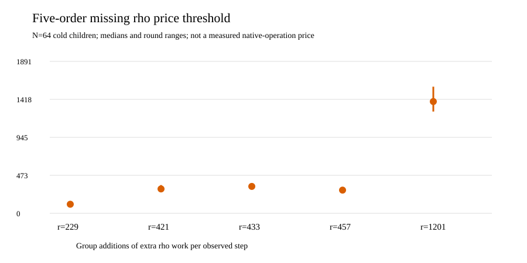

# Five-order missing-price threshold

**Status:** verified native derivation from frozen complete-solve
records, with the [protocol and input hashes](PROTOCOL_V1.md),
[60 paired rows](SENSITIVITY_FIVE_V1.json), [execution receipt](RUN.md),
and [visual PDF](../reports/run-20261016T0153Z-five-price/RESULTS.pdf).
The first four cells are exactly the historical V1 output; this version
adds the selected `(p,r)=(1237,1201)` cell.

For each cold child, `G_full` and `G_rho` include common checks, setup,
all target queries and final scalar verification. `rho_steps` counts
every observed rho walk step, including restarts. The additional
omitted rho cost needed to tie the full-image **group-count lower bound**
is `W_break=(G_full-G_rho)/rho_steps`, under the deliberately favorable
assumption that *all* omitted full-image work costs zero. This is not
a measured hash/table/row price, complete portable `S`, or end-to-end
speed ratio.

| order `r` | N64 median `W_break` (GAE/step) | round minimum | round maximum |
| ---: | ---: | ---: | ---: |
| 229 | 112.973 | 99.105 | 131.619 |
| 421 | 303.573 | 302.425 | 351.781 |
| 433 | 334.844 | 297.947 | 344.670 |
| 457 | 288.595 | 267.223 | 299.550 |
| 1,201 | **1,390.865** | 1,266.482 | 1,575.602 |

The fifth cell's counted full-image/rho `S_group` ratio is 376.364 at
N64 in the [selected complete-solve report](../order1000/RESULTS.md).
The threshold rises with this specific full-image source census; the
field prime and cofactor change across cells, so it is not an exponent
estimate. A measured primitive price above a threshold would require
computing both complete totals; the threshold alone cannot decide a
portable cost ordering. The [complete-price protocol](../PRICE_PROTOCOL_V2.md)
still requires disjoint field, root, hash/table, modular-row, allocation
and process counts with pinned host-class conversion. Its missing
implementation remains explicit in the [research roadmap](../RESEARCH_ROADMAP_V1.md).
