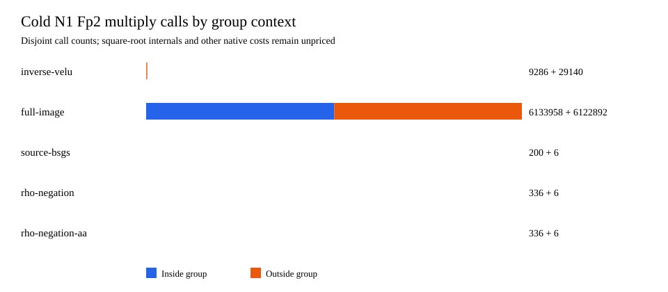

# Disjoint field-call census and independent Linux fiber replays

**Status:** a complete 60-child native instrumentation panel and two
independent Linux replay panels passed their correctness gates. This is a
primitive **count vector**, not a complete portable price. The larger-order
full-image Linux child is resource censored under its hard 512 MiB
address-space limit. The frozen [protocol](PROTOCOL_V1.md),
[raw run](RUN_V1/), [native V2 audit](PRIMITIVE_AUDIT_V2.json),
[graph](PRIMITIVE_GRAPH_V2.svg), and [Linux receipts](LINUX_RECEIPTS_V1/)
are the evidence. The failed V1 reducer attempt is retained as
`PRIMITIVE_AUDIT_ATTEMPT_V1.*`; its missing rho-field branch was fixed
in the V2 audit and did not affect the children or their replay.

## Same-target boundary and correctness

The prespecified generic two-class floor is `S=√(π/4)=0.886227`.
The references are same-target source BSGS and signed rho; rho A/A is
the timing-noise control. The order-1,201 public file and original
runner have the SHA-256 hashes in the protocol. The 60-child run used
five arms, prefixes 1/4/16/64 and three rotated rounds. Every child
exited zero. The original separate Rust checker reported `pass`,
replaying **1,275 scalars** and **6,126 relation witnesses** on 64
distinct public targets. The new native audit compared every
deterministic answer, witness, relation row, rank, group count and
previous field count with the immutable V2 row: **60/60 matched**.
The run-source snapshot is
[`FROZEN_RUNNER_V1.rs.txt`](FROZEN_RUNNER_V1.rs.txt), SHA-256
`0731ddc40f26397fdd30bed5098613a3bff91ec3c74c3863c7079d0313b8a250`,
which matches `RUN_V1/build-sha256.txt`. The run's artifact manifest
verified after download and local replay.

The field wrapper records each top-level Fp² arithmetic call once,
partitioned by whether it occurred inside a counted curve addition or
doubling. Inversions and square roots are **opaque calls** in this
ledger; their internal base-field arithmetic is not double counted.
The historical base-Fp multiplication and inversion totals stayed
bit-identical in all 60 records. The table shows means across three
rounds. `S_group` counts whole-child group additions and doublings;
at N64 it is the **whole 64-target panel**, not a per-target quotient.
CPU includes the whole child on shared Darwin and is descriptive.

| targets | arm | mean whole-child `S_group` | Fp² mul inside / outside | Fp² inv inside / outside | outside sqrt calls | mean child CPU |
| ---: | --- | ---: | ---: | ---: | ---: | ---: |
| 1 | full-image | 88,499.672 | 6,133,958 / 6,122,892 | 3,066,979 / 0 | 0 | 3,755.194 ms |
| 1 | inverse-Vélu | 134.457 | 9,286 / 29,140 | 4,643 / 1,785 | 34 | 9.050 ms |
| 1 | source BSGS | 2.972 | 200 / 6 | 100 / 0 | 0 | 7.063 ms |
| 1 | signed rho | 4.905 | 336 / 6 | 168 / 0 | 0 | 6.641 ms |
| 1 | rho A/A | 4.905 | 336 / 6 | 168 / 0 | 0 | 6.452 ms |
| 64 | full-image | 98,067.547 | 6,796,834.667 / 6,123,144 | 3,398,417.333 / 0 | 0 | 3,392.945 ms |
| 64 | inverse-Vélu | 9,702.332 | 672,162.667 / 29,392 | 336,081.333 / 1,785 | 34 | 79.249 ms |
| 64 | source BSGS | 84.171 | 5,696 / 132 | 2,848 / 0 | 0 | 7.673 ms |
| 64 | signed rho | 259.728 | 17,853.333 / 132 | 8,926.667 / 0 | 0 | 8.757 ms |
| 64 | rho A/A | 259.728 | 17,853.333 / 132 | 8,926.667 / 0 | 0 | 9.436 ms |

At N1 the full-image/inverse counted-group ratio is **658.201** and
inverse/rho is **27.410** using these three-round means. The inverse
arm's 29,140 outside-group Fp² multiply calls identify polynomial
and setup work absent from rho's six; this is a work-location result,
not a time conversion. Calibration of each primitive, internal
`sqrt_mod` work, polynomial control flow, map/table operations, heap
allocation, startup and I/O is still required before portable `S` can
be set. The group counts overlap field calls and are never summed with
them. Shared-host CPU ratios have no L2 wall admission.

## Independent Linux receipts

The three GitHub-hosted Ubuntu x86-64 jobs in [PR #1939](https://github.com/aburan28/crypto/pull/1939)
ran on an AMD EPYC 7763 virtual host. Their artifact directories are
copied here in full; each copied artifact manifest passed SHA-256
verification. The order-1,201 [inverse replay](LINUX_RECEIPTS_V1/isogeny-inverse-linux-v1/)
from [run 38961930762](https://github.com/aburan28/crypto/actions/runs/38961930762)
passed all 60 children, 1,275 scalar checks and 6,126 relation-witness
checks. The order-229 [nine-arm replay](LINUX_RECEIPTS_V1/isogeny-nine-arm-linux-v1/)
from [run 38961930725](https://github.com/aburan28/crypto/actions/runs/38961930725)
passed 108 rows, 996 relation-witness checks and 2,484 trials.
These are independent-host correctness and L1 performance receipts;
the virtual cores were not physically reserved and no L2 wall ratio
is admitted.

The order-2,437 [full-image hard-cap probe](LINUX_RECEIPTS_V1/isogeny-full-image-p2473-linux-v1/)
from [run 38961930860](https://github.com/aburan28/crypto/actions/runs/38961930860)
exited 134 (signal 6) with `memory allocation of 1072 bytes failed`.
The meter recorded 534,470,656 bytes peak RSS and 7.170 s wall before
exit under a 512 MiB address-space cap. Its stdout is empty. This is a
resource-censored row, not a completed scalar solve or a measured
full-image cost at that order. Its source hash matches the committed
`inverse_velu/FROZEN_INVERSE_TREND_V1.rs` snapshot; the current example
source is a different version, so comparing the artifact hash directly
to that example is the wrong check.

## Next discriminant

The measured inverse setup cost is concentrated outside group calls.
The next candidate should avoid raw preimage witness construction when
only a cofactor-projected destination factor base is used, with a
separately frozen projected-base selection rule and same-target rho,
BSGS and relation controls. A distinct base changes relation support,
so total verified solve cost must decide that comparison. The present
primitive vector still needs calibrated host factors and an independent
counter checker before it can answer the complete portable-price gate.
The larger full-image implementation needs a memory-bounded constructor
before retrying its censored order-2,437 cell; raising the cap would
change the frozen question.
