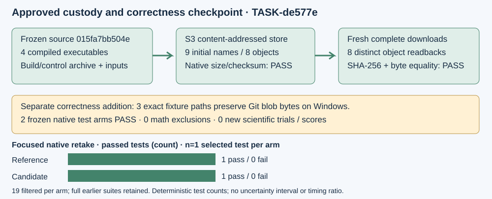

# Approved custody and portable fixture checkpoint — 2026-10-16

TASK-20261016-de577e delivers the default-off fixed-modulus implementation and its engineering controls for independent source/resource review. The requested largest-prime-degree campaign remains active across all 54 standard prime-field boards, ranked separately. This checkpoint adds custody and a checkout repair; it adds no degree or speed result.

| Requirement | Observed status | Evidence |
|---|---|---|
| Four exact compiled A/B executables preserved remotely | Verified: installed and compiled bytes equal before and after controls | inputs.json, verification.json |
| Build/control receipts, native manifest, complete generation datasets | Verified: nine initial names, eight distinct objects, all full readbacks byte-equal | store-index.json, push/, pull/, remote-verification.stdout |
| Windows fixture reproducibility | Locally verified for all three exact Git paths; Windows CI retake pending | ../windows-fixture-20261016/verification.json |
| Cache-path valid + rehashed negatives | Reference and candidate native tests each pass; complete mathematical JSON byte-equal, zero exclusions, all 20 transports | ../windows-fixture-20261016/native-manifest.json |
| Current merged-source full release library gate | FAIL: 4161 passed / 1 failed / 117 ignored / 0 filtered, exit 101; bounded module retake 14/0/0, 4265 filtered, exit 0 | root-gate.json, root-gate-3ce9694.tar.gz, root-custody/verification.json |
| Independent source/resource review | Not started; prospective snapshot/review follows producer delivery | source_gate_complete remains false |
| Larger-degree replay, performance measurement, new board score | Not run in this source task | scientific_runs = 0 |

## Custody and reproducibility

Explicit transfer approval was received before execution. The earlier denied attempt performed zero uploads. The successful native transfer returned exit 0 at 18:57:15 UTC. Four executable files, the 61-file frozen build/control archive, native manifest, and the two complete accepted-P192/13 preparation datasets were bound by the input manifest. Two logical dataset names share the same content object. Nine logical pushes reported eight new physical uploads and eight fresh downloads. Native remote HEAD size/checksum checks passed, then Python hashlib and byte comparisons independently checked all downloaded bytes. Python here performs metadata/hash/packaging only.

Destination: `s3://crypto-autoresearcher/store`. Logical prefix: `evidence/isogeny-fixed-modulus-20261016/015fa7bb504e/`. Every physical URI, hash, size and readback path appears in verification.json. The transport executable is hash-bound; its build-source provenance was not independently established, so verification also uses independent SHA-256 and full byte equality. No endpoint override or replacement write was used.

To retrieve an object with the dedicated native `crypto` binary, set `CRYPTO_STORE_REMOTE=s3://crypto-autoresearcher/store`, set `CRYPTO_STORE_INDEX` to this directory's store-index.json, choose a fresh `CRYPTO_STORE_CACHE`, then run `crypto store pull <logical-name>`. Compare the returned file's SHA-256 with verification.json. The receipt retains exact native commands, stdout, stderr, index and original input names. The two new evidence folders also disable text conversion locally so their hash-bound receipts and captured job log survive every Git checkout. Pull/verify emit text even with `--json`. The first metadata assembler's incorrect empty-stderr assertion and the corrected checker are both retained in metadata-assembly-attempts.md. Native transfer itself succeeded on the first executed attempt.

The later Windows-control and merged-root-gate supplements each have a separate content object, store index and full readback proof at ../windows-fixture-20261016/custody/verification.json and root-custody/verification.json. Across the three indices, custody totals 11 logical names / 10 distinct objects. The initial nine-name index and manifest remain unchanged.

## Windows failure and repair

Release workflow run 38933315615, Windows job 117082574923, failed the accepted P224/1471 fixture-hash assertion. Expected LF SHA-256 was `ecf1109dbff2a72000fd84d9939127db68e2287e55e4ec10d143229874c230c8`; Windows observed `854333812fd0dffb0bb3479d545d36f7805ee39c85314da57d6db59607f7fb5c`. A real Git checkout with core.autocrlf=true/core.eol=crlf reproduced that observed hash. The fixture-local .gitattributes now marks exactly search.json, p224/ell-1471.json and p224/ell-1471.stderr.txt as -text. A fresh checkout then matched all three Git blobs byte for byte. The expected hash, fixtures, native arithmetic and acceptance criteria remain unchanged.

Existing frozen 015-source integration test executables ran `--exact accepted_p224_1471_cache_control_and_rehashed_negatives --nocapture`, bound to the corresponding frozen installed isogeny binary. Each arm passed its one test with 19 others filtered; earlier full native suites remain 128 passed per arm. The controls exercise valid acceptance, rehashed kernel and numerator rejection, cache activation, and sampler receipts with zero unavailable samples. Raw OS times remain operational shared-host costs; no timing ratio is inferred. All 106 raw files are retained in the hash-checked native-controls.tar.gz. These are same-host engineering controls, not an independent review or a Windows-host retest.

## Source identity, history and next gate

Frozen scientific A/B source remains 015fa7bb504ef63953e0e04e464bb266f4f207bf. Current checkout before this metadata repair is merge 3ce9694072773badcedc815ddbb953339888e433. source-delta.json lists exact changed closure paths: upstream CM/CRT opt-in API/CLI/tests/docs additions. Dedicated replay arithmetic and existing API function bodies remain unchanged. The merged root library also received unrelated hwcost/inherited-F4/Koblitz changes; the fresh complete release gate records them separately: 4161 passed / 1 failed / 117 ignored, zero filtered, exit 101. The sole failure is the SQISign statistical assertion: 27 of 4000 accepted, rate 0.00675, below the strict 1/(37*4) lower bound. One predeclared whole-module retake on the same executable passed 14/0/0 with 4265 filtered; it does not replace or relabel the full failure. The SQISign module and SHA3 dependency are unchanged against frozen source and the main parent; the cause remains unestablished. root-gate.json and its checked archive preserve exact commands, source, executable hashes, outputs, OS costs, source comparisons and every raw file. The 24 administrative task-release tests passed with separate HA source69928 provenance. See the named problem at ../../../../problems/sqisign-statistical-root-gate.md. The named problem is also listed in problems/README.md after the preceding reservation released and a separate index reservation was acquired. Current source is not represented as byte-identical to the frozen closure.

The prior default-parallel root failure (4146 pass / 2 fail / 117 ignored), focused serial JV pass and complete serial root pass (4148 / 0 / 117) remain frozen. Their variation's cause and parallel stability are not established. Native IDC1h41e9973f839c85bf and the two checked Lean lemmas remain bounded; full formal-series/reversal bridges remain open. All failed attempts are preserved.

Producer delivery records all required runs honestly and will enable Coordinator TASK-c447e0's snapshot, then a fresh TASK-06cc13 source/resource review with prospective source/raw-first independence. Producer conclusions in this README and implementation-receipt.md must not seed that review. The Coordinator prepared a prospective 21-exact-path exclusion list; it must be committed before the reviewer is dispatched, and its current private preparation is not an official frozen review plan. Only the Coordinator may record the source-gate decision or approve a subsequent measurement/replay protocol. scientific_runs is zero here; no 50341 replay, larger construction, compact target, default activation or board promotion was executed.

Canonical graph families checked: docs/index-calculus-scoreboard.html, docs/ic/progress-timeline.json, docs/curves, docs/performance-gains, figures, and the challenge's board/curve visuals. No new map, cost claim, curve route or score was established, so they remain unchanged by this checkpoint. The existing official v0.1.2390 release is separate and does not include this cache feature.
