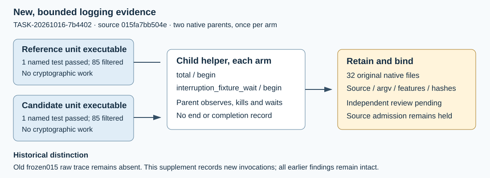

# Native interruption evidence supplement — 2026-10-16

This is a descriptive engineering report for GOAL-ISOU-f30a07 / TASK-20261016-7b4402. The two prescribed native logging controls completed once per arm. These are observations for independent supplemental review TASK-20261016-38a4d9. Source admission remains withheld under DEC-20261016-5cf723; scientific runs and new leaderboard scores are both zero.

The complete frozen protocol is in inputs/PROTOCOL.md; inputs/native-command.sh is the exact shell launcher. The launcher selected only replay_trace::tests::flushed_begin_survives_bounded_child_interruption from each existing native unit executable. Each parent spawned its ignored Session/stage/sleep helper, waited for the begin marker, then killed and waited for the child. Per-parent bounds were 20 seconds plus five seconds hard-kill grace. No build, cryptographic construction, map replay, benchmark, extra native test, or adaptive retry occurred.

| Arm | Parent passed / failed / filtered | Trace begin / end | OS wall, rounded | OS maximum RSS |
|---|---:|---:|---:|---:|
| reference | 1 / 0 / 85 | 2 / 0 | 0.03 s | 2,850,816 bytes |
| candidate | 1 / 0 / 85 | 2 / 0 | 0.03 s | 2,818,048 bytes |

These are operational OS receipts from a shared Apple host for a logging fixture, including parent/descendant accounting as emitted by /usr/bin/time -l. User/system values and all OS counters are retained in raw/ARM/os-time.txt. They supply no isolated speed ratio or scientific memory-admission result. Each arm's sample size is one parent invocation. The flow diagram describes the logging contract because no cryptographic quantity was measured.

Each retained control.json records flushed_begin_observed_before_kill=true, unfinished_stage_marked_complete=false, cryptographic_work=false and child_exit_code=null. Each interrupted.jsonl contains exactly total/begin and interruption_fixture_wait/begin. There is no end or terminal record. The native schema does not measure the Unix termination signal; null is preserved without inventing a signal value.

## Exact provenance and retained inputs

Frozen source is 015fa7bb504ef63953e0e04e464bb266f4f207bf; source trace bytes match that Git object. Current observed unit hashes, sizes and original build paths are in provenance-before.json and inputs/bindings.json. Both unit executable hashes and all four installed scientific executable hashes match before and after the controls. Source/features link through retained original build/test logs and source markers; unit hashes were observed for these new invocations and were not retained at the historical full-suite invocation. The supplement does not recover or relabel the missing old015 trace. Older e82 trace evidence remains older evidence.

The 32 original native files are copied byte for byte into raw/ and bound by raw-manifest.json. Parent and child stdout/stderr, exact argv, explicit environment whitelist, exit statuses, OS receipts and timestamps are retained. Metadata-only source, hash, archive and log inspection uses Python; native execution uses only the published shell launcher, gtimeout and time. Actual served model/effort are unexposed and recorded unknown; requested Executor policy/effort and no substitution are recorded.

## Preserved administrative and metadata failures

The first write-once claim push was rejected because the remote research branch advanced. Its stdout/stderr and exit2 are retained. The Coordinator prescribed a normal merge of the 40 remote commits into the existing local epoch1 claim; the 129 incoming files did not change this goal. Merge b2d66d0022405a77707017b2aa5bab11af15842a preserved both parents. Frozen-goal diff and binding checks passed; scoped branch hygiene passed171candidatepaths; publishing the existing claim then succeeded. No second claim epoch was allocated and no native test ran before publication.

The first metadata inspector incorrectly required128filtered, taken from an aggregate multi-executable full-suite count. Both actual unit logs have exactly1namedtest passed and85filtered. Original metadata.py, control-check.json (INCOMPLETE), and their logs remain unchanged. correct-log-count.py independently reparsed the original raw files and hashes, retained the observed count, and emitted control-check-v2.json (PASS). The native controls were not rerun. This correction changes derived metadata interpretation only. A later JavaScript packaging call failed parsing before any write or execution; metadata-attempts.md retains the exact diagnostic and cause.

## Archive, review and unchanged frontiers

The complete raw/control/source-binding/report payload and its hash/size manifest are archived as native-controls.tar.gz. Separate custody/ receipts bind the public raw archive to the authorized logical name evidence/isogeny-fixed-modulus-20261016/015fa7bb504e/interruption-retake-v1 at s3://crypto-autoresearcher/store and retain full readback verification. Large unit executables are not uploaded in this supplement. Transport-client bytes are bound; its build-source provenance remains unestablished.

The prior signed review06cc13 remains unchanged: semantics holds; resource/build/custody/default-policy was inconclusive because historical raw retention was missing. Current full root gate at3ce remains4161passed/1failed/117ignored, exit101; the filtered14-test pass does not replace it. No threshold, source, default or challenge rule changed.

The54standard-prime leaderboard rows and all canonical mathematical/curve/cost graphs remain unchanged because this fixture produces no isogeny or graphable mathematical finding. P192/50341 remains an unscored constructed candidate awaiting an admitted complete replay. Next: Coordinator snapshot0b8b61, fresh independent review38a4d9, then prospective decisionaea57d/archive409603. This producer assigns no admission or scientific status.
