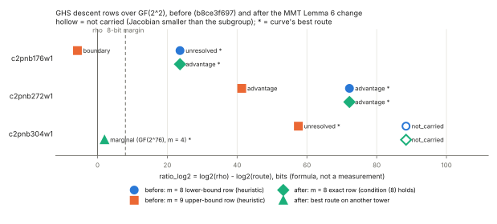
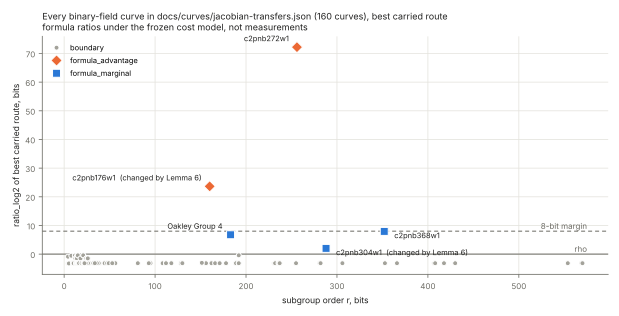

# MMT Lemma 6 in the Jacobian-transfer screen (2026-10-13)

**Question.** For a binary curve `E: y² + xy = x³ + ax² + b` over
`K = F_(2^N)` with `Tr(a) = 1` and an even relative degree `n = N/l`, what
are the GHS magic number and the descent route over `k = F_(2^l)`?  Before
this change the screen (`src/cryptanalysis/jacobian_transfer/`) did not
answer that question.  It priced two heuristic rows, `m` and `m + 1`, and
marked the curve `unresolved` when they disagreed.

**Answer (derived, exact on each curve).**
- `a` never changes the magic number `m = dim Span{(1, σ^i(√b))}`
  (Maurer–Menezes–Teske, LMS J. Comput. Math. 5 (2002), eq. (5)).
- `a` decides whether the descent exists: MMT Lemma 6, condition (8), is
  `n` odd, or `Tr(a) = 0`, or `Tr_(K/k)(b) ≠ 0`.
- Why condition (8) is needed: if `n` is even and `Tr_(K/k)(b) = 0`, the sum
  of the `n` Artin–Schreier conjugates of `z² + z = x + a + b/x²` reduces to
  the constant `Tr_(K/k)(a)`.  Its `℘`-root lies in `F_(q²)`, and lies in `k`
  only when `Tr(a) = 0`.  Otherwise every lift of the `q`-Frobenius has order
  `2n`, and there is no descent.
- The screen now gives one exact row per tower.  A row where (8) fails is
  `descent_obstructed`.

Full derivation and the list of changed code:
[`docs/audits/GHS_MAGIC_NUMBER_MMT_CORRECTION_20261013.md`](../../docs/audits/GHS_MAGIC_NUMBER_MMT_CORRECTION_20261013.md).
PDF of this report: [`REPORT.pdf`](REPORT.pdf).

## What changed, curve by curve

Sources:
- **Before:** `docs/curves/jacobian-transfers.json` at commit `b8ce3f697`.
- **After:** the same file at this report's commit.
- Both use registry SHA-256 `9e420a7f…1219e872` and schema
  `jacobian-transfers/2` after the change, with `--budget 200000`.

Every number below is copied from those files by `extract_rows.py`
(→ `gf4_rows.csv`, `binary_curves.csv`).  Magic numbers, genera and
condition (8) are exact invariants.  `ratio_log2 = log2(rho) − log2(route)`
is a formula under the frozen cost model, not a measurement.

| curve (ICV1 slug) | `r`, bits | GF(4) row before | GF(4) row after | verdict before → after | best route after |
|---|---|---|---|---|---|
| c2pnb176w1 (`icv1-f2m176-t38161931374797611715595947-5639a6d4`) | 160.0 | `m = 8` lower bound, heuristic, +23.64; `m = 9` upper bound, heuristic, −5.76 | `m = 8` exact, genus 128, (8) holds, +23.64 | unresolved → formula_advantage | the GF(4) row, +23.64 |
| c2pnb272w1 (`icv1-f2m272-t114182707820475866940422329614334265958971-985955bd`) | 256.0 | `m = 8` lower bound, heuristic, +72.20; `m = 9` upper bound, heuristic, +41.32 | `m = 8` exact, genus 128, (8) holds, +72.20 | formula_advantage → formula_advantage | the GF(4) row, +72.20 |
| c2pnb304w1 (`icv1-f2m304-tm1949050066876782037155448244017940336576672053-02fbe089`) | 288.0 | `m = 8` lower bound, not carried; `m = 9` upper bound, heuristic, +57.56 | `m = 8` exact, genus 128, (8) holds, not carried (256 bits < 288) | unresolved → formula_marginal | GHS to GF(2^76), `m = 4`, genus 8, +2.00 |

Across all 2091 registry curves, these three are the only verdict or GF(4)
row changes.  The isogeny-extension rows of these three curves are gone: for
`Tr(a) = 1` and even `n` they now count only targets that satisfy (8), and
none remain below the direct `m`.  Every removed row was `not_carried` or
`boundary`.  Condition (8) fails on one registry curve,
`icv1-f2m18-t999-40751283` (`b ∈ F_2`, `Tr(a) = 1`), at `l = 9, 3, 1`.
Its rows were already not carried, and its verdict stays `boundary`.



*Figure 1 (`gf4_rows.svg`, from `gf4_rows.csv`):*
- Shows the GHS rows over GF(2^2) for the three curves, before and after,
  plus c2pnb304w1's new best route.
- Hollow markers are not carried.  `*` marks each curve's best route.
- The x-axis is the formula ratio to rho; the dashed line is the screen's
  8-bit advantage margin.



*Figure 2 (`binary_curves.svg`, from `binary_curves.csv`):*
- Shows the best carried route of every binary-field curve in the file
  (160 curves) against subgroup size.
- 155 are `boundary`, 3 `formula_marginal`, 2 `formula_advantage`.
- The two curves whose verdict this change moved are labeled.

## Checks run

- `cargo test --release --lib` with the jacobian_transfer change: 4065
  passed, 0 failed, 114 ignored.
- New exhaustive test `mmt_condition_8_matches_the_relative_trace_of_b`,
  over `F_(2^12)` on all six towers.  It compares condition (8) with the
  relative trace of `b` computed directly and checks the kernel size
  `q^(n−1) − 1`.  It also checks that `m` and the type do not depend on `a`,
  and that `ec_trapdoor::mmt_condition_8` agrees.
- `ec_trapdoor` tests: `mmt_condition_8_counts_n12`,
  `audit_curve_puts_descending_towers_first`,
  `trapdoor_curves_satisfy_condition_8`.
- `jacobian_transfers check`: current.  Table in `JACOBIAN_TRANSFERS.md`:
  current.

## Scope and limits

- These are formula-level prices on exact invariants.  No cover is
  constructed, no map's action on the subgroup is verified, no relation is
  collected, and nothing is timed.  No speedup, key-recovery or
  deployed-curve security claim is made.  The `formula_advantage` rows on
  c2pnb176w1 and c2pnb272w1 are leads with every obligation in
  `docs/endomorphism-rules.md` open.
- Condition (8) is derived in the correction record and is used as stated by
  MMT.  The exhaustive test checks this implementation against the
  definition; it does not re-prove the lemma.

## Graphs checked

- `research/jacobian_transfer_scan_20261010/chart.svg` and its `report.pdf`
  are the dated 2026-10-10 snapshot (321 curves).  They are left unchanged:
  their text and tables describe that file.  Its README has a dated
  correction note that points here.
- `jacobian_transfers chart` (the tool's registry-wide chart) labels every
  advantage and marginal curve.  846 + 47 of those are toy `extension`-family
  curves, and at 2091 curves the labels overlap into an unreadable block.  This report draws Figure 2 from the same
  recorded file instead; the tool is unchanged.
- No `docs/index-calculus-scoreboard.html`, `docs/performance-gains/` or
  `figures/` graph plots these verdicts.

## Reproduce

```sh
git show b8ce3f697:docs/curves/jacobian-transfers.json > before.json
python3 -I extract_rows.py before.json ../../docs/curves/jacobian-transfers.json gf4_rows.csv binary_curves.csv
python3 -I plot_gf4_rows.py .          # matplotlib; SVGs only
python3 -c "import typst; typst.compile('REPORT.typ', output='REPORT.pdf')"
```
