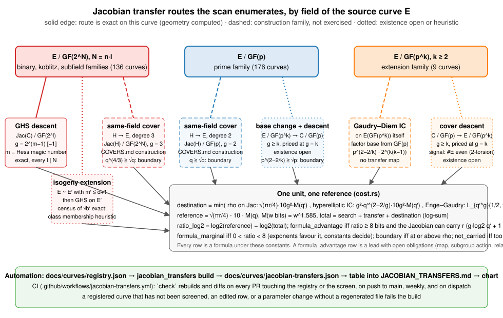
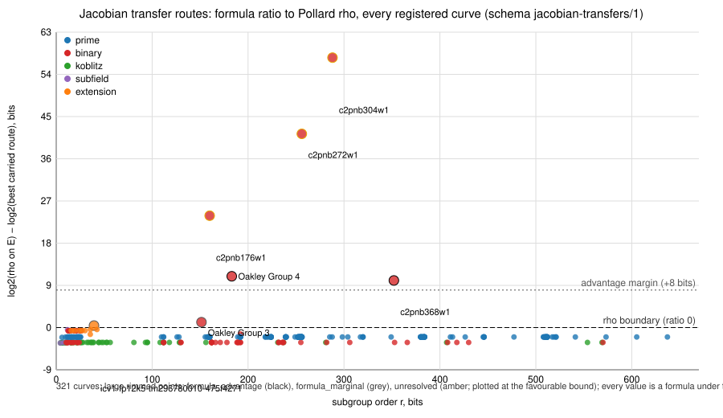

# Jacobian transfer discovery across the curve registry (2026-10-10)

**Question.** For every curve the repository names, can its discrete logarithm
be moved into the Jacobian of a higher-genus curve at a cost the literature's
complexity formulas place below Pollard rho on its subgroup?  Which routes, on
which curve families, and with what left to establish?

**Method.** The native screen `src/cryptanalysis/jacobian_transfer/` (CLI
`jacobian_transfers`, documented in
[`docs/curves/JACOBIAN_TRANSFERS.md`](../../docs/curves/JACOBIAN_TRANSFERS.md))
reads `docs/curves/registry.json` (SHA-256 in the report), enumerates for each
curve the routes in the diagram below, computes the exact parts (GHS magic
numbers with the `a` contribution, types and genera for every factorisation
of the field degree; the census of `√b′` by Frobenius-annihilator degree from
the factorisation of `x^n − 1` over `F_2`; same-field cover genera and
degrees; whether `#E` is even) and prices the rest with one frozen cost model
(parameters in the report's `cost_model` block).  Output:
[`docs/curves/jacobian-transfers.json`](../../docs/curves/jacobian-transfers.json).
Every row is a formula; see the doc page for the classes.

**Scope.** All 321 registered curves: 176 prime-field, 136 binary (72 random,
60 Koblitz, 4 subfield), 9 extension-field toys.  Not enumerated: Hess's
generalised Artin–Schreier covers, pairing transfers, G2 of pairing curves.

*Figure 1: the routes the scan enumerates, by field of the source curve, with
what is exact and what is estimated on each; `routes.svg`, TikZ copy in
`routes.tex`.*

## Findings

Registry SHA-256 `f8297bb893b0cb062b5b9e4a6f177ec4d1b1864485966695372cd53ad4441fba`;
321 curves, 1156 routes.  Verdicts under the default cost model:

| verdict | curves |
|:--|--:|
| `boundary` | 314 |
| `unresolved` | 3 |
| `formula_advantage` | 2 |
| `formula_marginal` | 2 |

Every curve with a non-boundary verdict, best carried route.  `rho` and
`total` are `log2` bit operations; `exp` is the ratio with every constant
stripped.

| curve | route | genus / field | solver | rho | total | exp | ratio | class | evidence |
|:--|:--|:--|:--|--:|--:|--:|--:|:--|:--|
| c2pnb304w1 | GHS, `N = 152·2`, `m = 9` (upper bound) | 256 / GF(4) | Enge–Gaudry, explicit count | 160.2 | 102.7 | +58.0 | +57.6 | unresolved | heuristic |
| c2pnb272w1 | GHS, `N = 136·2`, `m = 9` (upper bound) | 256 / GF(4) | Enge–Gaudry, explicit count | 144.0 | 102.6 | +42.0 | +41.3 | unresolved | heuristic |
| c2pnb176w1 | GHS, `N = 88·2`, `m = 8` (lower bound) | 127 / GF(4) | Enge–Gaudry, explicit count | 95.0 | 71.1 | +21.9 | +23.9 | unresolved | heuristic |
| Oakley Group 4 | GHS, `N = 5·37`, `m = 5` | 15 / GF(2^37) | Enge–Gaudry, explicit count | 106.6 | 95.6 | +14.4 | +10.9 | formula_advantage | exact invariant |
| c2pnb368w1 | GHS, `N = 4·92`, `m = 4` | 7 / GF(2^92) | double-large-prime IC | 192.7 | 182.6 | +18.3 | +10.1 | formula_advantage | exact invariant |
| Oakley Group 3 | GHS, `N = 5·31`, `m = 5` | 15 / GF(2^31) | Enge–Gaudry, explicit count | 90.4 | 89.2 | +5.4 | +1.1 | formula_marginal | exact invariant |
| `icv1-fp12k5-tm296780010-475f4271` (toy) | genus-5 cover descent | 5 / GF(p), p 11 bits | Enge–Gaudry, explicit count | 32.0 | 31.6 | −2.7 | +0.4 | formula_marginal | proposed |

1. **Every deployed prime-field curve is a boundary on every enumerated
   route.**  All 176 prime-field curves, 54 of them standardised, have best
   ratio between −2.1 and −2.0 bits: the same-field genus-2 cover, whose
   Jacobian rho has rho's exponent and four times its operation cost.
   Base-change descents are priced at their most favourable genus and are
   further above rho.  This agrees with
   `research/cover_route_prime_binary_20261008/` Part A.
2. **Every Koblitz and subfield curve, and every prime-degree binary
   curve, is a boundary.**  Koblitz curves degenerate (`m = 1`); random-`b`
   prime-degree curves have `m = n`.  The 60 Koblitz curves sit at −3.3 to
   −3.2 bits on the genus-3 same-field cover.
3. **Two exact formula advantages, both on deprecated or unused
   standards.**  Oakley Group 4 (RFC 2409, deprecated with IKEv1): magic
   number 5, genus 15 over GF(2^37), ratio +10.9 bits.  c2pnb368w1 (X9.62):
   magic number 4, genus 7 over GF(2^92), where the double-large-prime
   term `q^(12/7) = 2^157.7` sits below rho's `2^176`; ratio +10.1 bits.
   The magic numbers and genera are exact on these curves; everything else
   in the row is a formula.
4. **Three unresolved X9.62 w1 curves.**  *(Correction 2026-10-13: under
   MMT Lemma 6, `a` does not change the magic number; it decides whether the
   descent exists, and all three curves satisfy condition (8) on every tower.
   So `m = 8` is exact, genus 128 over GF(4).  Now c2pnb176w1 is
   formula_advantage at +23.6, c2pnb272w1 formula_advantage at +72.2, and
   c2pnb304w1 formula_marginal via `GF(2^76)` at +2.0, because its `GF(4)`
   Jacobian cannot carry the subgroup.  See
   [`docs/audits/GHS_MAGIC_NUMBER_MMT_CORRECTION_20261013.md`](../../docs/audits/GHS_MAGIC_NUMBER_MMT_CORRECTION_20261013.md)
   and the results report with graphs and PDF,
   [`research/jacobian_transfer_lemma6_20261013/`](../jacobian_transfer_lemma6_20261013/README.md).
   This directory's chart and PDF stay the 2026-10-10 snapshot.  The text
   below is the 2026-10-10 reading.)*  For c2pnb176w1, c2pnb272w1 and
   c2pnb304w1, `Tr(a) = 1` with `n` even over GF(4), so the GHS magic number
   is 8 or 9.  For c2pnb176w1 the lower bound (genus 127) gives +23.9 bits
   and the upper (genus 256) does not beat rho.  For the other two only the
   upper bound (genus 256) carries the subgroup at all, and it gives +41 and
   +58 bits.  The verdict waits on one computation: the reduced `a` and the
   exact Hess magic number on these three curves.
5. **Correction to `research/cover_route_prime_binary_20261008/`.**  That
   note priced the genus-16 cover of the Oakley groups with the
   double-large-prime term `q^(2−2/g)` alone and reported formula ratios of
   2^17.7 and 2^22.  Gaudry's relation-collection term `g!·q` is larger at
   this genus (`16!·2^31 = 2^75.3` against `2^58.1`), and the explicit
   Enge–Gaudry count is cheaper still.  The screen gives +1.1 bits for
   group 3 and +10.9 for group 4.  The note's census (m = 5, genus 15 or
   16) is reproduced exactly; its cost row is superseded.
6. **The repository's `ec_trapdoor::audit_curve` over-counts the magic
   number when `a` is not in a subfield.**  It adds Frobenius differences
   of the unreduced `a`; on the X9.62 w1 curves it reports 7, 13, 14 and 15
   where the `b`-only span is 4, 7, 8 and 8.  The screen records both and
   prices the reduced value.  `ghs_screen` and `ghs_full_attack` inherit the
   larger numbers; fixing `audit_curve` is outside this change.
7. **The isogeny extension never helps on a registered curve.**  Of 206
   priced `ghs_isogeny_extension` rows, none is the best carried route:
   curves with a small Frobenius annihilator are far too rare for one to be
   expected in an isogeny class of these sizes.

*Figure 2: best carried route's formula ratio to rho, every registered curve,
against subgroup size (`chart.svg`, generated by `jacobian_transfers chart`;
TikZ copy `chart.tex`).  Units: bits of estimated bit operations under the
frozen model.  Population: every registered curve with a carried route.
No uncertainty interval applies: these are formulas, and the constants are
the uncertainty.*

## Status of each statement

| statement | status |
|:--|:--|
| GHS magic numbers, types, genera per factorisation | computed exactly on each curve (`exact_invariant`), reproducing `research/cover_route_prime_binary_20261008` |
| census of curves with small annihilator degree per tower | exact count; class membership and walk cost heuristic |
| same-field cover genera and degrees | construction family (`docs/curves/COVERS.md`), not exercised |
| base-change and cover-descent rows | proposed; priced at the most favourable genus, existence open |
| every cost, ratio and class | formula under the frozen model; no measurement |
| any speedup, key recovery, deployed-curve security change | not claimed |

## Unresolved obligations on every `formula_advantage` row

Explicit cover model over the subfield; the conorm–norm map and its action on
the named subgroup (kernel intersection); relation collection and linear
algebra at the stated genus (no genus-16 hyperelliptic index calculus exists
in this repository); a matched rho reference in one counted unit (`ecbench`);
replay.  Each is a separately registered experiment under `AGENTS.md`.

## Graphs checked

`docs/index-calculus-scoreboard.html`, `docs/ic/progress-timeline.json`,
`docs/performance-gains/`: unchanged, as no measured value changed.  New
graphs: `routes.svg`, `chart.svg` here; the summary table in
`docs/curves/JACOBIAN_TRANSFERS.md`.

## Files

- `report.pdf` — this report with both figures (`tectonic report.tex`;
  `chart.tex`, `findings.tex`, `n_curves.tex` are generated).
- `routes.svg`, `routes.tex` — Figure 1 (hand-maintained pair).
- `chart.svg`, `chart.tex` — Figure 2 (generated from the report by the CLI).
- `rank.txt` — `jacobian_transfers rank --top 40` at the committed revision.

**Class: boundary** for every deployed curve; **lead** (formula advantage,
exact geometry, open obligations) for the rows listed above.  No speedup is
claimed.
