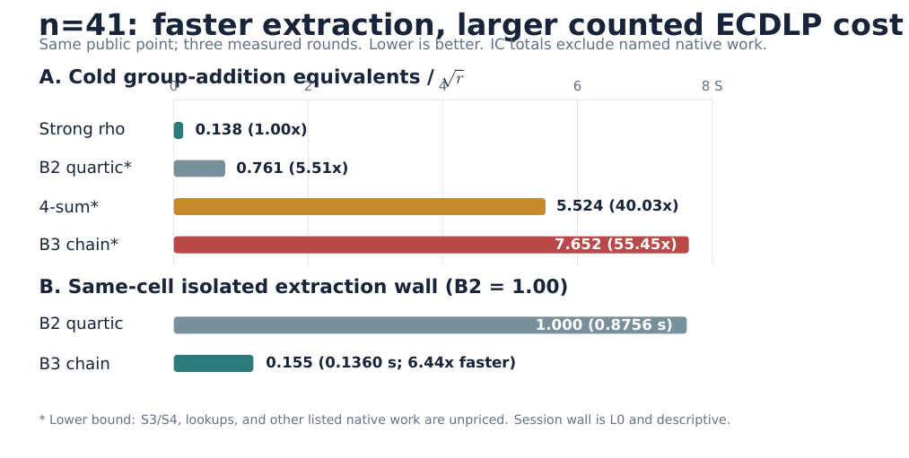

# Decision

The two-S3-chain kernel is correct and makes the stride-ordered extraction
primitive **6.44x faster** than the quartic kernel in a same-cell isolated
probe. It does **not** improve total algorithmic cost: the end-to-end candidate
is **55.447x matched strong rho** in counted group-addition equivalents before
pricing its S3 and lookup work.

# Controlled change

For every stride-ordered pair cell `(s1,s2)`, B3 replaces one quartic S4 root
solve with the union of two S3 root solves through `R+s1` and `R-s1`. The
factor base, pair-cell order, targets, relation verifier, linear algebra and
scalar replay are held fixed. Release tests establish split-quartic root-set
identity and verified recovery on planted, random and negative cases.

# Evidence

Both isolated arms reached the same verified relation after 78,041 cells.

| kernel | root work | point adds | extraction wall |
|---|---:|---:|---:|
| B2 quartic | 78,041 S4 | uncharged | 0.8756 s |
| B3 chain | 156,082 S3 | 234,129 | 0.1360 s |

The ecbench session ran one public target, one warmup, and three paired measured
rounds. All 20 executions verified; all 15 measured deterministic runs replayed
identically.

| arm | mean S | interval | ratio to rho |
|---|---:|---:|---:|
| strong rho | 0.1380 | [0.088, 0.202] | 1.000 |
| B2 quartic | 0.7609 | [0.662, 0.888] | 5.513 |
| 4-sum | 5.5241 | [4.327, 7.190] | 40.027 |
| B3 chain | 7.6521 | [6.616, 8.989] | 55.447 |

The rho mean is 0.997x the signed-Frobenius theory floor. B2 and B3 generated
the same 58 relations with identical trial and rank counts. Across measured
runs both visited 5,109,566 pair cells; B3 therefore added 15,328,698 charged
group operations. B3/B2 is 10.057x in counted work even though descriptive
pipeline wall is 0.150x.

# Blocker and next evidence gate

The remaining blocker is pair-cell complexity, not quartic implementation.
With about 88,096 cells per accepted relation here, materializing three group
adds per unchanged cell exceeds rho before native S3 and lookup work is priced.
A credible next candidate must reduce cells or amortize point construction
across cells/targets.

The n=83 gate is unavailable: ecbench reports that no factor-base plug-in runs
on a wide field (`n > 62`), and only strong rho and the claw method currently
have wide dispatch. Therefore these results establish neither an n=83 scaling
exponent nor an ECC2K-130 transfer claim.

# Qualification

Counts are primary. The ecbench run is L0 because PSI telemetry is unavailable;
wall ratios are descriptive. IC totals are lower bounds because S3/S4 and
lookup work is unpriced. This is one n=41 rung on one host, not independent
replication. The complete session, receipt, protocol, comparisons and machine-
readable summary accompany this PDF.

