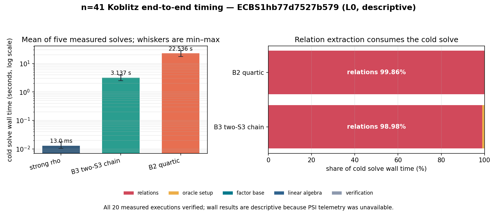

# n=41 cold end-to-end timing run

Session `ECBS1hb77d7527b579` measured the current B2 and B3 six-sum pipelines
from cold setup through verified scalar recovery against the matched strong-rho
reference. All 24 planned executions verified: four warmups and 20 measured
runs, five per arm. Exact replay reproduced all 20 measured deterministic runs.



## Run identity

| field | recorded value |
|---|---|
| UTC start | 2026-10-13 22:07:16 |
| spec | `ECS1hc7fc552628ee`, [`E2E_SPEC.json`](../../E2E_SPEC.json) |
| workload | `W2d6c43bf8940`, public target on `icv1-f2m41-tm2308219-7f48b14a` |
| source revision | `5f83882f976499a55a1f6851281131a85f7611db`, clean at build |
| binary SHA-256 | `30050604...44d2a1` (full value below) |
| host | Intel Xeon Platinum 8573C, virtualized Linux, CPU 4 reserved |
| isolation | L0 for all measured runs |
| audit | `audit-replay-all.json`; 20/20 measured replays identical, zero problems |

Binary SHA-256:
`3005060405a6e2a0cab404b2023b07d7c023d44f2a5c47feeb7f157f5944d2a1`.
Audit receipt SHA-256:
`46f230bbd9d91d8b79745a3701d547ace0f434bf2daa4232291c4d95034ffcfd`.

The strict command without `--allow-busy` refused before executing because CPU
and memory PSI telemetry were unavailable. The unchanged spec was then run with
the explicit downgrade:

```text
./target/release/ecbench run --wait --allow-busy --cpus auto \
  --spec research/koblitz_higher_arity_rho_20261013/E2E_SPEC.json \
  --out research/koblitz_higher_arity_rho_20261013/sessions/n41-e2e-wall-l0-1
```

The run also recorded unmovable user threads, hypervisor steal in some runs,
and no PMU. Consequently all elapsed-time values below are descriptive rather
than admitted wall claims.

\newpage

## Recorded elapsed time

`cold solve` begins with fresh-process method setup and ends after internal
scalar verification. `process` adds fork/exec, teardown and record transport.
`online` is the separately recorded target-dependent window.

| arm | measured n | cold solve mean | cold solve median [min, max] | process mean | online mean |
|---|---:|---:|---:|---:|---:|
| strong rho | 5 | 13.005 ms | 11.904 [10.354, 17.549] ms | 34.053 ms | 10.320 ms |
| B3 two-S3 chain | 5 | 3.137 s | 3.126 [2.461, 3.933] s | 3.185 s | 3.106 s |
| B2 quartic | 5 | 22.536 s | 22.283 [17.604, 27.906] s | 22.588 s | 22.505 s |

Derived from the recorded sums, B3 consumed `0.1392x` B2's cold solve time
(`7.183x` less wall time). B3 consumed `241.237x` rho's cold solve time; the
fork-to-reap ratio was `93.535x` because fixed process overhead is large beside
a 13 ms rho solve. Ecbench's paired descriptive median ratios were `0.1398`
for B3/B2 and `279.895` for B3/rho. These are observations on one L0 host and
one public target, not admitted wall-speed claims.

## Exclusive IC phase clocks

| phase | B2 mean | B2 share of solve | B3 mean | B3 share of solve |
|---|---:|---:|---:|---:|
| factor base | 0.616 ms | 0.003% | 0.594 ms | 0.019% |
| oracle setup | 27.691 ms | 0.123% | 28.523 ms | 0.909% |
| relations | 22.504 s | 99.858% | 3.105 s | 98.981% |
| linear algebra | 0.752 ms | 0.003% | 0.366 ms | 0.012% |
| verification | 0.015 ms | <0.001% | 0.015 ms | <0.001% |

The phase clock recorded `7.247x` less relation wall time for B3. The other
phases are effectively unchanged at this scale.

## Relation-work counters

| recorded counter across five measured runs | B2 | B3 |
|---|---:|---:|
| trials / verified relations | 98 / 98 | 98 / 98 |
| pair cells visited | 10,128,845 | 10,128,845 |
| mean pair cells per solve | 2,025,769 | 2,025,769 |
| pair cells per verified relation | 103,355.6 | 103,355.6 |
| table lookups | 40,515,237 | 40,515,237 |
| root solves | 10,128,845 S4 | 20,257,690 S3 |
| relation wall per pair cell | 11.109 us | 1.533 us |

The counters and relation/rank results match between B2 and B3. The replacement
changes the cost of processing a cell; it does not change how many cells the
pipeline scans.

## Evidence and limits

- Raw sealed session: [`sessions/n41-e2e-wall-l0-1`](../../sessions/n41-e2e-wall-l0-1/)
- Resource aggregate: [`resources.json`](../../sessions/n41-e2e-wall-l0-1/resources.json)
- Replay receipt: [`audit-replay-all.json`](../../sessions/n41-e2e-wall-l0-1/audit-replay-all.json)
- Strict L2 refusal: [`e2e-l2-refusal.stderr.txt`](../../records/e2e-l2-refusal.stderr.txt)
- Frozen protocol: [`E2E_PROTOCOL.md`](../../E2E_PROTOCOL.md)
- Graph data and source: [`data.json`](data.json), [`plot.py`](plot.py)

This is one n=41 workload and five rounds on one host. It is not a scaling
experiment, an independent-host timing, or evidence for ECC2K-130. B2's S4
solves, B3's S3 solves, lookups, and several factor-base operations remain
unpriced in `S`; counted-work ratios are lower-bound diagnostics and are not
substitutes for the elapsed-time observations above.
