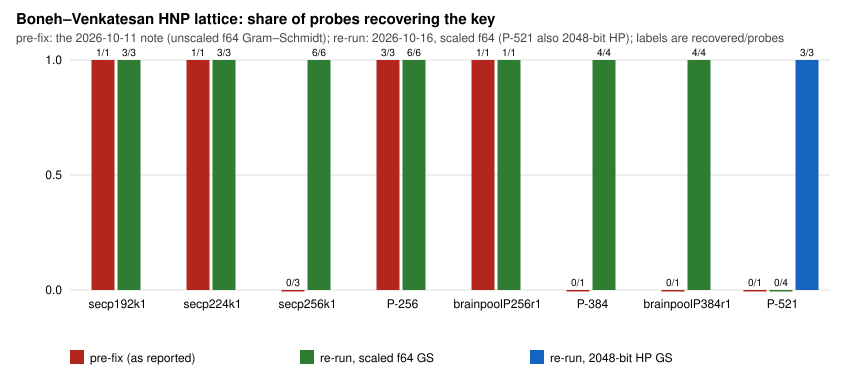

# LLL degeneracy probes, re-run 2026-10-16

This report records observations only: it re-runs the committed probes behind
`papers/lll-degeneracy-note` to correct that note. A sheriff audit
(crypto-autoresearcher `research/sheriff/SHF-20261016-3caa6f`, blocker P1)
found that the note reports, as curve properties, LLL failures that
`research/notes/lattice-hnp/RESEARCH_LLL_GS_ANALYSIS.md` §10 had already
traced to floating-point Gram–Schmidt bugs and fixed in May 2026.

> **Correction (2026-10-17, sheriff case SHF-20261017-e4d7f6, findings P-N1
> and P-N2).** (1) The counts below are probe *runs*. The probes are
> deterministic, and overlapping test functions repeat the same
> `(d_seed, k_seed)` pairs, so the distinct instances are fewer: see the
> "distinct" column added to the results table. (2) Every P-521 probe ran at
> `k_bits = 384` (3/4 of 512), not `⌊3·521/4⌋ = 390`. (3) The Reading's
> attribution of the P-521 scaled-`f64` failure to "the catastrophic
> cancellation of §10.2" is withdrawn as unsupported: with the scaling,
> P-521's diagonal `n²/2^542` is exactly `2^500` in `f64`, so the subtraction
> §10.2 describes is exact on the initial basis. The measured 0 of 3
> (scaled `f64`) and 3 of 3 (2048-bit) stand. `results.json`, `parse.py` and
> `recovery.svg` are unchanged (they count runs; every share is 0 or 1 either
> way). Original wording is kept, struck through.

## What ran

| Item | Value |
| --- | --- |
| Code | commit `97d89f0fd52a`. This is `origin/main` `72843c83a` plus a `src/zk`-only change; `src/cryptanalysis/lattice.rs` and `hnp_ecdsa.rs` are untouched. |
| Probes | `cargo test --release --test lll_degeneracy_probe -- --include-ignored --nocapture --test-threads=1 --skip p521` (`logs/probes.log`) |
| P-521 probe | `cargo test --release --test lll_degeneracy_probe probe_p521_lll_hp -- --exact --ignored --nocapture` (`logs/p521_hp.log`) |
| Parameters | `m = 8` signatures, `k_bits = 3/4 · n_bits` (144, 168, 192, 288; **384 at P-521**, not 390; corrected 2026-10-17), `δ = 0.75`, seeds as in the logs |
| Host | `logs/host.txt`: 4 vCPU cloud VM, not isolated |

Timings are wall time on that host, one run each. They are not a benchmark.

## Results

These come from `results.json`, which `parse.py` builds from the logs, and are
drawn in `recovery.svg` by `make_figure.py`.

| Curve | Gram–Schmidt path | `k_bits` | Recovered / distinct seed pairs (added 2026-10-17) | Recovered / probe runs | Note's pre-fix report |
| --- | --- | --: | --- | --- | --- |
| secp192k1 | scaled f64 | 144 | 2 / 2 | 3 / 3 | recovered |
| secp224k1 | scaled f64 | 168 | 2 / 2 | 3 / 3 | recovered |
| secp256k1 | scaled f64 | 192 | **3 / 3** | 6 / 6 | **0 / 3**, "curve-specific" |
| P-256 | scaled f64 | 192 | 3 / 3 | 6 / 6 | 3 / 3 |
| brainpoolP256r1 | scaled f64 | 192 | 1 / 1 | 1 / 1 | recovered |
| P-384 | scaled f64 | 288 | **3 / 3** | 4 / 4 | **iteration cap** |
| brainpoolP384r1 | scaled f64 | 288 | **3 / 3** | 4 / 4 | **iteration cap** |
| P-521 | scaled f64 | 384 | 0 / 3 | 0 / 4 | iteration cap |
| P-521 | 2048-bit fixed point (`lll_reduce_hp`) | 384 | **3 / 3** | 3 / 3 | not run |

Distinct pairs were tallied from the `d_seed`/`k_seed` fields of every probe
line in `logs/probes.log` and `logs/p521_hp.log` (the HP log prints `d_seed`
only; its `k_seed`s are the three pairs in `probe_p521_lll_hp`).

Each recovered probe returned the planted key `d`. The probe compares the
recovered key with `d` (`tests/lll_degeneracy_probe.rs`, `probe_once`). Every
probe at 256 or 384 bits finished in 13–27 ms. The note reported about 10 s and
about 20 s "iteration cap" failures.

## Reading

- **Failure mode A (secp256k1 at 256 bits).** It does not reproduce. As
  `RESEARCH_LLL_GS_ANALYSIS.md` §10.1 records, the cause was an `f64` overflow
  in the Gram–Schmidt squared norms: `n⁴` exceeds `f64::MAX` for secp256k1's
  order but not for P-256's or brainpoolP256r1's. The sheriff case checks this
  with exact arithmetic (`checks/f64-overflow.txt` there). The scaling fix in
  `src/cryptanalysis/lattice.rs` removes it.
- **Failure mode B (384 bits and above).** It does not reproduce at 384 bits:
  the same scaling fix suffices, so the iteration cap was not the cause. P-521
  still fails on the scaled `f64` path ~~, through the catastrophic cancellation
  of §10.2,~~ (0 of 3 distinct seed pairs; the cause is not isolated, see the
  2026-10-17 correction), and recovers 3 of 3 with the 2048-bit path of §10.3.
- **The `probe_koblitz_lll_degeneracy_hypothesis` closing line.** It prints
  "Hypothesis confirmed", but its near-power-of-two bucket is empty (0/0), so
  the line is vacuous. `RESEARCH_GLV_HNP.md` already says so. This re-run
  inherits that message, and it supports nothing.

## Limits

- **Small samples.** One to three distinct seed pairs (one to six probe runs)
  per curve, at `m = 8` only, on one unisolated host.
- **Scope.** The re-run establishes that the note's failures do not reproduce
  with the fixed code. It establishes nothing about LLL cost across curves, and
  it is not a security statement about any curve.
