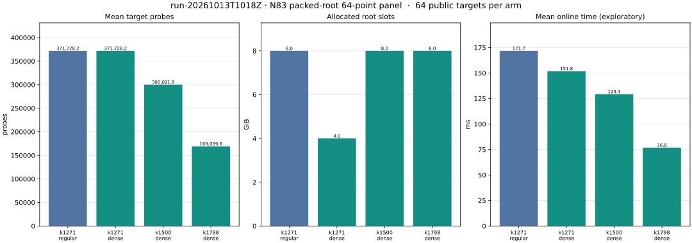
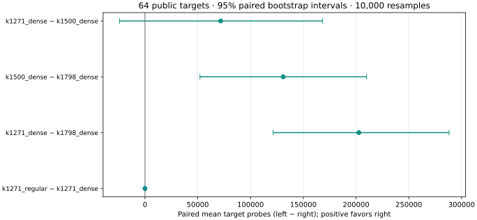

# N83 packed-root capacity and prefix-base result

**K1798 dense is the lowest-mean-probe completed prefix base in the frozen
64-point comparison.** It contains 298,468 distinct subgroup-usable points
in 1,798 signed-Frobenius columns and uses an 8 GiB packed root table. Its
169,069.8125 mean target probes compare with 300,021.90625 for K1500 dense;
the paired difference is 130,952.09375 probes, with a 95% bootstrap interval
of [52,057.703125, 209,990.828125]. All completed target rows and the
three archived factor bases passed independent generic-curve replay.

The same previously unseen public point was solved by K1798 dense in 63.324125
ms online and the selected strong-rho reference in 1,173.29325 ms online.
Both recovered scalar `2927171373054142` from point
`(6156598173116761880680889,2569387936113339852934176)` and passed
independent replay. The rho/IC online arithmetic ratio is 18.528377 for this
one point on a shared Apple M4 Pro host. CPU timing remains exploratory until
a Tier 1 or Tier 0 isolation receipt is attached. The IC process also spent
319.165 s in setup, 19.825 s in rank, and 0.014 s in final matrix algebra
before this target's online interval; the complete primary process was
339.068 s. The online comparison follows the repository's one-target timer
boundary and reports preparation separately.

| Evidence question | Result | Record |
|---|---|---|
| Dense table preserves root lookup semantics | K1271 regular/dense first witness, x codes, point indices, probes and recovered scalars agree on 64/64 public targets; 12 focused release example tests passed | [panel analysis](analysis_panel.json), [example tests](example_tests.log) |
| Dense table changes capacity | K1271 allocated slots: 8 GiB regular, 4 GiB dense; the K1500 and K1798 dense tables each allocated 8 GiB | [primary analysis](analysis_primary.json), [panel analysis](analysis_panel.json) |
| Numeric capacity bound | Six Lean 4 theorems built with no axioms; K1798 dense request fits 2^29 slots under `states <= 83*K^2`, while the K1799 maximum crosses that bound | [proof map](PROOF_MAP.md), [Lean source](DenseCapacity.lean), [check](proof_check.json) |
| One public target against strong rho | K1798 dense 63.324125 ms; same-point rho 1,173.29325 ms; both independent replay pass | [primary run](reports/run-20261013T0942Z/REPORT.md) |
| Reserved 64-point base comparison | K1798 dense selected by frozen lowest-mean-probe rule; all 256 completed arm rows pass scalar and four-point relation replay | [panel run](reports/run-20261013T1018Z/REPORT.md) |
| K1500 regular control | Primary and panel both exit 124 at their 900-second caps; no target rows promoted | [primary raw](runs/primary/k1500_regular/), [panel raw](runs/panel/k1500_regular/) |

## Exact execution and verification

The curve is Koblitz `a=b=1` over `F_2^83`, polynomial
`z^83+z^7+z^4+z^2+1`, subgroup order `8569786107849059`, cofactor
`1128547018`, and generator
`(6614244651398184860292015,8868260410029249391539529)`.
Its canonical rho-receipt identity is
`ICV1:f2m-83-a5fd0d39:6151469093347:9671406556910881928556062:0x1:-7:unk:r:9eba6cd5d359`.
The factor bases are deterministic prefix x scans, cofactor projected and
closed under sign and Frobenius. Actual usable point counts are 210,986
(K1271), 249,000 (K1500), and 298,468 (K1798), before orbit folding.
The corresponding effective log columns are 1,271, 1,500, and 1,798.
The three full base dumps have SHA-256 values recorded in the panel run
report and are retained in `runs/panel/`.

The fixture generator writes public point coordinates to `targets.jsonl`
and known scalars to a separate `answers.jsonl`. Its exact BLAKE3-indexed
input law, source/binary hashes and freeze commits are in [the protocol](PROTOCOL.md).
The producer opens only the public point file. Every IC run uses rank seed
29, 12 rank threads, one target thread, and a 900-second process cap.
The same-point rho uses the previously selected `fold-L64-DP6-E0` policy,
walk seed `2026101301`, one OS thread and a 60-second cap. Preparation and
process totals remain separate from each target's online interval. The 64
point panel is secondary to the completed one-target IC/rho comparison.

The native [analyzer](analyzer/) checked generic-curve scalar replay; every
archived base point's distinctness, representative subgroup membership,
166-point signed-Frobenius orbit and coefficient label; every target's
four-point group sum; target phase sums; and cross-layout witness parity.
K1500 regular target and parity values remain censored by exit 124.
The panel bootstrap uses 10,000 paired resamples and seed `20261013256`.

The shared host had 14 Apple M4 Pro cores, 48 GiB RAM and macOS 26.6; another
research process was active. A host-isolation receipt is absent, so controlled
CPU speedup remains null. The next implementation experiment will test an
explicit 75% table-load rule at larger K: its numeric upper bound keeps
K2202 within 8 GiB of packed slots, while K2203 crosses that bucket under
`states <= 83*K^2`. Two additional conditional Lean declarations check this
numeric threshold using standard `propext` in the division lemma. The rule
has not been implemented or measured here. The Rust-loop-to-Lean bridge is
documented as partial in the proof map.

Source freeze: commits `4489ffdba3`, `b69f539fdd`, `48f3892294`,
`0f8f99ab63`, `d2e485458a`. Producer binary SHA-256
`caa723d4e2894b8573c04f6ec2ec474ce4fb41eb8a2c452b793b3d2d286aa351`.
The complete raw records, including both timeouts, are in `runs/`.
The final release, Lean, formatting and report checks are listed in
[TESTS.md](TESTS.md).
