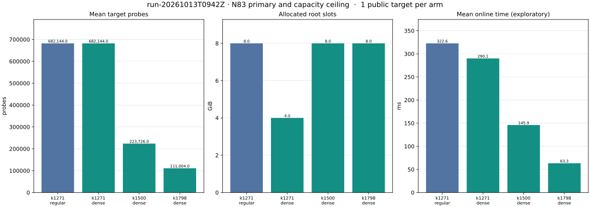

# N83 packed-root primary run (2026-10-13 09:42 UTC)

The opt-in dense table preserved K1271's first witness and reduced its
allocated packed slots from 8 GiB to 4 GiB. The pre-panel K1798 capacity
extension solved the same public target with a 298,468-point base, 111,004
probes and 63.324 ms online. The same-point selected strong-rho control solved
it in 1,173.293 ms online. The arithmetic ratio is 18.528 for this point on
this shared Apple M4 Pro host; the controlled CPU speedup field remains null.

| Arm | Actual B | Columns | Allocated slots | Probes | IC online ms | Process s | Status |
|---|---:|---:|---:|---:|---:|---:|---|
| K1271 regular | 210,986 | 1,271 | 8 GiB | 682,144 | 322.621 | 192.472 | independent scalar replay pass |
| K1271 dense | 210,986 | 1,271 | 4 GiB | 682,144 | 290.081 | 171.013 | independent scalar replay pass |
| K1500 dense | 249,000 | 1,500 | 8 GiB | 223,726 | 145.943 | 256.805 | independent scalar replay pass |
| K1500 regular | unknown (run capped before summary) | unknown | unknown measured | unknown | unknown | 901.30 wall from `time -l` | timeout 124 at 900 s; max RSS 12,855,771,136 B |
| K1798 dense | 298,468 | 1,798 | 8 GiB | 111,004 | 63.324 | 339.068 | independent scalar replay pass |

All arms use Koblitz `a=b=1` over `F_2^83` with low polynomial terms
`[0,2,4,7]`, prime subgroup order `8569786107849059`, and generator
`(6614244651398184860292015,8868260410029249391539529)`. The exact curve
identity in the rho receipt is
`ICV1:f2m-83-a5fd0d39:6151469093347:9671406556910881928556062:0x1:-7:unk:r:9eba6cd5d359`.
The one public target is
`(6156598173116761880680889,2569387936113339852934176)`; the separate
answer sidecar fixes scalar `2927171373054142`. The producer opens only the
public point. Each IC process constructs its prefix signed-Frobenius base,
builds the compact four-summand S3 root index, fills guided rank with seed 29
and 12 rank threads, solves the final log matrix, then uses one target thread.
The primary online interval begins at target-dependent query work and ends
after scalar replay. Setup, rank, and process totals are recorded separately.

The rho point-only worker used the previously selected `fold-L64-DP6-E0`
policy, walk seed `2026101301`, one OS thread, and a 60-second process cap.
Its verified online interval was 1,173.293 ms, including target validation,
walk/collision and generic scalar replay. This gives exploratory rho/IC online
ratios 3.637 (K1271 regular), 4.045 (K1271 dense), 8.039 (K1500 dense), and
18.528 (K1798 dense). A separate generic-curve replay verified every
completed IC scalar and the rho answer. IC online phase residuals were below
0.00034 ms. The primary runs do not contain archived point-defined bases;
the reserved panel archives them for complete orbit/label and four-point
relation replay.

The host was an Apple M4 Pro with 14 cores and 48 GiB RAM, macOS 26.6.
Another research process was active, and there is no host isolation receipt.
These timing ratios are exploratory. The K1500 regular timeout remains a
censored resource outcome, not a target failure. The 64-point panel was still
unopened when the K1798 capacity arm was frozen; it is the next test of the
probe distribution.

Source/evidence: pre-run commits `4489ffdba3`, `b69f539fdd`, `48f3892294`,
`0f8f99ab63`, `d2e485458a`; producer binary SHA-256
`caa723d4e2894b8573c04f6ec2ec474ce4fb41eb8a2c452b793b3d2d286aa351`;
point SHA-256 `21c8dfc7d488909e5c4a42c839fcc01bdefa9821c11ba001626a1d15697240e8`.
See `../../PROTOCOL.md`, `../../CAPACITY_CEILING.md`,
`../../analysis_primary.json`, `../../runs/primary/`, and
`../../runs/rho_primary/`. The Lean capacity map is `../../PROOF_MAP.md`.
