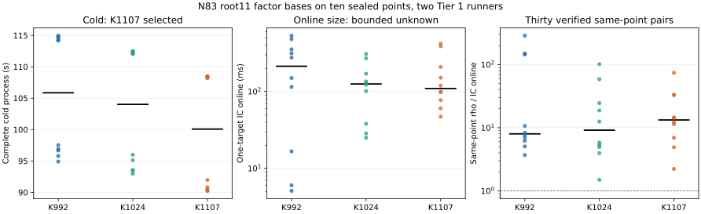

# N83 root11 factor-base follow-up: K1107 wins the three-arm cold comparison

K1107/root11 has the shortest complete one-target cold process among the
prespecified K992, K1024 and K1107 bases on ten sealed N83 points. Its mean
paired advantage is 5.897 s over K992 (95% descriptive interval 5.387–6.406 s)
and 3.679 s over K1024 (3.187–4.171 s). Both exact two-sided sign-flip tests
give `p=0.001953125`, passing the frozen three-comparison Bonferroni threshold
`0.05/3`. The primary target-online factor-base selection is
`BOUNDED_UNKNOWN`: none is faster than both alternatives under that same gate.
All thirty IC/rho pairs recovered and independently checked the same point;
their Tier 1 paired online ratios exceed one.

| Factor base | Actual usable points | Folded columns | Mean IC online, ms | Mean same-point rho online, ms | Median paired rho/IC | Mean complete cold, s |
| --- | ---: | ---: | ---: | ---: | ---: | ---: |
| K992/root11 | 164,672 | 992 | 225.024 | 2,041.400 | 7.992 | 105.459 |
| K1024/root11 | 169,984 | 1,024 | 132.771 | 1,411.756 | 9.157 | 103.241 |
| K1107/root11 | 183,762 | 1,107 | 166.867 | 1,980.260 | 13.283 | **99.562** |

Each row comprises ten independently verified single-target runs on the same
ten public points. Ratios are paired per point and per arm, not ratios of the
mean times. The cold interval includes base, root index, factor-base log and
target work. The online interval starts with target-dependent IC work and
ends after scalar recovery and verification; rho's paired interval starts at
its target-dependent walk and ends after recovery and verification. Fixture
generation and process launch are outside both online intervals. The
[point-level table](results/paired_rows.csv) retains phase, rank, memory,
target probe, rho and ratio columns. The full
[validated rows](results/validated_rows.json), [selection](results/selection.json)
and [plot source](results/plot.py) retain all thirty pairs and the exact
selector output.

The three candidate IDs are, respectively:

* `IC1N83Ckb1a1fb164672PDP4rootRCguidedLAgaussTDdirectISO0h829ed476f094`;
* `IC1N83Ckb1a1fb169984PDP4rootRCguidedLAgaussTDdirectISO0h3eb055926289`;
* `IC1N83Ckb1a1fb183762PDP4rootRCguidedLAgaussTDdirectISO0h82329aa062fa`.

Their exact manifests and the field, curve, subgroup and base digests are in
this study directory. The [preregistered protocol](PROTOCOL.md) fixed ten
points, two cloud strata, rotation, calibration, the three arm IDs and the
exact selector before this panel. Source SHA-256 was
`8a2fe55dd90dc33892c197d27260182bf783fc8212fb485d8297daf2bbba8e12`.
The target-file SHA-256 was
`89c7208dd4fc7a5621cf727b3fac9a6714f04f66a312e516b418c31764e7547e`.

## Tier 1 admission and replay

GitHub Actions [run 39023971459](https://github.com/aburan28/crypto/actions/runs/39023971459)
produced two completed, successful matrix jobs. Half 0 ran points 0–4 on
runner ID `1000328566` and job ID `117371192436`; half 1 ran points 5–9 on
runner ID `1000328557` and job ID `117371192278`. Their job intervals
overlapped from `10:43:37Z` to `11:18:57Z` on 2026-10-17. Both archived host
receipts name the corresponding provider runner. Each host passed exposed
topology and resource checks, the ten-percent before/after calibration gate
for every pair, all fifteen same-point arithmetic replays and the frozen
event order. The result is Tier 1 cloud-instance timing under the recorded
GitHub runner envelope. Raw ZIPs are retained outside Git under
`/Volumes/SSD990/crypto/artifacts/n83_k992_cold_followup_20261017/`, with SHA-256
`0255be8c71c4483c4db4b949629bed19d04c5ba6a6de4d50054f293939f3b333`
and `f58871b2012cb608b29c13a309b4b3b0fbd6e7d84f3297d4d5a41ac56cdd1d56`.

The dispatched aggregator reported `VERIFICATION_FAILED` because its
cross-host gate compared `parent_instance_id`. That field held the common
matrix-job label on both hosts. The [original failed validated rows](results/original_failed_validated_rows.json)
and [original failed selection](results/original_failed_selection.json) are
preserved. A separate [identity replay](aggregate_identity_replay.py) first
reconstructs both failed files byte-for-byte from the raw archives and local
verifier logs, then checks the [provider job snapshot](results/provider_jobs.json):
distinct provider job and runner IDs, matching archived runner names, host
receipt times inside their job windows, and overlapping windows. It changes
only `different_cloud_instances` and `evidence_status` in a copy of the
validated aggregate before applying the frozen selector. Provider snapshot
SHA-256 is
`a221f03257ae797ae17b8b1ff76998c4cc8fe54c7706bfd4a27cba4f886e0cdd`.
The [runner identity implementation](../n83_runner_identity_replay_20261017/jobs.py)
also rejects duplicate runner IDs, mismatched names, failed jobs and invalid
time windows in its regression check.

## Paired selection

| Comparison, second minus first | Mean cold difference, s | 95% descriptive interval, s | Exact two-sided p | Mean online log(second/first) | Exact online p |
| --- | ---: | ---: | ---: | ---: | ---: |
| K1024 − K992 | −2.218 | [−2.930, −1.506] | 0.001953125 | 0.018 | 0.974609375 |
| K1107 − K992 | −5.897 | [−6.406, −5.387] | 0.001953125 | 0.294 | 0.591796875 |
| K1107 − K1024 | −3.679 | [−4.171, −3.187] | 0.001953125 | 0.276 | 0.4375 |

The displayed 95% intervals are descriptive paired-mean intervals; the
preregistered selection uses the exact p values and the `0.05/3` threshold.
Online times depend strongly on the target point, so the lower K1024 mean is
not an online selection. The next sealed twelve-point holdout is fixed in
`research/n83_final_online_holdout_20261017`; it includes K992 and K1107 and
uses the preregistered outcome of the separate five-arm panel to choose its
remaining arm.
