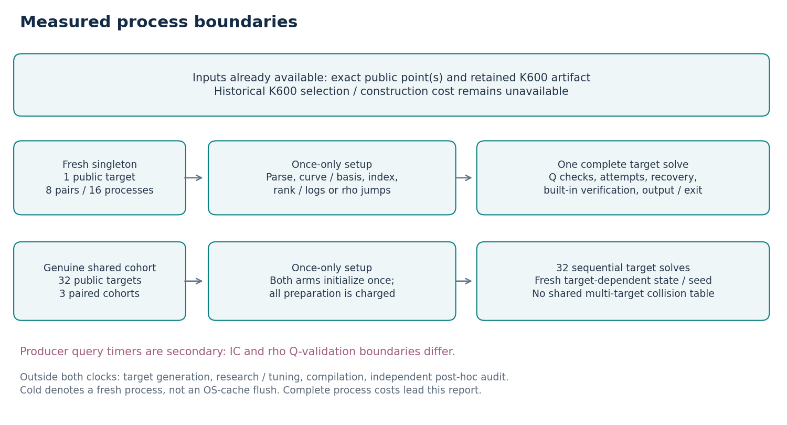
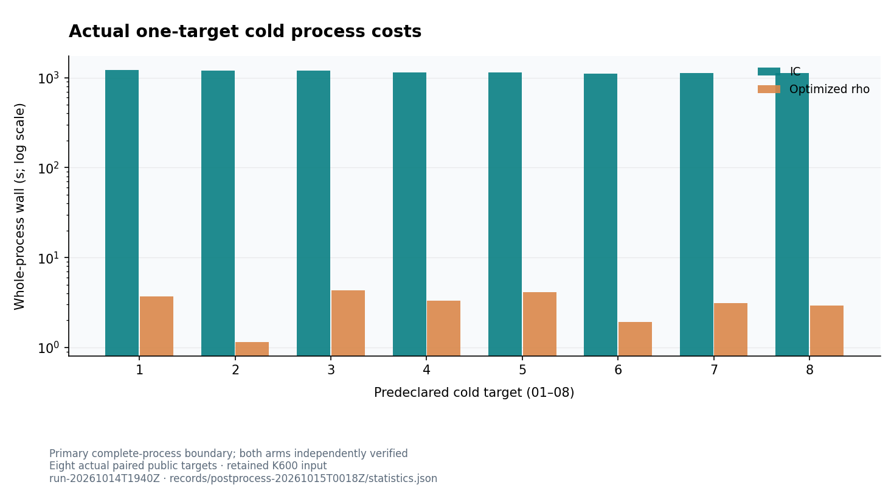
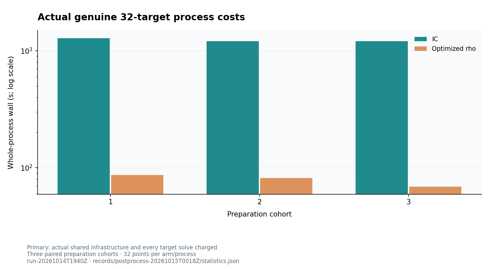
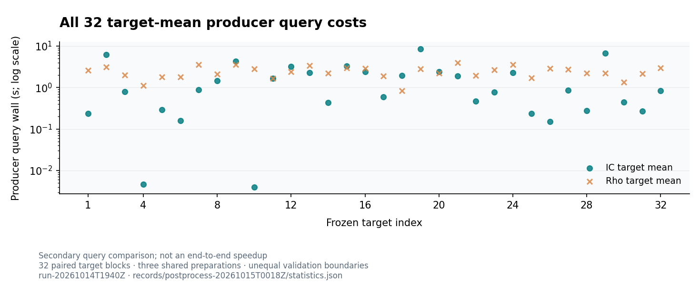
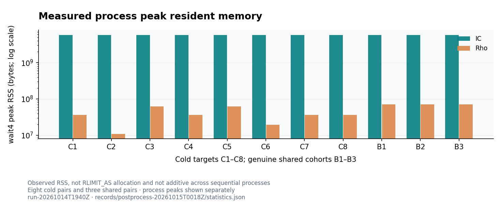
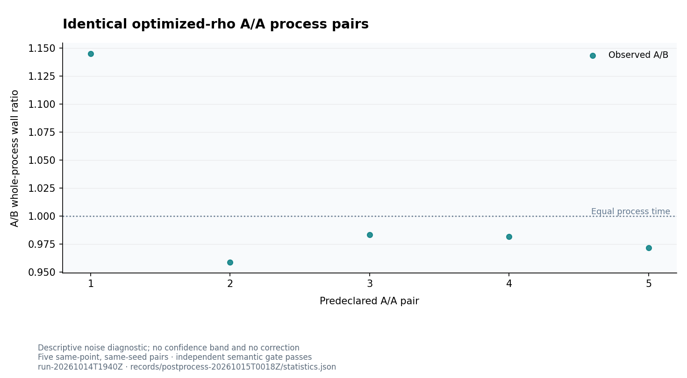

# Matched degree-83 IC and optimized rho

Actual cold processes, genuine reused setup, and a larger fresh target panel

14–15 October 2026 · run-20261014T1940Z

> Actual IC/rho mean complete-process ratio: 377.435691 for eight cold singleton pairs; 15.615702 for three genuine 32-target cohort pairs. Values above 1 favor rho. The 32-target query comparison and crossover model remain secondary.

## 1. Actual complete-process comparison

> All 32 solver processes completed and all 218 answers passed independent scalar replay. Actual cold singleton means are IC 1159.349882 s and rho 3.071649 s; actual 32-target cohort means are IC 1232.975217 s and rho 78.957400 s.

The two frozen methods solve the same point-only inputs under one recorded resource envelope. IC is the existing wide koblitz_orbit_dlp_fast producer with the retained K600 factor base. Rho uses Fold field reduction, reference u64 scalar arithmetic, 256 lockstep lanes, DP6, fruitless escape off and step-cap factor 2000. This study performs no further configuration selection on the new points.

| Actual measured workload | IC wall (s) | Rho wall (s) | IC/rho and native interval |
| --- | --- | --- | --- |
| Eight fresh singleton pairs | 1159.349882 | 3.071649 | 377.435691 / [311.812847, 499.010210] |
| Three real 32-target cohort pairs | 1232.975217 | 78.957400 | 15.615702 / [14.743543, 17.614848] |

Cold here means an actual fresh process given the already materialized K600 artifact. Historical factor-base selection and construction cost is unavailable and remains an additive gap for a curve-only cold-start comparison. The shared workload initializes each arm once for 32 points; every target receives fresh walk, distinguished-point and collision state.

All 32 processes completed: 208 main matched answers and 10 A/A answers. Independent native replay passes for all 218 scalars, all 104 IC four-point witnesses and all five same-work A/A pairs, with zero invalid or missing answers. The reservation records 2,654 samples and zero contended samples. Wall times remain conditional on one guest host; calibrated S, ecbench L2 and independent-host admission remain unset.

*Sources: [Protocol](https://github.com/aburan28/crypto/blob/fb26ccaef5c8f5e97aa81b3503d42e5501b030e4/research/n83_matched_20261014/PROTOCOL.md), [Native statistics](https://github.com/aburan28/crypto/blob/fb26ccaef5c8f5e97aa81b3503d42e5501b030e4/research/n83_matched_20261014/records/postprocess-20261015T0018Z/statistics.json), [Independent replay](https://github.com/aburan28/crypto/blob/fb26ccaef5c8f5e97aa81b3503d42e5501b030e4/research/n83_matched_20261014/records/postprocess-20261015T0018Z/independent_replay_v3_receipt.json), [Collector seal](https://github.com/aburan28/crypto/blob/fb26ccaef5c8f5e97aa81b3503d42e5501b030e4/research/n83_matched_20261014/records/postprocess-20261015T0018Z/collector_extraction_receipt.json).*

## 2. Curve, bases and invariants held fixed

The retained model is icv1-f2m83-t6151469093347-9eba6cd5: y²+xy=x³+x²+1 over GF(2)[z]/(z^83+z^7+z^4+z²+1), prime subgroup r=8569786107849059, cofactor 1128547018, and G=(6614244651398184860292015,8868260410029249391539529). The field degree is 83; the subgroup has about 52.928 bits. The signed Frobenius quotient uses 166 phases and eigenvalue λ=2998004823950457.

| Representation or invariant | Role in the measured algorithm | Identity / accounting status |
| --- | --- | --- |
| Binary field and polynomial basis | Exact field arithmetic and curve representation | Tail 149; no tail-45 or a=0 substitution |
| Normal-basis conversion and signed Frobenius quotient | Shared coordinate/quotient machinery; 166 signed phases | Charged once per genuine process |
| K600 factor-base point set | 600 columns and 99,600 signed orbit points for IC | Artifact parsing, index and rank/log reconstruction charged; original selection unavailable |
| Reference scalar arithmetic and rho policy | Fold field, u64 scalars, 256 lockstep lanes, DP6, escape off | Frozen prior selected configuration; no new tuning |

These are distinct objects: a field representation, an orbit quotient, an IC factor-base point set and a solver policy. They can share exact curve and subgroup invariants without sharing a cost boundary. This follow-up changes measurement coverage and workload accounting; it establishes no new generic counting exponent or algebraic invariant.

Registry representation EC1N83Ce1h35c7ced6b497; curve UID urn:ec-record:1:sha256:35c7ced6b497231fbc82fe24db596fd55379a87356962dad47a7dc774388ce9d. K600 file SHA-256 0d290b14a350db6271c9a49f0cd6ba246edd8c9bc6754387ad1ceebf08ec0c09; declared point-set digest d4a4da26d6e7cb09367de922d9806631fe49989f70d378cae76f347f8d76a9f7. Exact field, subgroup, generator and point-set identities are retained rather than inferred from degree alone.

*Sources: [Exact curve registry](https://github.com/aburan28/crypto/blob/fb26ccaef5c8f5e97aa81b3503d42e5501b030e4/docs/curves/registry.json), [Frozen protocol](https://github.com/aburan28/crypto/blob/fb26ccaef5c8f5e97aa81b3503d42e5501b030e4/research/n83_matched_20261014/provenance/protocol.json), [Build/source pins](https://github.com/aburan28/crypto/blob/fb26ccaef5c8f5e97aa81b3503d42e5501b030e4/research/n83_matched_20261014/provenance/build_receipt.json).*

## 3. Fresh panel and frozen execution order

Native C++ generation uses unbiased nonzero scalar rejection sampling with SplitMix64 seed 202610146301. It excludes the signed orbits of the K600 representatives, the original exposed target, all 16 prior optimization targets and each accepted new target. There are 617 initially excluded orbits. Solvers receive point-only files; known validation scalars remain in a checker-only sidecar.

| Prospective component | Processes / answers | Order and purpose |
| --- | --- | --- |
| Five identical rho A/A pairs | 10 processes / 10 answers | target_01, equal seed inside each pair; noise diagnostic |
| Three genuine shared cohorts | 6 processes / 192 matched answers | 32 points per arm, target orders rotated by 0/11/22; second rotated order reversed |
| Eight actual singleton cold pairs | 16 processes / 16 matched answers | target_01 through target_08; predeclared alternating arm order |
| Total prospective matrix | 32 processes / 218 answers | 208 main matched answers plus 10 A/A answers; every attempt retained |

All 32 fresh points and both older eight-point streams pass independent native regeneration, scalar/subgroup checks and signed-orbit exclusions. Shared rho seeds are 202610146501–596, assigned by frozen target index and cohort; actual cold seeds are 202610146601–608; A/A seeds are 202610146411–415. IC rank seed stays 29. Every actual target order and point-file/seed-file digest is in the frozen matrix.

No fastest-seed selection, target deletion, adaptive pruning or policy change is permitted. Sampling is conditional on orbit exclusions and without replacement. Target and preparation repetitions are distinct: the online panel has 32 target blocks sharing three IC preparations.

*Sources: [Fixture generator](https://github.com/aburan28/crypto/blob/fb26ccaef5c8f5e97aa81b3503d42e5501b030e4/research/n83_matched_20261014/verification/fixtures/generator_receipt.json), [Independent fixtures](https://github.com/aburan28/crypto/blob/fb26ccaef5c8f5e97aa81b3503d42e5501b030e4/research/n83_matched_20261014/verification/fixture_replay_receipt.json), [Frozen execution matrix](https://github.com/aburan28/crypto/blob/fb26ccaef5c8f5e97aa81b3503d42e5501b030e4/research/n83_matched_20261014/provenance/frozen_campaign_manifest.json).*

## 4. What the clocks include

Actual fresh singleton and genuine reused-setup process boundaries. Public-point generation, compilation and external research audit are outside both arm process clocks. Historical K600 selection/construction cost is unavailable. Run run-20261014T1940Z.

Actual process wall includes launch, public input parsing, curve/basis setup, IC index and rank/log reconstruction or rho jumps, Q checks, solving, scalar recovery, built-in verification, output and exit. A whole-process timeout and native wait4 meters apply equally to both arms.

Stock IC target_ms omits input/Q-validation/output intervals that rho online includes. Those producer query timings stay secondary and retain the mismatch. The five exported IC stage fields and their residual are shown; they are not silently redefined as five exhaustive mutually exclusive end-to-end phases.

Producer preparation includes IC index/rank/log work and rho curve/normal-basis/seed-specific jumps. Independent final V3 scalar/witness/file replay took 1.167454 s wall, 1.089206 s user CPU and 0.075961 s system CPU, peak RSS 109,332 KiB, separately metered without observed contention. That is one post-hoc research-audit pass over the campaign, not a production per-target verification estimate. Built-in solver verification is already inside each process cost.

*Sources: [IC timer source](https://github.com/aburan28/crypto/blob/fb26ccaef5c8f5e97aa81b3503d42e5501b030e4/examples/koblitz_orbit_dlp_fast.rs), [Rho timer source](https://github.com/aburan28/crypto/blob/fb26ccaef5c8f5e97aa81b3503d42e5501b030e4/examples/n83_rho_matched_eval.rs), [Audit meter](https://github.com/aburan28/crypto/blob/fb26ccaef5c8f5e97aa81b3503d42e5501b030e4/research/n83_matched_20261014/records/postprocess-20261015T0018Z/independent_replay_v3_meter.jsonl).*

## 5. Recorded phase accounting and residuals

All 104 main IC answers retain the five producer stage fields: 96 queries in shared cohorts and eight singleton queries. The native supplement computes the signed target-clock-minus-stage-sum residual. These fields describe the producer clock; they do not repair its omitted Q-validation/input/output boundary.

| Native IC field (ms) | Mean | Median | p95 | Maximum |
| --- | --- | --- | --- | --- |
| Query-origin preparation | 0.000026 | 0.000030 | 0.000030 | 0.000040 |
| Point decomposition excluding relation checks | 1718.020904 | 827.241681 | 6604.401760 | 9481.881343 |
| Relation checks | 0.014410 | 0.012750 | 0.024960 | 0.108736 |
| Scalar descent / recovery | 0.001578 | 0.000726 | 0.001130 | 0.026090 |
| Recovery group check | 0.136032 | 0.120762 | 0.163148 | 1.243078 |
| Target clock minus five-phase sum | 0.000921 | 0.000781 | 0.001069 | 0.013611 |

Native IC residual (target_ms minus five_phase_sum_ms), n=104: mean 0.000921423 ms, median 0.000781000 ms, minimum 0.000300000 ms and maximum 0.013611000 ms, with zero negative rows. This small residual is retained; the larger omitted input/Q-validation/output boundary remains a separate issue. The supplement's source-file hashes and JSON/JSONL pointers bind each recorded field.

Rho retains exact nanosecond phase and residual counters in its own raw target records, with A/A cases identified separately. Process-level supervisor-minus-producer residuals, CPU and RSS remain in the native supplement with source-file hashes and JSON/JSONL pointers. No phase sum or residual is recalculated by the PDF renderer.

*Sources: [Native signed phase/residual supplement](https://github.com/aburan28/crypto/blob/fb26ccaef5c8f5e97aa81b3503d42e5501b030e4/research/n83_matched_20261014/records/postprocess-20261015T0018Z/presentation_supplement.json), [Native phase exporter source](https://github.com/aburan28/crypto/blob/fb26ccaef5c8f5e97aa81b3503d42e5501b030e4/research/n83_matched_20261014/postprocessing/src/lib.rs), [Raw producer fields](https://github.com/aburan28/crypto/blob/fb26ccaef5c8f5e97aa81b3503d42e5501b030e4/research/n83_matched_20261014/records/postprocess-20261015T0018Z/statistics_input.json).*

## 6. Eight actual cold singleton pairs

All eight predeclared actual singleton process pairs, seconds on a logarithmic y-axis. Primary complete-process boundary, given retained K600; every original pair independently verifies. Run run-20261014T1940Z.

| Target | IC process (s) | Rho process (s) | IC/rho / status |
| --- | --- | --- | --- |
| target_01 | 1222.138607 | 3.720382 | 328.498148 / verified |
| target_02 | 1203.297036 | 1.143097 | 1052.663582 / verified |
| target_03 | 1193.387645 | 4.327487 | 275.769196 / verified |
| target_04 | 1146.736518 | 3.315835 | 345.836421 / verified |
| target_05 | 1140.785160 | 4.117988 | 277.024876 / verified |
| target_06 | 1109.371728 | 1.915267 | 579.225622 / verified |
| target_07 | 1131.835702 | 3.121473 | 362.596633 / verified |
| target_08 | 1127.246662 | 2.911660 | 387.149111 / verified |

Native paired eight-target percentile 95% interval for the mean-cost ratio: [311.812847, 499.010210]. IC process median 1143.760839 s (min 1109.371728, max 1222.138607); rho median 3.218654 s (min 1.143097, max 4.327487). All eight original point pairs are included; given retained K600, without OS-cache flushing.

*Sources: [All cold rows and native estimator](https://github.com/aburan28/crypto/blob/fb26ccaef5c8f5e97aa81b3503d42e5501b030e4/research/n83_matched_20261014/records/postprocess-20261015T0018Z/statistics.json), [Raw cold process K01-ic](https://github.com/aburan28/crypto/blob/fb26ccaef5c8f5e97aa81b3503d42e5501b030e4/research/n83_matched_20261014/records/campaign-20261014T1940Z/runs/K01-ic/observation.json).*

## 7. Three genuine reused-setup cohorts

All three actual 32-target process pairs, seconds on a logarithmic y-axis. Each arm initializes infrastructure once and charges every target. Rho target-dependent collision state is reset. Only three preparation clusters. Run run-20261014T1940Z.

| Cohort | IC process / setup (s) | Rho process / setup (s) | Complete status |
| --- | --- | --- | --- |
| 1 | 1282.605726 / 1222.727201 | 86.376504 / 0.254761 | Both verified; all 32 points |
| 2 | 1204.820756 / 1149.988148 | 81.718538 / 0.271938 | Both verified; all 32 points |
| 3 | 1211.499169 / 1156.448203 | 68.777158 / 0.241819 | Both verified; all 32 points |

The primary shared-workload estimate uses mean actual process cost over three paired cohorts, not a synthetic sum of singleton launches divided by 32. Its native paired bootstrap conditions on this one host and only three preparation clusters; it does not describe independent-host uncertainty or robust extreme tails.

Native mean actual process ratio IC/rho 15.615702, paired-cohort 95% interval [14.743543, 17.614848]. Each arm has exactly three observed whole-process costs. No process timeout, failure or target omission is converted into a zero-cost observation.

*Sources: [All shared cohorts and native estimator](https://github.com/aburan28/crypto/blob/fb26ccaef5c8f5e97aa81b3503d42e5501b030e4/research/n83_matched_20261014/records/postprocess-20261015T0018Z/statistics.json), [Raw cohort C01-ic](https://github.com/aburan28/crypto/blob/fb26ccaef5c8f5e97aa81b3503d42e5501b030e4/research/n83_matched_20261014/records/campaign-20261014T1940Z/runs/C01-ic/observation.json).*

## 8. Producer query distributions and slow cases

All 32 native target means in seconds on a logarithmic y-axis, three query observations per arm/target. The IC and rho producer validation/input/output boundaries differ; this is a secondary diagnostic. Run run-20261014T1940Z.

| Native descriptive statistic | IC | Rho | Scope |
| --- | --- | --- | --- |
| Mean query (s) | 1.760364 | 2.457289 | 32 target means, three repeats each |
| Median query (s) | 0.852103 | 2.332984 | 32 target means, three repeats each |
| p90 query (s) | 4.182302 | 3.523073 | 32 target means, three repeats each |
| p95 query (s) | 6.412727 | 3.579652 | 32 target means, three repeats each |
| Maximum query (s) | 8.590054 | 4.016571 | 32 target means, three repeats each |
| Mean query (s) | 1.760364 | 2.457289 | 96 draws sharing three preparations |
| Median query (s) | 0.833230 | 2.168825 | 96 draws sharing three preparations |
| p90 query (s) | 4.401029 | 4.401391 | 96 draws sharing three preparations |
| p95 query (s) | 6.677992 | 5.016997 | 96 draws sharing three preparations |
| Maximum query (s) | 9.482010 | 6.193312 | 96 draws sharing three preparations |

Secondary ratio of arithmetic mean target costs IC/rho 0.716385, 32-target-block 95% interval [0.460389, 1.013127]. Crossed target/cohort sensitivity interval [0.452168, 1.046078]. Descriptive geometric mean of paired target-mean ratios 0.315622. These clocks have unequal validation boundaries and do not establish the complete-process winner.

Means, medians and tail quantiles answer different questions. Conventional even-sample medians use midpoint interpolation in native analysis. Every slow or regressing point remains in the panel; successful subset summaries never turn a failed or missing solve into a win.

*Sources: [All native query distributions/intervals](https://github.com/aburan28/crypto/blob/fb26ccaef5c8f5e97aa81b3503d42e5501b030e4/research/n83_matched_20261014/records/postprocess-20261015T0018Z/statistics.json), [Native statistical source](https://github.com/aburan28/crypto/blob/fb26ccaef5c8f5e97aa81b3503d42e5501b030e4/research/n83_matched_20261014/analysis/src/lib.rs).*

## 9. Complete query rows: targets 01–16

Each row contains the native three IC producer query observations, three rho observations and native target means/ratio. Units and unequal Q-validation boundaries remain explicit. Seeds and full point hashes are in the source records.

| Target | IC queries (s) | Rho queries (s) | Native means (s) / IC/rho |
| --- | --- | --- | --- |
| target_01 | 0.234867, 0.260464, 0.222896 | 1.640854, 5.196469, 0.989932 | 0.239409 / 2.609085 ratio 0.091760 |
| target_02 | 6.642331, 5.957789, 5.849844 | 3.296084, 3.590678, 2.502273 | 6.149988 / 3.129678 ratio 1.965055 |
| target_03 | 0.909376, 0.777519, 0.723368 | 1.429782, 2.474638, 2.034428 | 0.803421 / 1.979616 ratio 0.405847 |
| target_04 | 0.004565, 0.004735, 0.004703 | 1.616102, 0.872278, 0.917898 | 0.004667 / 1.135426 ratio 0.004111 |
| target_05 | 0.311761, 0.297816, 0.265460 | 3.087775, 0.600333, 1.784729 | 0.291679 / 1.824279 ratio 0.159887 |
| target_06 | 0.187674, 0.146220, 0.146495 | 2.061500, 1.040531, 2.277989 | 0.160130 / 1.793340 ratio 0.089291 |
| target_07 | 0.988067, 0.827510, 0.815178 | 6.193312, 0.657449, 3.775011 | 0.876918 / 3.541924 ratio 0.247582 |
| target_08 | 1.619075, 1.344187, 1.362457 | 1.579708, 3.997688, 0.814403 | 1.441906 / 2.130600 ratio 0.676761 |
| target_09 | 4.568501, 4.233557, 4.050278 | 3.845046, 1.977733, 4.778620 | 4.284112 / 3.533800 ratio 1.212324 |
| target_10 | 0.004085, 0.003979, 0.003934 | 0.847963, 4.154483, 3.570212 | 0.003999 / 2.857553 ratio 0.001400 |
| target_11 | 1.635520, 1.628618, 1.670129 | 2.819685, 1.479100, 0.699827 | 1.644756 / 1.666204 ratio 0.987128 |
| target_12 | 3.164274, 3.178024, 3.194376 | 2.177541, 2.973375, 2.087461 | 3.178891 / 2.412792 ratio 1.317515 |
| target_13 | 2.291834, 2.260263, 2.302585 | 3.456101, 4.663401, 2.160109 | 2.284894 / 3.426537 ratio 0.666823 |
| target_14 | 0.448802, 0.421863, 0.427136 | 0.777461, 5.015016, 0.843483 | 0.432600 / 2.211987 ratio 0.195571 |
| target_15 | 3.381695, 3.253157, 3.163199 | 2.830017, 3.089726, 3.080597 | 3.266017 / 3.000113 ratio 1.088631 |
| target_16 | 2.575803, 2.375660, 2.342953 | 2.228766, 4.511234, 2.063196 | 2.431472 / 2.934399 ratio 0.828610 |

*Sources: [All native target rows](https://github.com/aburan28/crypto/blob/fb26ccaef5c8f5e97aa81b3503d42e5501b030e4/research/n83_matched_20261014/records/postprocess-20261015T0018Z/statistics.json), [Raw query input](https://github.com/aburan28/crypto/blob/fb26ccaef5c8f5e97aa81b3503d42e5501b030e4/research/n83_matched_20261014/records/postprocess-20261015T0018Z/statistics_input.json).*

## 10. Complete query rows: targets 17–32

The same native accounting and formatting apply to every point. These rows are retained rather than replacing the panel with a pooled median or selected fastest cases.

| Target | IC queries (s) | Rho queries (s) | Native means (s) / IC/rho |
| --- | --- | --- | --- |
| target_17 | 0.620815, 0.592335, 0.589533 | 0.262199, 2.019367, 3.439275 | 0.600894 / 1.906947 ratio 0.315108 |
| target_18 | 2.187152, 1.832016, 1.841578 | 0.963085, 0.730592, 0.826744 | 1.953582 / 0.840140 ratio 2.325304 |
| target_19 | 9.482010, 8.086817, 8.201336 | 5.500752, 1.531207, 1.373199 | 8.590054 / 2.801719 ratio 3.065994 |
| target_20 | 2.596347, 2.399435, 2.301716 | 2.213324, 3.360088, 1.135344 | 2.432500 / 2.236252 ratio 1.087757 |
| target_21 | 2.045828, 1.783484, 1.906819 | 4.287396, 2.836442, 4.925875 | 1.912044 / 4.016571 ratio 0.476039 |
| target_22 | 0.484078, 0.457909, 0.483056 | 3.257985, 0.975511, 1.693946 | 0.475014 / 1.975814 ratio 0.240415 |
| target_23 | 0.784440, 0.770213, 0.794702 | 4.291549, 0.912472, 2.925784 | 0.783118 / 2.709935 ratio 0.288980 |
| target_24 | 2.349436, 2.251366, 2.202186 | 2.758987, 5.241807, 2.876498 | 2.267663 / 3.625764 ratio 0.625430 |
| target_25 | 0.255149, 0.216389, 0.238129 | 2.495483, 1.753540, 0.910344 | 0.236556 / 1.719789 ratio 0.137549 |
| target_26 | 0.139901, 0.168311, 0.149233 | 4.233758, 2.779285, 1.746992 | 0.152481 / 2.920012 ratio 0.052219 |
| target_27 | 0.857479, 0.813129, 0.910952 | 1.330264, 5.022941, 1.790285 | 0.860520 / 2.714497 ratio 0.317009 |
| target_28 | 0.269494, 0.262076, 0.298113 | 4.057517, 1.126848, 1.575164 | 0.276561 / 2.253176 ratio 0.122743 |
| target_29 | 7.026236, 6.390347, 6.784973 | 1.931769, 3.711723, 1.042105 | 6.733852 / 2.228532 ratio 3.021653 |
| target_30 | 0.434742, 0.476855, 0.429565 | 1.754524, 0.376710, 1.863671 | 0.447054 / 1.331635 ratio 0.335718 |
| target_31 | 0.267509, 0.280338, 0.265773 | 2.712757, 1.046975, 2.798944 | 0.271207 / 2.186225 ratio 0.124052 |
| target_32 | 0.827256, 0.838951, 0.864852 | 4.111872, 1.660656, 3.164147 | 0.843686 / 2.978892 ratio 0.283222 |

*Sources: [All native target rows](https://github.com/aburan28/crypto/blob/fb26ccaef5c8f5e97aa81b3503d42e5501b030e4/research/n83_matched_20261014/records/postprocess-20261015T0018Z/statistics.json), [Raw query input](https://github.com/aburan28/crypto/blob/fb26ccaef5c8f5e97aa81b3503d42e5501b030e4/research/n83_matched_20261014/records/postprocess-20261015T0018Z/statistics_input.json).*

## 11. Memory, CPU and retained failures

Native wait4 peak RSS in bytes for all eight cold pairs and three genuine shared pairs. These sequential process peaks are not additive concurrent footprints. Run run-20261014T1940Z.

| Workload / arm | CPU / peak RSS | Complete / failure status |
| --- | --- | --- |
| IC / 8 cold | CPU mean 1159.264837 s RSS min / max 5811519488 / 5811724288 bytes | All original processes verified; costs retained |
| RHO / 8 cold | CPU mean 3.063495 s RSS min / max 10928128 / 62115840 bytes | All original processes verified; costs retained |
| IC / 3 shared | CPU mean 1232.883520 s RSS min / max 5811548160 / 5811691520 bytes | All original processes verified; costs retained |
| RHO / 3 shared | CPU mean 78.941576 s RSS min / max 70713344 / 70823936 bytes | All original processes verified; costs retained |

Each run retains exit/signal status, timeout flags, the raw memory-limit indicator, scalar-validation status and internal rho capped-walk counters. A null memory-limit indicator remains unavailable. Internal rho lane restarts are charged algorithmic work; zero whole-process timeouts does not imply zero internal restarts.

All 32 processes completed under the 12-GiB RLIMIT_AS envelope with no whole-process timeout, reported solve failure or invalid scalar answer. The memory_limit_hit indicator is null for every process; memory-limit-hit detection is unavailable and is not inferred from exit status. Per-target rho work counters below retain internal capped-walk restarts. IC peak RSS is about 5.81 billion bytes on every process; exact native wait4 values remain in the records. No consumed work is dropped from the complete-process estimators.

Native rho work counters: the 104 main answers retain 1001130567 walk steps and 4488 internal capped-walk restarts; the 10 A/A answers retain 558 restarts. All 114 rho answers retain 5046 restarts. These algorithmic events and their work remain charged. They are distinct from whole-process timeout or global-cap failure.

*Sources: [Exact resource/work supplement](https://github.com/aburan28/crypto/blob/fb26ccaef5c8f5e97aa81b3503d42e5501b030e4/research/n83_matched_20261014/records/postprocess-20261015T0018Z/presentation_supplement.json), [Native process records](https://github.com/aburan28/crypto/blob/fb26ccaef5c8f5e97aa81b3503d42e5501b030e4/research/n83_matched_20261014/records/postprocess-20261015T0018Z/statistics_input.json).*

## 12. Reusable-setup break-even is a model

Native additive setup-plus-linear-query model. N=1,685 is a modeled point threshold; only N=1 and N=32 complete processes were executed. The nonfinite bootstrap fraction is 0.0407. Query clocks differ and process residual/original K600 construction costs are absent. Run run-20261014T1940Z.

| Model field | Native value / status |
| --- | --- |
| Native additive setup coefficients | IC 1176.387851 s; rho invariant setup 0.216993 s |
| Native per-target coefficients | IC query 1.760364 s; rho query 2.457289 s + seed-specific jumps 0.001224 s = 2.458513 s |
| Point-estimate first favorable target count | N=1,685; modeled and outside executed N=32 |
| Bootstrap finite / nonfinite draws | 19,186 / 814 of 20,000; nonfinite fraction 0.0407 retained |
| Unconditional extended 95% interval | [844, nonfinite / no eventual IC advantage] |
| Observed complete-process sizes | Actual N=1 and N=32; no larger measured crossover |

The model assumes additive reusable setup and a stable mean per-target cost. Producer query intervals have unequal Q-validation boundaries, and the original K600 construction cost is absent. Thresholds conditional on those quantities cannot establish a complete production or curve-only crossover. If IC's mean query cost is not lower, the native point estimate has no finite threshold.

Native model point threshold: N=1,685, beyond the only measured shared size N=32. Of 20,000 crossed-bootstrap draws, 814 (fraction 0.0407) have no eventual IC advantage in the linear model. The unconditional extended 95% interval starts at 844 targets and has a nonfinite upper endpoint. Finite-only descriptive quantiles are median 1,602, p025 840 and p975 11,270.125; these condition on finite draws and are not an unconditional confidence interval. Native setup-plus-query prefixes are derived producer-accounted prefixes, not observed prefix wall times. No larger crossover was executed. Projected costs may exceed the current 2100 s cap; larger N requires a new prospective equal-budget protocol.

*Sources: [Native additive model and finite/nonfinite mass](https://github.com/aburan28/crypto/blob/fb26ccaef5c8f5e97aa81b3503d42e5501b030e4/research/n83_matched_20261014/records/postprocess-20261015T0018Z/statistics.json), [Frozen native model source](https://github.com/aburan28/crypto/blob/fb26ccaef5c8f5e97aa81b3503d42e5501b030e4/research/n83_matched_20261014/analysis/src/lib.rs).*

## 13. A/A noise, isolation and admission

Five identical rho A/A singleton process pairs: native A/B ratios, with equality at one. This initial local range is descriptive, not a confidence band or bound on the later multi-hour matrix. Run run-20261014T1940Z.

| Envelope / admission | Recorded status |
| --- | --- |
| CPU and threads | CPU3; one OS thread per child. The 256 lockstep rho lanes are not OS threads. |
| Common limits | 12 GiB RLIMIT_AS; 2100 s process timeout; native wait4 wall/user/system/RSS. memory_limit_hit is null: detection unavailable, not inferred from exit. |
| Guest host | AMD EPYC 9V74; x86-64; five visible logical CPUs, cgroup four-CPU/16-GiB envelope; Linux 6.18.44 / KVM |
| Reservation and contention | Native exclusive guest reservation: 2,654 samples, zero contended samples; physical-host exclusivity unknown |
| Compiler and profile | Rust 1.99.0 b940084d7eb6a299eb4bfeb8e34901bc051e7ac4; LLVM 23.1.1; both workers use the same release compiler/profile |
| Unadmitted scope | Calibrated operation S, ecbench L2, physical-host exclusivity and independent-host timing reproduction remain unset |

A/A process A/B ratios: 1.145033, 0.958760, 0.983577, 0.981760, 0.971640. Native median 0.981760, minimum 0.958760, maximum 1.145033. Five pairs use identical points, seeds, policies and exported semantic work, independently checked. No noise correction is subtracted from observed method costs.

A guest reservation monitors movable processes and local pressure. Physical-host neighbours and frequency are outside its reach. All timing statements are conditional on the measured host, declared target exclusions, retained materialized base and workload boundaries.

*Sources: [Native reservation](https://github.com/aburan28/crypto/blob/fb26ccaef5c8f5e97aa81b3503d42e5501b030e4/research/n83_matched_20261014/records/main-20261014T1940Z/main_isolation.jsonl), [Native A/A statistics](https://github.com/aburan28/crypto/blob/fb26ccaef5c8f5e97aa81b3503d42e5501b030e4/research/n83_matched_20261014/records/postprocess-20261015T0018Z/statistics.json), [Build receipt](https://github.com/aburan28/crypto/blob/fb26ccaef5c8f5e97aa81b3503d42e5501b030e4/research/n83_matched_20261014/provenance/build_receipt.json).*

## 14. Verification and requirement status

| Obligation | Actual status / evidence / remaining gap |
| --- | --- |
| Frozen larger matched panel | Verified complete: 32 fresh points, 617 initial orbit exclusions, prospective 32-process matrix; all attempts retained |
| Actual cold and genuine reused setup | Verified complete: eight singleton pairs and three real 32-target cohort pairs; 208 main answers |
| Independent scalars / IC witnesses / same-work A/A | PASS: 218 scalars, 104 IC four-point witnesses, five A/A semantic pairs; zero invalid/missing answers |
| Full IC rank/log transcript | Not exported by the existing wide producer; remains unvalidated |
| Pre-timing native checks | 4,089 library tests passed, zero failed, 117 ignored; four strict-worker, nine controller, 14 frozen-analysis and seven metadata tests passed |
| Source-linked PDFs and preserved prior report | New source-linked addendum and comprehensive PDF; page-preservation and independent inspection receipts accompany publication |
| Canonical progress versus boundary promotion | Diagnostic progress entry records this run; no boundary-ledger promotion, calibrated S or independent-host claim |

Independent C++ arithmetic regenerates the fixtures, replays every completed scalar and verifies every exported IC decomposition witness. File and execution-matrix audits bind source, binaries, inputs and records. The post-hoc audit is metered separately and is not silently assigned as a per-target production-verification charge.

Measured sources were frozen at c6e8daafb5a59d27e1be88a2f61f0bd6ee83ef03 and prospective binary/matrix metadata at ba94c10811ab48da60c9af1824c1eb767a9e17ec. The final independent V3 replay records 1,237 hash bindings, 239 distinct bound files and 336 file snapshots. The separate collect-only extractor rechecks all 336 snapshot hashes and exports 32 process rows, 192 cohort query rows and 26 auxiliary target rows. Source pins cover selected relevant sources and Cargo.lock, not a full compiled dependency-closure proof.

Preserved failure: the frozen V2 checker reported invalid_rows=227 after metadata-binding failures. Native diagnosis found 127 copied floating-point tokens, each exactly one decoded f64 ULP from its original after Rust parsing/reserialization. V3 changes only four observation-copy comparisons, allowing adjacent finite f64 values at explicit diagnostic paths. Integer/coordinate/scalar/seed/counter/nanosecond/hash/configuration gates remain exact; two ULPs and one-nanosecond changes are rejected. The original frozen collect command then failed exact observation reconstruction; a separate versioned collect-only program uses arbitrary-precision JSON tokens and the V3 file seal, without recalculating clocks or launching solvers. Original failures, sources, observations and all measured bytes remain unchanged. This is a post-hoc validation/extraction correction, not a newly measured solver improvement.

*Sources: [Final independent replay](https://github.com/aburan28/crypto/blob/fb26ccaef5c8f5e97aa81b3503d42e5501b030e4/research/n83_matched_20261014/records/postprocess-20261015T0018Z/independent_replay_v3_receipt.json), [V3 numeric-copy correction](https://github.com/aburan28/crypto/blob/fb26ccaef5c8f5e97aa81b3503d42e5501b030e4/research/n83_matched_20261014/verification/revisions/20261015-v3/README.md), [Separate collect-only extraction](https://github.com/aburan28/crypto/blob/fb26ccaef5c8f5e97aa81b3503d42e5501b030e4/research/n83_matched_20261014/postprocessing/collector-only/README.md), [Pre-timing checks](https://github.com/aburan28/crypto/blob/fb26ccaef5c8f5e97aa81b3503d42e5501b030e4/research/n83_matched_20261014/checks/README.md).*

## 15. What changes in the measurement approach

For the measured retained-base one-target workload and the actual 32-target shared workload, the optimized rho implementation has lower complete-process cost. IC's secondary producer-query mean is lower, but its target-block and crossed intervals include equal cost, its upper query tail is higher, and its clock omits validation/input/output work included by rho. The observed data therefore support using this rho configuration for these two executed workload sizes on this host. They do not establish global optimality or an executed larger-batch IC crossover.

| Measurement change | Why it matters / next validation |
| --- | --- |
| Align target-dependent clocks before an online headline | Include matching input/Q validation, output and independent-check boundaries; keep present producer query ratios secondary |
| Add independent preparation clusters and hosts | Three shared preparations on one guest give limited interval resolution; target/seed repeats do not replace setup/host replication |
| Distribute A/A controls across timing epochs | Current five pairs precede the multi-hour matrix; their initial range cannot bound later host/frequency drift |
| Retain all cost regimes and distributions | Keep actual cold and genuine shared totals, means, conventional medians, slow cases, failures, memory and internal restart work |
| Price original K600 selection/construction | This unavailable additive cost remains open for a curve-only cold-start or complete deployment crossover |
| Fix producer JSON round trips prospectively | V3 verifier and token-preserving collect-only corrections are post-hoc audit/extraction changes; a future producer fix needs a new frozen protocol and new measurements |
| Execute any claimed larger crossover | N>32 remains modeled; charge fresh rho seed-specific jumps, retain nonfinite uncertainty, and do not infer globally optimal amortized rho |
| Keep historical and current panels separate | No multiplication of historical gains or pairing old IC timings with this newly optimized rho |

The broad curve/vector-basis synthesis and all earlier degree-83 studies follow as the unchanged 70-page historical appendix. New figures are study-local diagnostics. Canonical admitted boundary graphs and ledger values change only when their own claim contracts are met.

The frozen protocol, create-new execution matrix, exact build commands, source/binary/input hashes, raw records, independent replay, versioned post-hoc corrections, native statistics and supplement are committed with this report. Reproduce into new directories. Benchmark PDFs/SVG/150 dpi PNGs are browsing copies; study records remain authoritative. The renderers only format native values and inspect layout; they do not recompute results. Native evidence is pinned at fb26ccaef5c8f5e97aa81b3503d42e5501b030e4. [Authoritative evidence](https://github.com/aburan28/crypto/blob/fb26ccaef5c8f5e97aa81b3503d42e5501b030e4/research/n83_matched_20261014/records/postprocess-20261015T0018Z/collector_extraction_receipt.json).

*Sources: [Executed workload statistics](https://github.com/aburan28/crypto/blob/fb26ccaef5c8f5e97aa81b3503d42e5501b030e4/research/n83_matched_20261014/records/postprocess-20261015T0018Z/statistics.json), [Accounting protocol](https://github.com/aburan28/crypto/blob/fb26ccaef5c8f5e97aa81b3503d42e5501b030e4/research/n83_matched_20261014/PROTOCOL.md), [Preserved numeric-copy diagnosis](https://github.com/aburan28/crypto/blob/fb26ccaef5c8f5e97aa81b3503d42e5501b030e4/research/n83_matched_20261014/verification/revisions/20261015-v3/diagnosis.json).*
