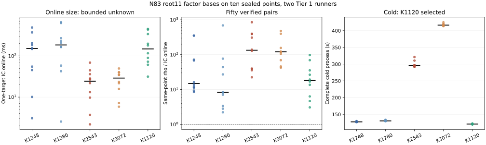

# N83 five-arm factor-base panel: 25.516 ms observed online for K2543

K2543/root11 has the lowest observed mean one-target online interval among the
five prespecified bases on ten sealed N83 points: **25.516 ms**. K3072/root11
is close at 27.312 ms. Their paired online log-ratio test gives an exact
two-sided `p=0.568359375`, so the frozen ten-comparison selection rule records
`BOUNDED_UNKNOWN` for the online factor-base choice. K1120/root11 wins the
supplementary complete cold-process comparison at 120.943 s mean. All fifty
same-point IC/rho pairs passed independent scalar replay and the Tier 1 gates;
every paired `rho_online_ms / IC_online_ms` ratio exceeds one.

| Root11 base | Actual usable points | Folded columns | Mean IC online, ms | Mean paired rho online, ms | Median paired rho/IC | Mean complete cold, s |
| --- | ---: | ---: | ---: | ---: | ---: | ---: |
| K1248 | 207,168 | 1,248 | 167.120 | 2,885.030 | 14.882 | 127.828 |
| K1280 | 212,480 | 1,280 | 243.249 | 2,236.754 | 8.307 | 130.830 |
| K2543 | 422,138 | 2,543 | **25.516** | 2,492.419 | **133.771** | 299.119 |
| K3072 | 509,952 | 3,072 | 27.312 | 2,893.297 | 120.514 | 417.454 |
| K1120 | 185,920 | 1,120 | 198.205 | 2,881.916 | 18.140 | **120.943** |

Each row contains ten distinct one-public-point workloads. An IC arm ran in a
fresh process with empty base, root index and log caches; its online interval
starts at target-dependent work and ends after scalar recovery and verification.
Its complete cold process includes base, index, log and target work. A separately
seeded rho process recovered and verified the same point for each arm. The
[point-level table](results/paired_rows.csv), [canonical IC1 run rows](results/ic1_rows_39020811188.json),
[validated aggregate](results/validated_rows.json) and [frozen selector output](results/selection.json)
retain the complete timing and correctness evidence. The plotted marks are
individual points and the black bars are medians; [plot source](results/plot.py)
and [PDF](results/panel.pdf) are versioned.

The candidate IDs, in table order, are:

* `IC1N83Ckb1a1fb207168PDP4rootRCguidedLAgaussTDdirectISO0hc9eda193920f`;
* `IC1N83Ckb1a1fb212480PDP4rootRCguidedLAgaussTDdirectISO0h69261fd42dac`;
* `IC1N83Ckb1a1fb422138PDP4rootRCguidedLAgaussTDdirectISO0h7a345a837c55`;
* `IC1N83Ckb1a1fb509952PDP4rootRCguidedLAgaussTDdirectISO0hec7ae07d8b9a`;
* `IC1N83Ckb1a1fb185920PDP4rootRCguidedLAgaussTDdirectISO0hc922b499a234`.

The fifth arm is the preregistered K1120 fallback because the earlier finalist
panel did not select an online candidate. The [protocol](PROTOCOL.md) fixed the
fixture, five-arm decision, order, caps and exact selector before this run.
The N83 curve is `EC1N83Ckb1a1haacb69ee9f37` over GF(2^83), using polynomial
integer `9671406556917033397649557`, equation `y² + xy = x³ + x² + 1`, and
prime subgroup order `8569786107849059`. Source SHA-256 was
`8a2fe55dd90dc33892c197d27260182bf783fc8212fb485d8297daf2bbba8e12`;
the public-target file SHA-256 was
`9bf9bfca72d4e82a5780759d52ac000b812ca25e831af04238983c8b72d2d777`.

## Tier 1 admission and replay

GitHub Actions [run 39020811188](https://github.com/aburan28/crypto/actions/runs/39020811188)
completed two cloud-instance strata. Half 0 measured points 0–4 on runner ID
`1000328342`, job ID `117362070751`; half 1 measured points 5–9 on runner ID
`1000328368`, job ID `117362070880`. The provider job intervals overlapped
from `10:16:04Z` to `12:08:58Z` on 2026-10-17. Both hosts passed the exposed
topology and resource checks, before/after calibration within ten percent for
each pair, event-order checks, and 25 IC plus 25 rho arithmetic replays. A
separate local verifier reproduced each cloud analysis exactly, with exit 0
and empty stderr.

The raw provider ZIPs remain outside Git under
`/Volumes/SSD990/crypto/artifacts/n83_smallk_challenge_20261017/`. Their
SHA-256 digests are, respectively,
`38a038d1f961ce7908f15bc509fa402f4c4675de6e8984833d15f05f6fbab393`
and `183e1d50bb0656bbca768cfff2c6897b6c1423a8b0cc3074c1e973e745bab998`.
The authenticated [provider job snapshot](results/provider_jobs.json) has
SHA-256 `e3586ad81b34c456de9451029218c299909e26479d8d2e88c21c08664084e700`.

The dispatched aggregator reported `VERIFICATION_FAILED` because it treated
the shared matrix-job `parent_instance_id` label as a physical runner ID.
The [original failed aggregate](results/original_failed_validated_rows.json)
and [selection](results/original_failed_selection.json) are retained. The
[provider identity replay](aggregate_identity_replay.py) recomputes those files
from the raw archives and local replay logs, checks distinct concurrent
provider runner IDs against both host receipts, and changes only the identity
gate and aggregate evidence status before rerunning the frozen selector.
Its result is `PASS_DISTINCT_CONCURRENT_RUNNERS` and `PASS_INDEPENDENT_REPLAY`.

## Paired selection and next holdout

K2543's online mean log ratio against K3072 is 0.2845 in the direction of
K2543, with descriptive 95% interval [−0.803, 1.372] and exact
`p=0.568359375`. Against K1248 and K1280, the exact online p values are
`0.02734375` and `0.0234375`; neither passes the predeclared
`0.05/10 = 0.005` threshold. The selector accordingly retains a null online
choice. K1120's mean cold advantages over K1248, K1280, K2543 and K3072 are
6.885 s, 9.887 s, 178.176 s and 296.512 s; each exact two-sided p value is
`0.001953125`, passing that same threshold.

The sealed [twelve-point final online holdout](../n83_final_online_holdout_20261017/PROTOCOL.md)
therefore takes the prespecified K1280 fallback from this panel, together with
K992 and K1107 and the earlier K992-panel fallback. It will compare those
exact candidate IDs on fresh public points with the same-point rho clock.
