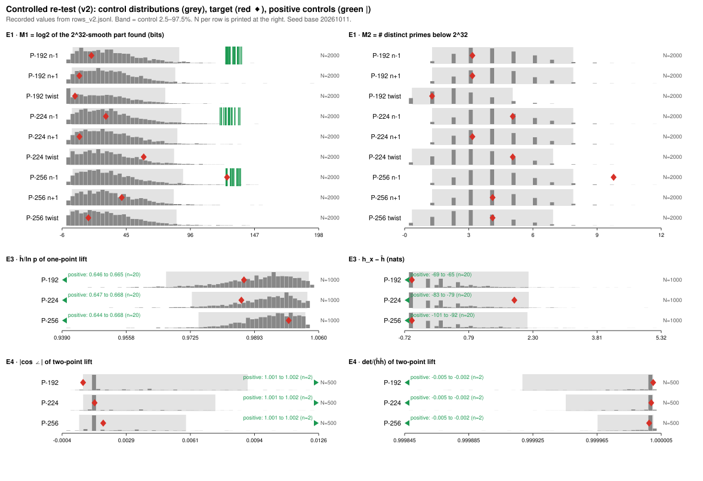

# Controlled re-test of the NIST cyclotomic / point-height note

**Date.** 2026-10-11. **What it tests.** The comparative and "nothing found"
claims of
[`RESEARCH_NIST_CYCLOTOMIC_POINT_HEIGHTS.md`](../notes/cm-isogeny/RESEARCH_NIST_CYCLOTOMIC_POINT_HEIGHTS.md)
(merged in #1655). Each claim gets a null population, a positive control and a
frozen decision rule, following
[`.claude/skills/controlled-experiment/SKILL.md`](../../.claude/skills/controlled-experiment/SKILL.md),
which this change introduces. **Status.** Measured. No attack is claimed and
no ECDLP cost changes.

## Verdicts in one table

| original claim (note §) | class | verdict (v2, pre-registered rule) |
|:--|:--|:--|
| P-256 `n − 1` is "the outlier", "a 1-in-30 accident" (§0, §2.2) | comparative | **Not established.** It ranks 1992/2000 on M1 (p = 0.009) and 1991/2000 on M2 (p = 0.010) against random Hasse-interval primes. α = 0.05/18 = 0.0028, so it is **within the control distribution**. It is more extreme than 99.6% of controls before correction. The "1-in-30" Dickman figure assumed the wrong null and is withdrawn. |
| other `n ± 1` and twist orders unremarkable (§2.2, §2.3) | comparative | **Supported.** All 8 are within the control distribution (p ≥ 0.20 on both metrics). |
| the canonical lift has no small points (§3.1) | "nothing found" | **Supported only as bounded.** The census found 90/90 planted points (integer, `d = 2`, `d = 3`), found nothing on 30 random-`b` curves, and found nothing on the NIST `b`. Licensed wording: "no point with integer x, −10^6 ≤ x ≤ 10^6, or `x = u/d²` with `d ≤ 40` and −10^5 ≤ u ≤ 10^5". "No small point" is not licensed. |
| lifted generator has `ĥ ≈ log p`, nowhere near small (§3.2) | comparative | **Supported as "typical".** `ĥ(G̃)/ln p` is within the random-point distribution on all three curves (p ≥ 0.37). The generator is an ordinary lifted point, neither large nor small. |
| two-point lift: independent and orthogonal, cos < 0.002 (§3.3) | comparative | **Independence supported, orthogonality unresolved.** det/(ĥĥ) for random pairs is 1.0000 (2.5–97.5%: 0.99992–1.00000), against −0.005 to −0.002 for exactly dependent pairs. The absolute cosine sits at the instrument's floor (below), and the dependent pairs read 1.0011–1.0025 where the truth is 1. "Zero to three decimals" is below the instrument's resolution and is withdrawn. |

Exact computations in the note (factorisations, certified `Z[t]` identities,
embedding degrees, Cheon tables) are not statistical claims and were not
re-tested.

## Protocol history (read this first)

1. **`PROTOCOL.md` (v1) was frozen before any data**, and committed in
   `b8280b445` with sha256 `2c3c8df5…6383`.
2. A small-N dry run on scratch output showed that v1 **could not reject in
   any comparative family**. Its add-one empirical tail has a minimum
   two-sided p of `2/(N + 1)`, which is above α/m for E1 (0.0050 vs 0.0028),
   E3 (0.0100 vs 0.0083) and E4 (0.0198 vs 0.0083). That is a design error.
3. **`AMENDMENT_1.md` (v2) was frozen before any protocol-N run** (commit
   `49a5e20f7`, sha256 `cbbb4e72…397a`). It raises N only, to 2000 / 1000 /
   500 by the rule `N + 1 ≥ 4m/α`, and discloses what the dry run showed,
   including P-256 `n − 1` lying beyond the dry-run controls. Discount v2
   accordingly. The skill now carries this power check.
4. Both versions ran. v1 is reported as frozen. Every v1 verdict is "within
   the control distribution", as the power failure guaranteed in advance.
   v1's control samples are exact prefixes of v2's (verified row by row for
   all 9 curve × experiment arms).

## Runs

| | v1 | v2 |
|:--|:--|:--|
| command | `cargo run --release --example nist_cyclotomic_controls -- --protocol v1` | `… -- --protocol v2` |
| source | working tree committed as `4f068fd76`; later edits only touch the figure layout in `controls_svg` | same binary |
| host | 4-vCPU Intel Xeon @ 2.80 GHz, 15 GiB, Claude Code cloud container, no isolation (wall time is not a result) | same |
| toolchain | rustc 1.98.1 | same |
| seeds | `20261011 + offset` per experiment and curve | same |
| N (E1 / E2 / E3 / E4) | 400 / 10 per arm / 200 / 100 | 2000 / not re-run / 1000 / 500 |
| positive controls | E1: 20 planted-smooth per curve. E2: 30 planted per curve. E3: 20 small-`x` per curve. E4: 2 dependent pairs per curve | same, except E2 |
| completed | all rows; wall 2804 s | all rows; wall 8966 s |
| records | `rows_v1.jsonl`, `RESULTS_v1.md`, `results_v1.json` | `rows_v2.jsonl`, `RESULTS_v2.md`, `results_v2.json` |

All numbers in the tables are measured on the recorded rows. p-values and
ranks are derived from them by the frozen rule (`rank_p` in the example). No
run failed or timed out.



*Figure (v2). Grey histograms are the control arm per row, with the
2.5–97.5% band shaded. Red diamonds are the NIST targets. Green ticks or edge
markers are the positive controls. N is printed per row. Recorded values
only. `controls_v1.svg` is the same layout for v1.*

## Observations beyond the protocol (post hoc, labelled)

These were noticed after the data. They are not pre-registered verdicts.

- **The E4 instrument has a floor.** `|cos|` piles up at 0.00128–0.00130 on
  all three curves (31–43 of 100 v1 pairs per curve hit exactly that
  value), although ĥ differs by a third between curves. The exactly
  dependent pairs read `|cos|` = 1.0011–1.0025 and det/(ĥĥ) = −0.002 to
  −0.005.

  Cause, from reading the code: `height_sequence` scales the curve to an
  integral model with `u = lcm(all denominators)`, including the point's
  own (`x.d = d²`, `y.d = d³`). It measures the naive height on that model,
  so h_x is inflated by about `2 log u` and 4⁵ doublings leave about 0.3
  nats. On E1 the integer points have `u = 1`, so E3 is unaffected. A
  follow-up protocol will measure the reduced rational `x` instead and
  re-test E4.
- **`h_x − ĥ` is discrete.** In E3 it takes a few values (−0.5493 =
  −½ ln 3, −0.2027, 0.1438, …), consistent with local correction terms at
  2 and 3. Ties are handled conservatively by the rank rule. P-256's
  generator sits exactly at the most common value.
- **Small naive height is not small canonical height.** The E3 positive
  control (points with `x < 2^32`) has `h_x/ln p` of 0.09–0.17 but
  `ĥ/ln p` of 0.64–0.67, because the lift's `B ≈ y²` is about `p²`. Note
  §3.4 equated the two and is corrected.

## What this does not show

Nothing here is a security statement. E1 is one incomplete small-factor
metric against one null model of prime-order group orders. Its
completeness below 2^32 is argued analytically: rho with 2^18 iterations
per constant misses a 32-bit prime with probability of about 3·10⁻⁴ per
constant. An ECM robustness run is a follow-up. E2 is bounded by its
census box. E3 and E4 compare against random points under one lift
construction and say nothing about adversarially chosen lifts. "Within the
control distribution" means the test did not distinguish the target from
the null at the stated α. It does not mean the target is identical to the
null.

## Checklist (`controlled-experiment` §6)

- [x] every published sentence classified (`PROTOCOL.md` §0, table above)
- [x] comparative claims have a negative-control population with a stated null
- [x] every "nothing found" has a passing positive control on the same path (E2 90/90)
- [x] one instrument, identical budgets across arms
- [x] power check: v1 failed it (reported), v2 passes it
- [x] protocol frozen with hashes recorded (`results_v*.json`); dry run on scratch output
- [x] raw rows committed; summaries recomputable
- [x] decision rule and Bonferroni correction applied as written
- [x] fixed verdict wording; scope sentence present
- [x] superseded claims corrected in place in the note, dated 2026-10-11

## Reproduce

```bash
cargo run --release --example nist_cyclotomic_controls -- --protocol v1   # ≈ 47 min on 4 vCPU
cargo run --release --example nist_cyclotomic_controls -- --protocol v2   # ≈ 2.5 h on 4 vCPU
cargo run --release --example nist_cyclotomic_controls -- --protocol v1 --plot
cargo run --release --example nist_cyclotomic_controls -- --protocol v2 --plot
sh research/nist_cyclotomic_controls_20261011/build.sh                    # REPORT.pdf
```
