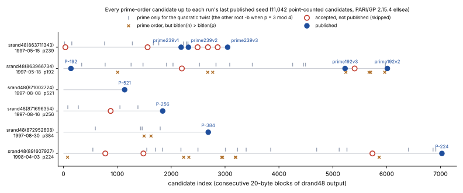

# NIST curve seed provenance: independent reproduction (2026-10-16)

**Status.** Verified provenance, not an attack. Nothing here changes the ECDLP
on any curve. Independently validated on 2026-10-17; one derived sentence was
corrected (see "Independent validation").

**Source claim.** Anthropic Frontier Red Team, *Claude reveals ECDSA curve
origins* (anthropic.com/research/ecdsa-curve-origins), and F. Valsorda, *NIST
Elliptic Curves Seeds Bounty Has Been Claimed* (words.filippo.io/seeds-solved),
both 2026-10-16. The bounty was claimed on 2026-10-15 at 01:07:51 UTC.

**Claim.** Every X9.62 / FIPS 186-2 prime-curve seed (P-192, P-224, P-256,
P-384, P-521, prime192v2/v3, prime239v1–v3) is one 20-byte block of
`(int)(drand48() * 256)` output after `srand48(t)`, with `t` a UNIX time between
May 1997 and April 1998. Each block is tried as an X9.62 seed. Four of the five
binary-curve seeds (B-233, B-283, B-409, B-571) are five `lrand48()` words after
`srand48(t / 2)` on 1998-04-17. The base points of P-192, prime192v2/v3 and
prime239v1–v3 come from Lenstra's FreeLIP `zrandom` with seeds 20000–20517.



*Figure: recorded census outcomes (`census/summary.json`, written by
`classify.gp` from `census/orders_*.txt`); laid out by `plot_streams.py`.
Filled dots: published seeds. Open circles: candidates that pass every known
check but were not published. Crosses: prime order rejected because `n` has
more bits than `p`. Ticks: only the quadratic twist has prime order.*

## What this repository verifies natively

`src/cryptanalysis/nist_seed_provenance.rs` (Rust, no Python):

```text
cargo test --release --lib nist_seed_provenance
```

| test | what it checks |
|---|---|
| `every_prime_seed_is_a_drand48_block` | all 10 prime seeds regenerated from `srand48(t)` at the stated block; every `t` lies in 1997–98 |
| `every_prime_seed_satisfies_x962_with_published_b` | `r(seed)·b² ≡ −27 (mod p)` for all 10 (X9.62 A.3.3.1, `a = −3`) |
| `four_binary_seeds_are_lrand48_words` | B-233/283/409/571 regenerated; doubled `srand48` arguments fall on 1998-04-17 |
| `walking_back_from_a_seed_block_reaches_its_srand48_state` | the LCG inverse walks the P-256 seed state back to `srand48(871696354)` |
| `a_published_seed_is_not_an_earlier_block_of_its_run` | control: neither the previous block nor the next second's run matches |

## The census (Rust enumeration, PARI/GP point counting)

For every block of each run, up to the run's last published seed:

1. `examples/nist_seed_candidates.rs` derives the X9.62 value `r` and keeps
   the blocks where `b² = −27/r` is a square.
2. `sea_census.gp` point-counts the curve with `b0 = b²^((p+1)/4)` (any root
   when `p ≡ 1 mod 4`) and its quadratic twist, using `ellsea` early abort.
3. `classify.gp` applies the criteria of Valsorda's `seeds.go`: prime order,
   `bitlen(n) ≤ bitlen(p)`, `n ≠ p`, and `p^k ≢ 1 (mod n)` for `k < 2^10`.

```text
research/nist_seed_provenance_20261016/census.sh <srand48 value> <blocks> <p in decimal>
```

The full run took about 1.5 CPU-hours on 4 cores with PARI/GP 2.15.4 and the
seadata package (`apt-get install pari-gp pari-seadata`). Checks of the
native pipeline:

- The Rust enumerator's candidate lists are byte-identical to those of the
  original (external) enumeration for all six runs.
- `census.sh` re-run on the P-256 run (about 2 minutes on 4 cores) reproduced
  `census/orders_871696354.txt` byte for byte.
- `classify.gp` on the six recorded files gives the table below. Recorded outputs:
`census/orders_<run>.txt` (`i N0 Nt`, 0 = early abort) and
`census/summary.json`. **Measured:**

| `srand48(t)` | date (UTC) | field | blocks | `b` exists | twist only prime | `n` longer than `p` | accepted | published / skipped | matches post |
|---|---|---|---:|---:|---:|---:|---:|---:|---|
| 863711343 | 1997-05-15 15:49:03 | p239 | 3,048 | 1,555 | 9 | 0 | 8 | 3 / 5 | yes |
| 863966734 | 1997-05-18 14:45:34 | p192 | 6,013 | 3,061 | 14 | 7 | 5 | 3 / 2 | yes |
| 871002724 | 1997-08-08 01:12:04 | p521 | 1,136 | 584 | 0 | 0 | 1 | 1 / 0 | yes |
| 871696354 | 1997-08-16 01:52:34 | p256 | 1,842 | 960 | 4 | 0 | 2 | 1 / 1 | yes |
| 872952608 | 1997-08-30 14:50:08 | p384 | 2,688 | 1,337 | 4 | 2 | 1 | 1 / 0 | yes |
| 891607927 | 1998-04-03 12:52:07 | p224 | 7,026 | 3,545 | 16 | 8 | 4 | 1 / 3 | yes |
| **total** | | | **21,753** | **11,042** | **47** | **17** | **21** | **10 / 11** | **21 of 21** |

Derived observations:

- The rule "reject when `bitlen(n) > bitlen(p)`" removed 17 prime-order
  candidates. It can never apply at p239 or p256, where `p` lies too far below
  a power of two.
- On every curve with `p ≡ 3 (mod 4)` (nine published curves), `b` is the
  `(p+1)/4` root (2^−9 by chance). That is the root exponentiation returns,
  so the 1997 code never tried `−b`, which would have given the twist. In the
  five `p ≡ 3 mod 4` runs, 31 candidates have a prime twist order but a
  composite curve order. 26 of them would pass the criteria on the twist, so
  26 seeds were lost this way. The other five fail `bitlen(n) ≤ bitlen(p)` on
  the twist: p192 candidates 774, 1477, 3506 and 4492, and p384 candidate
  1432. *(Corrected 2026-10-17. This sentence used to say "In the four
  `p ≡ 3 mod 4` runs, 31 seeds were lost". There are five such runs; p521
  has no twist-only candidates. CORR-20261016-10d498.)*
- P-224's `b` is the negative of the Tonelli–Shanks root taken with the
  smallest non-residue (11). The sign is irrelevant there (`p ≡ 1 mod 4`).

## How strong the attribution is (derived)

- **The generator.** A 48-bit LCG state that regenerates all 160 bits of a
  seed occurs by chance with probability about 2^48 / 2^160 = 2^−112, so a
  match proves the seed is drand48 output.
- **The timestamps.** Walking the state backwards hits a state of the
  `srand48` form (low 16 bits `0x330E`) every 65,536 steps. Within 8,000
  blocks, at most one such state is block-aligned. For each of the ten seeds
  that state is the claimed 1997–98 timestamp, and two triples of seeds land
  on identical values. A random 32-bit value falls in 1997–98 with
  probability 0.0147, so six such dates by chance have probability about
  10^−11.

This attribution was established outside the repository by lattice state
recovery from the seed alone (see "External analyses"). The native test above
checks the forward direction and the inverse step.

## Security consequences (derived)

| source of freedom | choices | bits |
|---|---:|---:|
| start time anywhere in 1997–98 | 63,072,000 s | 25.9 |
| which accepted candidate to publish (generous: any of the first 16) | 16 | 4.0 |
| **total per curve** | ~10^9 | **~30** |
| Bernstein–Lange seed-grinding scenario (as relayed by Valsorda; Koblitz–Menezes 2015/1018 not retrievable here) | ~10^21 | ~70 |

In the four single-curve runs, the published seed is the 1st, 1st, 2nd and 4th
accepted candidate. Unchanged:

- ECDLP hardness, which never depended on the seed's origin.
- Shor.
- Twist and invalid-curve pitfalls. P-224's twist rho cost is about 2^58.5:
  the largest prime factor of the twist order is about 2^117.
- Base points: in a prime-order group the choice of generator does not affect
  ECDSA or ECDH.
- The binary curves are deprecated (SP 800-186). B-163 is about 80-bit.

## External analyses (outside the repository, Python + PARI/GP; not repository measurements)

These ran in a standalone session with Python 3 (`gmpy2`, `fpylll`) and
PARI/GP. Under `AGENTS.md` ("Implementation language: no Python") they are
reported here as observations with their provenance, not as repository
evidence. The skip-filter protocol was frozen before any curve order was seen:
`PREREGISTRATION.md`, verbatim. *(Note 2026-10-17: that timing comes only
from the file's own dates. The file was first committed in the same commit as
the census data, so the repository history cannot confirm it. The independent
validator therefore ruled it inconclusive, not refuted (VAL-20261016-cd9156,
joint J7).)*

**Why about half the valid candidates were skipped (10 published vs 11
skipped).** Not explained:

| hypothesis | result |
|---|---|
| RNG consumption between candidates (5 models, e.g. Tonelli–Shanks drawing non-residues from the same stream) | refuted: every model leaves published seeds untried (best 7 of 10) |
| Elkies-only SEA giving up (Elkies coverage at L = 50…300) | no separation; slight lean to *fewer* Elkies primes among published (best p = 0.008, Bonferroni bound 0.004) |
| twist smoothness; structure of `n ± 1` | no separation |
| 53 residue and character features (t, n mod 3/4/8; Kronecker symbols of `t² − 4p`; properties of `b`, `c`) | no perfect split; closest: `t ≡ 1 (mod 8)` in 0 of 10 published, 6 of 11 skipped |
| too-tight Hasse sanity check, `|t|/(2√p)` (post hoc, labelled) | medians 0.27 vs 0.31, p = 1.0 |
| round-robin bookkeeping (rank residues mod 2, 3, 4) | never disjoint |

**The unexplained values.** A seed-agnostic lattice scan looked for
drand48-family structure (`(state >> s) mod 2^w`, all `w ∈ {8, 15, 16, 24, 31,
32}`, all shifts, offsets, word orders, byte swaps, and lrand48 31-bit words in
32-bit slots) and for FreeLIP `zrandom` limbs (26-bit limbs of a 107-bit state,
read through the mod-`p` reduction). It covered the B-163 seed and every
unexplained base-point coordinate. All four positive controls were found,
including synthetic FreeLIP base points on P-384 and P-521 with arbitrary
seeds. Results:

- No hits on the 19 targets.
- P-384 and P-521 `G` are not FreeLIP output under the May 1997 recipe for
  any generator seed.
- P-224 and P-256 `G` are not drand48-family output. The FreeLIP test cannot
  see them through the reduction.
- The sign of `Gy` on the six FreeLIP base points is not the fixed root (3 of
  6), and no single bit of the next generator outputs predicts it.

## Independent validation (2026-10-17)

A blind validator in `aburan28/crypto-autoresearcher` checked this bundle
(VAL-20261016-cd9156, merged in crypto-autoresearcher #2305). It built its
own drand48, lrand48 and X9.62 code from the public specifications. It never
opened this repository's sources. Its sample rows were drawn from a nonce
derived from the freeze commit.

- **Verdict.** Joints J1–J6 hold; J7 is inconclusive. Of 30 checks, 28
  passed, 1 raised a concern and 1 was not run. The concern (J4-3) is the
  31-versus-26 sentence corrected above. The check not run (J6-4) was running
  this repository's native Rust tests, which the blind plan excluded.
- **Seeds.** All ten prime seeds were re-derived from `(t, block)`, and all
  ten satisfy the X9.62 relation. All four binary seeds were re-derived as
  `lrand48` words.
- **Walk-back.** Each of the ten seeds walks back to exactly one
  block-aligned `srand48` state, and that state is the claimed `t`. Random
  strings give none. Positive controls: 10 of 10.
- **Census.** All 11,042 rows were re-counted independently, with 0
  mismatches. In 466 rows, the twist count recorded here is composite where
  the validator's count aborted early; each of those equals `2(p+1) − N0`.
  Full point counts on 289 rows (85 named, 204 sampled) also gave 0
  mismatches. 21 of 21 accepted candidates agree with the posts.
- **Root choice.** The `(p+1)/4` root holds on 9 of 9 curves. P-224's `b`
  is the negated Tonelli–Shanks root with `z = 11`.
- **Files.** 14 of 14 bundle hashes match.

The validator shares PARI/GP's SEA with this census, so the composite rows
are empirical only. There was one reviewer and no red team.

Records in `aburan28/crypto-autoresearcher`:

- **Evidence: EV-SCURVE-e9d71b.**
  - Generator facts: replicated.
  - Native-test description: preliminary (the tests were not run).
  - Walk-back attribution: strong.
  - Census: strong, with this one sentence corrected.
  - Root choice: replicated.
  - External analyses: no strength assigned.
- **Decision: DEC-20261016-82753f,** `support`, scoped to provenance.
- **Correction: CORR-20261016-10d498.**
- **Finding: KN-FIND-cee88d.**


*Figure: in each run, the candidates with only a prime twist order (light)
and those that would pass the criteria on the twist (dark). P-224 has
`p ≡ 1 (mod 4)`, so `−b` gives an isomorphic curve and cannot reach the
twist. Values below (recorded by the validator in `out/j4_lost_criteria.json`).
The figure was drawn by `render_figures.py` beside crypto-autoresearcher's
`review-DEC-20261016-82753f/report.md`.*

| run | field | p mod 4 | twist-only | pass on twist | fail bitlen |
|---|---|---:|---:|---:|---|
| 863711343 | p239 | 3 | 9 | 9 | – |
| 863966734 | p192 | 3 | 14 | 10 | 774, 1477, 3506, 4492 |
| 871002724 | p521 | 3 | 0 | 0 | – |
| 871696354 | p256 | 3 | 4 | 4 | – |
| 872952608 | p384 | 3 | 4 | 3 | 1432 |
| 891607927 | p224 | 1 | 16 | (9; not reachable) | 546, 2497, 3848, 4700, 5119, 6406, 6912 |
| **p ≡ 3 mod 4 total** | | | **31** | **26** | **5** |

## Open

- The skip filter.
- The B-163 seed.
- The base points of P-224, P-256, P-384, P-521 and the binary curves.

None of these bears on ECDLP hardness.

## Files

| file | what it is |
|---|---|
| `README.md`, `report.pdf` | this report; PDF with the figure |
| `streams.svg`, `streams.png`, `plot_streams.py` | figure, its 150 dpi render, its plotting-only source |
| `census.sh`, `sea_census.gp`, `classify.gp` | census driver (shell), point counting and classification (GP) |
| `census/orders_<run>.txt`, `census/summary.json` | recorded point counts (11,042 lines) and classifier output |
| `PREREGISTRATION.md` | skip-filter protocol, frozen before the census was read (self-dated; see the 2026-10-17 note) |
| `validation_twist_bookkeeping.svg`, `.png` | the validation figure, copied from crypto-autoresearcher `review-DEC-20261016-82753f/fig3-twist-bookkeeping.*` |
| `../../examples/nist_seed_candidates.rs`, `../../src/cryptanalysis/nist_seed_provenance.rs` | native enumeration and tests |
