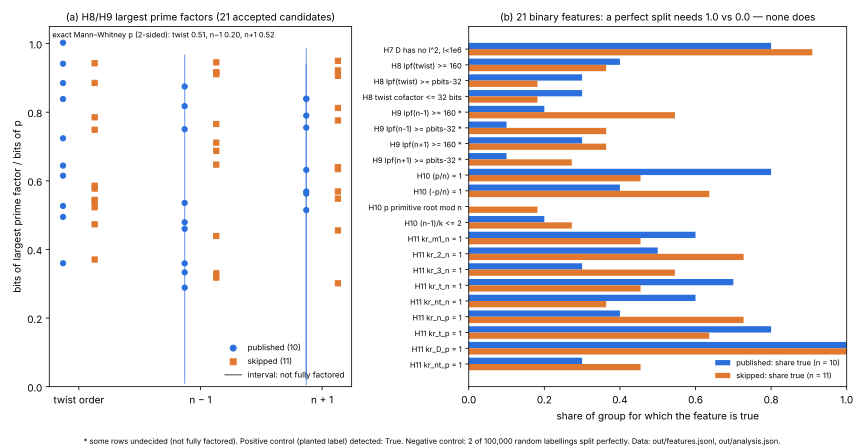

# NIST seed skip filter: new deterministic features (2026-10-17)

**Status.** Measured negative result. None of the 21 new preregistered binary
features explains why 11 of the 21 valid seed candidates were not published.
This is about the provenance of the NIST seeds. It has no bearing on ECDLP
hardness.

**Question.** The 1997–98 runs that produced the NIST/X9.62 prime-curve seeds
accepted 21 candidates under every known criterion (prime order,
`bitlen(n) ≤ bitlen(p)`, MOV, not anomalous). Only 10 of them were published.
The rule that skipped the other 11 is the open question raised by the
Anthropic and Valsorda posts of 2026-10-16. The study before this one,
[`../nist_seed_provenance_20261016/`](../nist_seed_provenance_20261016/README.md),
reproduced the census and ruled out about 60 features (H1–H6: Elkies
coverage, twist smoothness, small factors of `n ± 1`, residues, `b`/`c`
properties and RNG consumption). This study tests features no one had tried.

## Protocol

[`PREREGISTRATION.md`](PREREGISTRATION.md) was committed and pushed
(`3586810ea`) **before** any feature was computed, which answers the timing
concern raised against the previous protocol (J7). Every feature is a function
of `(p, n)` only. The `n` values are the census's recorded orders.

| family | features |
|---|---|
| H7 endomorphism ring | `Z[π]` maximal at every odd `l < 10^6` (no `l²` divides `D = t² − 4p`) |
| H8 twist security | largest prime factor of the twist order `≥ 160` bits, `≥ bitlen(p) − 32`, cofactor `≤ 32` bits |
| H9 `n ± 1` | largest prime factor of `n − 1` and of `n + 1`, at the same two thresholds |
| H10 shortcut MOV test | `(p/n) = 1`, `(−p/n) = 1`, `p` a primitive root mod `n`, `(n − 1)/ord_n(p) ≤ 2` |
| H11 cross characters | `(x/n)` for `x ∈ {−1, 2, 3, t, n'}`; `(y/p)` for `y ∈ {n, t, D, n'}` |

## Results (measured)

`features.gp` computes the features and `analysis.gp` applies the decision
rule. Records: `out/features.jsonl`, `out/analysis.json`, `out/analysis.txt`.
Wall time: 40.6 min for the features on 4 cores (mostly the P-384/P-521
factorisations), 1.3 min for the analysis. PARI/GP 2.15.4.

*Figure: (a) Bit length of the largest prime factor of the twist order,
`n − 1` and `n + 1`, divided by `bitlen(p)`, for published (blue) and
skipped (orange) candidates. Vertical lines are recorded intervals where
factoring did not finish in 600 s. (b) For each binary feature, the share of
each group for which it is true. Drawn by `plot_features.py` from the two
records.*

- **Binary.** 0 of 21 features split published from skipped perfectly.
  Strongest leans (partial, not claimed):
  - `(p/n) = 1`: 8/10 published, 5/11 skipped.
  - `lpf(n − 1) ≥ 160`: 2/10 published, 6/11 skipped.
  - `(n/p) = 1`: 4/10 published, 8/11 skipped.
- **Continuous.** Exact Mann–Whitney over all C(21,10) labellings:
  - twist: p = 0.51
  - `n − 1`: p = 0.20
  - `n + 1`: p = 0.52
  - count of `l²` dividing `D`: p = 0.59

  None is significant even before the Bonferroni correction over 4 tests.
- **Positive control.** A planted label, the 10 smallest values of
  `n mod 2^20`, was detected by the same code.
- **Negative control.** In 100,000 random relabellings (10 of 21), some
  binary feature in this family split perfectly 2 times, a family-wise rate
  of 2·10⁻⁵. The family therefore had the power to show a perfect split, and
  a chance split was unlikely.
- **Unfactored rows (600 s limit).** Recorded as intervals: P-521 `n + 1`,
  P-384 `n − 1` and `n + 1`. All are on published curves. They make 1–2
  thresholds undecided for those rows, which only blocks a split; it cannot
  create one.
- **Cross-checks.** The largest prime factor of the twist order is 241 bits
  for P-256 and 118 bits for P-224. Both agree with known values (P-224's
  twist rho cost of about 2^58.5 in the earlier README).

## Deviations and caveats

- `kronecker(D, p) = 1` holds for every curve, because `D ≡ t² (mod p)`. That
  feature was included by mistake and could never split anything.
- "`p` a primitive root mod `n`" and "`ord_n(p) = n − 1`" are the same
  condition and are reported once.
- "Twist cofactor ≤ 32 bits" is computed as
  `bitlen(n') − bitlen(largest prime factor) ≤ 32`, which can be off by one bit.
- A bug in `features.gp` (an `if` comma that inverted the "fully factored"
  flag) was found and fixed before any analysis ran. The full run was then
  repeated from scratch. The factor bit lengths were unaffected.
- The analysis code was written after the preregistration. Its parser fix (GP
  does not allow nested braces) changed no rule.

## What this leaves

The skip rule is still unexplained. The previous study and this one together
have ruled out about 80 deterministic features of `(p, n, b, c, seed)`. A
feature-based search has a limit: a 50% rule that a selector could have
applied is often not a function of the curve at all. Two hypotheses fit every
observation so far, and no exact computation can test them:

1. **A randomised check outside the seed stream.** For example, a "pick a
   random point and test `[n]P = O`" step that took a square root without
   first checking that `f(x)` is a square, so that about half of all curves
   fail. Such a step would have to draw from a separate generator, because
   the published seeds sit at exact 20-byte block offsets, so no draw from
   the seed stream came between candidates.
2. **Manual choice** from a printed list.

Each run's last published candidate is also the last index searched. That is
consistent with a program that stops after `k` passes (`k = 3` for the
X9.62 runs with v1–v3, `k = 1` otherwise). The posts do not say whether the
runs continued, so this is not evidence.

## Files

| file | what it is |
|---|---|
| `PREREGISTRATION.md` | hypotheses and decision rule, committed before computing |
| `features.gp`, `run_features.sh` | feature computation (GP) and driver |
| `analysis.gp` | decision rule, exact Mann–Whitney, controls (GP) |
| `out/features.jsonl`, `out/analysis.json`, `out/analysis.txt` | records |
| `features.svg`, `features.png`, `plot_features.py` | figure, 150 dpi render, plotting-only source |
| `report.typ`, `report.pdf` | PDF report with the figure |

Reproduce from the repository root (about 40 minutes on 4 cores):
`research/nist_seed_skip_filter_20261017/run_features.sh`.
