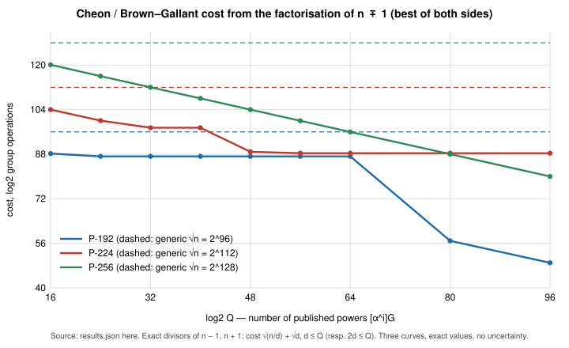

# Research Note: Cyclotomic Factorisation of P-192, P-224, P-256 — What Reaches the Points, and Point Heights

**Date.** 2026-10-11.  **Status.** Derived and natively verified; no attack
claimed, no ECDLP cost measured.  Closes open items 4 and 5 of
[`RESEARCH_NIST_SOLINAS_STRUCTURE.md`](RESEARCH_NIST_SOLINAS_STRUCTURE.md)
and corrects one line there and in
[`docs/ECDLP_CALIBRATION_PRIMES.md`](../../../docs/ECDLP_CALIBRATION_PRIMES.md).
**Code.** `examples/nist_cyclotomic_point_heights.rs` (Rust; `num-bigint`,
`curve_traits::arith`, `identity_certificate`).  **Evidence.**
[`research/nist_cyclotomic_point_heights_20261011/`](../../nist_cyclotomic_point_heights_20261011/):
`RESULTS.md` (every table below, regenerated by the example), `results.json`,
four `identity_*.json` certificates, `cheon_cost.svg`, `structure.svg`,
`REPORT.pdf`, `build.sh`.

Curves are the FIPS 186 / SEC 2 curves `P-192`, `P-224`, `P-256`
(`y² = x³ − 3x + b`, prime order `n`, generator `G`); the registry slugs for
P-192 and P-256 are in `docs/curves/registry.json`.

---

## 0. The question, and the one-paragraph answer

*Does the cyclotomic structure of the NIST primes change the complexity of
anything on the point group `E(F_p)`, and do lifted points have unusually
small heights?*

**No, on both counts, and the note now says precisely why with numbers.**
Each prime is `f(2^32)` for a sparse Solinas polynomial `f`, and `f ± 1`
factors in `Z[t]` with cyclotomic factors `Φ_1, Φ_2, Φ_4` that force small
prime factors of `p ± 1` (§1).  **That includes P-256**, whose `p + 1 =
2^96 (2^64 + 1)(2^96 − 2^64 + 1)` has largest prime factor 94 bits —
contrary to the "no clean factorisation" line in two earlier documents.
The structure lives in `F_p^*` and `F_{p²}^*`.  It reaches `E(F_p)` only
through the embedding degree, which is `(n − 1)/10`, `(n − 1)/3`,
`(n − 1)/3` for the three curves (§2), so it never arrives.  The integers
that *do* act on the points — `n ∓ 1` (Cheon / Brown–Gallant), the twist
order `N(Φ_2(π))`, and the cyclotomic norms `N(Φ_d(π))` that factor
`#E(F_{p^k})` — are not algebraically forced by the Solinas form; they are
arithmetic accidents of each curve, and the one notable accident is P-256's
`n − 1`, whose twelve prime factors are all at most 92 bits (§2.2).  On
heights (§3): the canonical lift `y² = x³ − 3x + b` has no integer or
small-denominator rational point in a census of `9.8·10⁶` candidates per
curve (expected `10⁻²²`–`10⁻³²`), the generator lifted xedni-style has
canonical height `ĥ = (0.986–0.998)·log p` with the Lang ratio
`ĥ / log|Δ| ≈ 1/6`, and a two-point lift has regulator `≈ ĥ(G̃)ĥ(R̃)` with
pairing cosine `< 0.002`: lifted points are as large and as independent as
a random point can be.  A point of `E(F_p)` has a lift of naive height
`≤ H` nats only when `|x| ≤ e^H` or `|x − p| ≤ e^H`, i.e. the small-height
points *are* the small-`x` factor base of
[`RESEARCH_PRIME_FIELD_BREAKTHROUGH_PROGRAM.md`](../../../RESEARCH_PRIME_FIELD_BREAKTHROUGH_PROGRAM.md),
whose reach is already bounded there.

Everything in §1–§3 is recomputed or verified by the example (polynomial
identities by exact expansion and sealed as `identity.certificate/v1`
records; integer factorisations by product and Miller–Rabin on each factor;
heights by the `4^{-k} h_x([2^k]P)` limit, which agrees with PARI's
`ellheight` to the printed digits).  The one fact below that is a PARI
cross-check only, not reproduced natively, is labelled as such (§3.1).

## 1. Algebraic (cyclotomic) factorisation of `p ± 1`

With `t = 2^32`:

| curve | `f(t)` | `f − 1` | `f + 1` |
|:--|:--|:--|:--|
| P-192 | `t⁶ − t² − 1` | `t⁶ − t² − 2`, irreducible | `t² · Φ_1 Φ_2 Φ_4 = t²(t⁴ − 1)` |
| P-224 | `t⁷ − t³ + 1` | `t³ · Φ_1 Φ_2 Φ_4 = t³(t⁴ − 1)` | `t⁷ − t³ + 2`, irreducible |
| P-256 | `t⁸ − t⁷ + t⁶ + t³ − 1` | `Φ_1 Φ_2 · (t⁶ − t⁵ + 2t⁴ − t³ + 2t² + 2)` | `t³ · Φ_4 · (t³ − t² + 1)` |

Certificates (`identity.certificate/v1`, 64 points over `F_{2^61−1}`,
degree bound 8, so a false identity passes with probability
`< 2^{-61·64+…}`; the exact `Z[t]` expansion in the example is the
independent check): P-192 `f + 1` `IDC1h52442d0716847371`; P-224 `f − 1`
`IDC1h7d04feed32d16d24`; P-256 `f − 1` `IDC1h8c257e9ef061103a`; P-256
`f + 1` `IDC1h923abc2d4d3a80f4`.

The integer consequence (full factorisations, discovered with PARI 2.17 and
verified natively; largest prime factor in bits):

| curve | `p − 1` | largest | `p + 1` | largest |
|:--|:--|--:|:--|--:|
| P-192 | `2 · 59 · 149309 · 11393611 · 108341181769254293 · 288626509448065367648032903` | 88 | `2^64 · 3 · 5 · 17 · 257 · 641 · 65537 · 274177 · 6700417 · 67280421310721` | 46 |
| P-224 | `2^96 · 3 · 5 · 17 · 257 · 641 · 65537 · 274177 · 6700417 · 67280421310721` | 46 | `2 · 41 · 2671 · 10637177 · 78987407 · 146503177923784692041805407165164772746256602529` | 157 |
| P-256 | `2 · 3 · 5² · 17 · 257 · 641 · 1531 · 65537 · 490463 · 6700417 · 835945042244614951780389953367877943453916927241` | 160 | `2^96 · 7 · 274177 · 67280421310721 · 11318308927973941931404914103` | 94 |

Reading the algebra off the numbers: `Φ_1Φ_2Φ_4(2^32) = 2^128 − 1 =
3·5·17·257·641·65537·274177·6700417·67280421310721` is the whole odd part
of P-224's `p − 1` and of P-192's `p + 1`; for P-256, `Φ_1Φ_2(2^32) =
2^64 − 1` contributes `3·5·17·257·641·65537·6700417` to `p − 1` and
`Φ_4(2^32) = 2^64 + 1 = 274177 · 67280421310721` together with
`2^96 − 2^64 + 1 = 7 · 11318308927973941931404914103` make up `p + 1`.
The irreducible cofactors (`t⁶ − t² − 2`, `t⁷ − t³ + 2`, the P-256
sextic) carry the large primes; their factorisations are accidents.

**Correction.** `docs/ECDLP_CALIBRATION_PRIMES.md` §2 and
`RESEARCH_NIST_SOLINAS_STRUCTURE.md` §2 listed the 5-term P-256 shape as
"no clean cyclotomic factorisation".  The 5-term shape
`2ⁿ − 2ᵃ + 2ᵇ + 2ᶜ − 1` has `p + 1 = 2ᶜ(2^{n−c} − 2^{a−c} + 2^{b−c} + 1)`,
and for P-256's exponents `(a, b, c) = (224, 192, 96)` the bracket is
`(2^64 + 1)(2^96 − 2^64 + 1)`.  This is specific to P-256's exponents (it
needs `n − c = a − c + b − c`, i.e. `n + c = a + b`, which `256 + 96 =
224 + 192` satisfies), so the *family* row stays "no forced factor" but
the NIST anchor does not.  Both documents are amended in this change.

**Where it acts.** Pohlig–Hellman in `F_p^*` costs about the square root
of the largest factor of `p − 1`: `2^44` for P-192, `2^23` for P-224,
`2^80` for P-256 (where NFS at 256 bits is cheaper anyway).  In
`F_{p²}^*`, order `(p − 1)(p + 1)`, the largest factors are 88, 157 and
160 bits.  None of this is an ECDLP statement; it says these primes must
not double as finite-field DLP moduli, which
`RESEARCH_NIST_SOLINAS_STRUCTURE.md` §5 already concluded for P-224.

## 2. What reaches the point group

### 2.1 Embedding degree — the only bridge, and it is closed

`ord_n(p)`, computed exactly from the complete factorisation of `n − 1`:

| curve | `ord_n(p)` | bits |
|:--|:--|--:|
| P-192 | `(n − 1)/10` | 189 |
| P-224 | `(n − 1)/3` | 223 |
| P-256 | `(n − 1)/3` | 255 |

This replaces the lower bounds in the repository (`> 10⁸` in
`docs/guides/P256_PROPERTIES.md`, `> 1000` in the P-192 walk) with exact
values.  The smoothness of `p ± 1` sits in `F_p^*` and `F_{p²}^*`; the
pairing lands in `F_{p^k}` with `k ≈ 2^{188}`–`2^{254}`.  There is no path.

### 2.2 `n ∓ 1` — Cheon / Brown–Gallant, the one place the points feel a factorisation

`n = p + 1 − t` with a 95/112/127-bit trace, so the Solinas form forces
nothing about `n ∓ 1`.  Complete factorisations:

| curve | `n − 1` | largest | `n + 1` | largest |
|:--|:--|--:|:--|--:|
| P-192 | `2^4 · 5 · 2389 · 9564682313913860059195669 · 3433859179316188682119986911` | 92 | `2 · 3 · 41 · 116696426742853568300653 · 218658569360579814643606926178439` | 108 |
| P-224 | `2² · 3⁶ · 5 · 17 · 2153 · 50520606258875818707470860153287666700917696099933389351507` | 196 | `2 · 7 · 19 · 641707280681 · 157943015469068292359817151928968170360745244072702747` | 177 |
| P-256 | `2^4 · 3 · 71 · 131 · 373 · 3407 · 17449 · 38189 · 187019741 · 622491383 · 1002328039319 · 2624747550333869278416773953` | 92 | `2 · 5 · 1879 · 176337611 · 34946779280882916835155272231706129710560967816144871596921775673` | 215 |

P-256's `n − 1` is the outlier: twelve prime factors, none above 92 bits,
smooth part (everything but the largest prime) `2^{164}`.  For a random
256-bit integer the probability that the largest prime factor is below
`2^{92}` is Dickman `ρ(256/92) ≈ 0.03`, so this is a 1-in-30 accident,
not a design artefact.  P-224's smooth part is `2^{28}`, P-192's `2^{100}`
but with nothing usable between `2^{17.5}` and `2^{83}`.

Where it matters: a protocol that publishes `[α^i]G` for `i ≤ Q` (`q`-SDH
setups, powers-of-tau; **not** ECDSA or ECDH) lets Cheon solve for `α` in
`√(n/d) + √d` operations for any `d | n − 1` with `d ≤ Q` (or `d | n + 1`
with `2d ≤ Q`).  Best divisor and cost in bits (`√n` generic is 96 / 112 /
128):

| `log2 Q` | P-192 | P-224 | P-256 |
|--:|--:|--:|--:|
| 16 | 88.2 | 104.0 | 120.1 |
| 32 | 87.2 | 97.5 | 112.0 |
| 48 | 87.2 | 88.9 (`n + 1` side) | 104.0 |
| 64 | 87.2 | 88.4 (`n + 1` side) | 96.0 |
| 80 | 56.9 (`n + 1`, `d = 2^{78}`) | 88.4 | 88.0 |
| 96 | 49.0 | 88.4 | 80.0 |



P-256 gives up exactly `log2(Q)/2` bits for every `Q` up to `2^{96}`,
because `n − 1` has a divisor within a factor 1.05 of every power of two
in that range; P-224 is capped at 23.6 bits of saving however many powers
are published.  This is consistent with, and extends, the `Q ≤ 2^{32}` /
`Q ≤ 2^{64}` columns of
[`RESEARCH_TORSION_AUXILIARY_INPUTS.md`](../ecdlp-general/RESEARCH_TORSION_AUXILIARY_INPUTS.md)
§"What a leak would buy", which stopped at trial division plus bounded rho.
It is also the correction to
`docs/guides/ELLIPTIC_CURVE_ATTACKS_AND_TYPES_GUIDE.md` §3.8, which wrote
the Cheon parameter as a divisor of `p − 1`; it divides the *group order*
side `n ∓ 1`, which is why the `p ± 1` smoothness of §1 buys Cheon nothing.

### 2.3 Cyclotomic factorisation *of the points*: `#E(F_{p^k}) = ∏_{d | k} N(Φ_d(π))`

The honest meaning of "cyclotomic factorisation over the points" is the
Frobenius one.  With `π² − tπ + p = 0`, `#E(F_{p^k}) = ∏_{d|k} N_d`,
`N_d = N_{Q(π)/Q}(Φ_d(π))`, verified against `p^k + 1 − V_k(t, p)` for all
`k ≤ 12`; `N_1 = n`, `N_2 = p + 1 + t` is the twist order.  Trial division
plus bounded rho on each `N_d` (`P` probable prime, `C` unsplit composite,
subscripts are bit lengths):

| `d` | P-192 | P-224 | P-256 |
|--:|:--|:--|:--|
| 2 (twist) | `23 · P95 · P95` | `3² · 11 · 47 · 3015283 · 40375823 · 267983539294927 · P118` | `3 · 5 · 13 · 179 · P241` |
| 3 | `2² · 10453 · 551527921513 · C330` | `2² · 719746610461 · C407` | `2² · 606116377 · 635514031 · C452` |
| 4 | `5 · 13 · P378` | `C448` | `13 · 10657 · 318281 · 842272153 · C447` |
| 6 | `2² · 181 · 223 · C367` | `2⁴ · 3² · 5² · 17² · 877 · C419` | `2² · 3³ · 43 · 76213 · 3655760077 · P452` |
| 12 | `2² · 13 · C763` | `2² · 16674781 · C871` | `2² · 373 · 1908157 · C993` |

(The twist rows are the complete factorisations from §2.2's run; the
others are what budget `2^{16}` rho splits.)  Nothing here is small
enough to matter: every `N_d` with `d ≥ 3` keeps a cofactor of at least
330 bits, and the only `d ≥ 3` subgroup an attacker could even address is
the one `E(F_p)` itself sits in.  The twist orders restate the known
twist-security picture — P-224's twist has a 118-bit largest factor (an
invalid-curve attack recovers the key in about `2^{59}` work if points
are not validated), P-192's 95 bits, P-256's 241 bits.

### 2.4 Trace and CM discriminant, for completeness

`t`: `89 · 179 · 383 · 6196490257 · 835990267859` (P-192),
`17626237 · 55872356921 · 4806058943693873` (P-224),
`113 · 2521 · 12713 · 3450079 · 7138040046852502726273` (P-256).
`4p − t²`: `5 · 11 · 31 · P184`, `3³ · 29 · 79 · 7523 · 40927 ·
11549194661 · P149`, `3 · 5 · 456597257999 · 1428624589419343516204097 ·
P136`.  The fundamental discriminants are huge and the class numbers
`≈ 2^{125}`-scale, as `docs/guides/P256_PROPERTIES.md` §2 and the P-192
walk already record; no new isogeny-graph fact, and no canonical graph
changes.

## 3. Point heights

### 3.1 The canonical lift has no small points

`E_b/Q : y² = x³ − 3x + b` with the integer `b ∈ [0, p)`;
`Δ = −432 (b − 2)(b + 2)`, `log2|Δ| = 390.0 / 455.7 / 517.8`.  Census of
integer `x` with `|x| ≤ 10⁶` and rational `x = u/d²` with `2 ≤ d ≤ 40`,
`|u| ≤ 10⁵` (residue filter mod 64, 63, 65, 11, then exact square test):

| curve | candidates | after filter | points | expected |
|:--|--:|--:|--:|--:|
| P-192 | 9 800 040 | 21 601 | 0 | `2.0·10⁻²²` |
| P-224 | 9 800 040 | 29 905 | 0 | `2.3·10⁻²⁷` |
| P-256 | 9 800 040 | 70 300 | 0 | `4.8·10⁻³²` |

Zero, as expected: each candidate is a square with probability about
`b^{−1/2}`.  The torsion of `E_b(Q)` is trivial (PARI `elltors`, not
reproduced natively).  **PARI cross-check only:** `(b ∓ 2)` factor as
products of 2–9 primes with no repeated factor for all three curves, so
`E_b` is semistable away from 2 and 3, the conductor is `≈ |Δ|` and the
Szpiro ratio `log|Δ_min| / log N` is `1.000 / 1.000 / 1.002`.  Under the
Lang–Silverman conjecture a non-torsion point then has
`ĥ ≥ c · log|Δ_min|` with `c` absolute; the smallest-height point on `E_b`
is therefore of height at least some constant times 270–360 nats, and no
point of `E(F_p)` has a lift anywhere near the `O(1)` heights that would
make a sieve possible.

### 3.2 Lifted generator: `ĥ = log p`, Lang ratio `1/6`

xedni-style one-point lift: `E_1 : y² = x³ − 3x + B_1` through
`G̃ = (G_x, G_y) ∈ Z²`, `B_1 = G_y² − G_x³ + 3G_x` (566 / 671 / 765 bits).
`ĥ := lim 4^{-k} h_x([2^k]P)` (the `x`-coordinate normalisation, twice
Silverman's AEC `ĥ`), computed in Jacobian coordinates over `Z`; the
sequence is stationary to four decimals from `k = 2`:

| curve | `ĥ(G̃)` nats | bits | `ĥ / log p` | `log|Δ(E_1)|` | `ĥ / log|Δ|` | `h_x(G̃) − ĥ(G̃)` |
|:--|--:|--:|--:|--:|--:|--:|
| P-192 | 131.289 | 189.4 | 0.9865 | 790.5 | 0.1661 | −0.549 |
| P-224 | 153.066 | 220.8 | 0.9858 | 935.6 | 0.1636 | +1.864 |
| P-256 | 177.124 | 255.5 | 0.9982 | 1065.5 | 0.1662 | −0.549 |

PARI `ellheight` on the same curves gives 131.289, 153.066, 177.124: the
native limit and the archimedean-series computation agree.  Two readings.
(i) `ĥ ≈ h_x` to within two nats although Silverman's bounds allow a
discrepancy of order `log|Δ|/12 ≈ 70–90` nats: the lift has no cancellation
to offer.  (ii) `ĥ / log|Δ_min| ≈ 1/6` in this normalisation (`1/12` in
Silverman's), against a Hindry–Silverman lower bound of order `10^{-15}`
for Szpiro ratio 1 — the lifted generator is nowhere near a small point of
its curve.

### 3.3 Two-point lift: independent, orthogonal

`E_2 : y² = x³ + Ax + B`, `A, B ∈ Q`, through `G̃` and `R̃`, `R = [k]G`,
`k = 0x1234567890abcdef`:

| curve | `ĥ(G̃)` | `ĥ(R̃)` | `⟨G̃, R̃⟩` | cos ∠ | regulator |
|:--|--:|--:|--:|--:|--:|
| P-192 | 196.91 | 196.28 | 0.140 | 0.0007 | `3.87·10⁴` |
| P-224 | 229.73 | 229.77 | 0.297 | 0.0013 | `5.28·10⁴` |
| P-256 | 263.97 | 264.03 | 0.457 | 0.0017 | `6.97·10⁴` |

(Heights on `E_2` exceed those on `E_1` by the factor `≈ 1.48` because
clearing the 189–253-bit denominator of `A` rescales the model; the
canonical height is a model invariant only up to that rescaling.)  Xedni
needs the lifted points to be *dependent*; the regulator is as large as
the product of the heights allows and the pairing is zero to three
decimals.  This is Jacobson–Koblitz–Silverman–Stein–Teske (2000) seen in
the numbers, and it is the same obstruction
[`RESEARCH_IC_LEADS_AND_CONNECTIONS_20261010.md`](../../../RESEARCH_IC_LEADS_AND_CONNECTIONS_20261010.md)
§(d) states through the parallelogram law `ĥ(P + Q) + ĥ(P − Q) = 2ĥ(P) +
2ĥ(Q)`: the sum of two height-`log p` points has height `≈ 2 log p`, so no
height-bounded factor base is closed under the group law.

### 3.4 "Smaller point heights" quantified

A point `P ∈ E(F_p)` has a lift to some Weierstrass model over `Q` of
naive height `≤ H` nats only if its `x`-coordinate has a representative of
absolute value `≤ e^H`, i.e. `x ∈ [0, e^H] ∪ [p − e^H, p)`.  The fraction
of the group with that property is `2e^H / p`:

| `H` (bits) | fraction of `E(F_p)`, P-256 | what it is |
|--:|--:|:--|
| 64 | `2^{−191}` | `δ = 1/4` small-`x` base (`p^{1/4}`): the threshold at which §2.1 of the breakthrough note needs `O(1)` lattice reductions per trial |
| 85 | `2^{−170}` | `p^{1/3}`: the Bernstein–Lange advice size |
| 128 | `2^{−127}` | `√p`: a base as large as rho's running time |
| 255 | `≈ 1` | every point: height `log p`, the measured `ĥ(G̃)` |

So the only points with "smaller heights" are the small-`x` points, their
usefulness is exactly the Coppersmith-reach question already closed in
`RESEARCH_PRIME_FIELD_BREAKTHROUGH_PROGRAM.md` §2, and the cyclotomic shape
of `p` does not enter: the height of a lift depends on the *size* of `x`,
not on the arithmetic of `p`.

## 4. Decision and what is not here

- **No change to any ECDLP cost, scoreboard row or attack-matrix entry.**
  `docs/ECDLP_ATTACK_MATRIX.md`, `docs/index-calculus-scoreboard.html` and
  the curve diagrams were checked; nothing in this note is graphable there.
- **Two factual corrections** land with this note (P-256's `p + 1`; the
  Cheon parameter divides `n ∓ 1`, not `p − 1`), and
  `docs/guides/P256_PROPERTIES.md`'s embedding-degree lower bound is
  superseded by the exact value above (left in place, as it is a frozen
  probe report; this note is the current statement).
- **Not done:** the `4p − t²` cofactors `P184`, `P149`, `P136` and the
  `N_d` cofactors for `d ≥ 3` are probable primes / unsplit composites;
  nothing here depends on them being prime.  The conductor and torsion
  facts in §3.1 are PARI-only.  A native ECM would let the example split
  the `C140`–`C216` cofactors its rho leaves (the frozen lists cover them).

## 5. Reproduce

```bash
cargo run --release --example nist_cyclotomic_point_heights -- \
    --out research/nist_cyclotomic_point_heights_20261011        # ≈ 70 s
sh research/nist_cyclotomic_point_heights_20261011/build.sh       # REPORT.pdf
```

**Cross-references.** `RESEARCH_NIST_SOLINAS_STRUCTURE.md` (mechanism,
P-224 worked out, calibration rows), `RESEARCH_NIST_SOLINAS_EXPERIMENTS.md`
(measured Pohlig–Hellman in `F_p^*`, twist leakage),
`RESEARCH_TORSION_AUXILIARY_INPUTS.md` (Cheon on the repository's rho
reference), `RESEARCH_PRIME_FIELD_BREAKTHROUGH_PROGRAM.md` (small-`x` bases
and Coppersmith reach), `RESEARCH_IC_LEADS_AND_CONNECTIONS_20261010.md`
(the height obstruction as a licensing datum), `docs/guides/P256_PROPERTIES.md`
(twist, CM discriminant, earlier embedding-degree probe).
