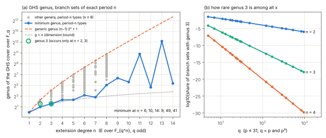

# Odd-characteristic Weil descent onto genus 3: which extension degrees, which curves

2026-10-14. This is proposal 5 and the "next discriminating step" of
[`problems/ghs-to-smith-pipeline-characteristic-mismatch.md`](../../problems/ghs-to-smith-pipeline-characteristic-mismatch.md).
It combines a literature reading with an exact native enumeration. It solves
no discrete logarithm and claims no cost or speedup. Protocol:
[PROTOCOL.md](PROTOCOL.md), frozen at commit `4ad7dd5db` before the first run,
with one dated amendment. Tool:
[`examples/odd_char_ghs_genus.rs`](../../examples/odd_char_ghs_genus.rs)
(std-only Rust, single-threaded). Runs: `20261014T1758Z` and
`20261014T1800Z`; their records are in [results/](results/), with
`env.txt` in each run directory. Run report:
[reports/run-20261014T1800Z/run-report.pdf](reports/run-20261014T1800Z/run-report.pdf).
This report as PDF: [REPORT.pdf](REPORT.pdf). Conductor is not installed on
this host, so there is no task card.

**Tags.** Every claim below carries one tag:

- **[T]** a theorem, either stated by a cited source or derived here with a
  proof;
- **[E]** an exact computation by the tool, reproducible and checked;
- **[H]** a heuristic;
- **[O]** out of scope or not established.

## Answer

- **[T, source]** Yes. For `n = 3` there is an odd-characteristic GHS
  descent whose target is a genus-3 **hyperelliptic** curve over `F_q`, for
  any odd `q`, so in particular for `p >= 5`. It applies to
  `E/F_{q^3}: y^2 = e·g(x)(x − α)(x − α^q)` with `α ∈ F_{q^3} \ F_q` and
  `g ∈ F_q[x]` of degree 1 or 2. The cover has degree 8 over `P^1(x)`. There
  are `Θ(q^2)` `F_{q^3}`-isomorphism classes of such `E`. Source: Momose–Chao,
  ECC 2007 talk, slide 24. Joux–Vitse (Eurocrypt 2012, §4.1, eq. (3)) state
  the same family with `e = 1` and `h = g`, and call it "the only" one for
  hyperelliptic genus-3 GHS covers, citing Diem 2003, Momose–Chao 2005 and
  Thériault 2003.
- **[E]** The tool checks Joux–Vitse's explicit model `H` (Appendix A.1) on
  81 instances (`p ≤ 31`; three `α` per `p`; `h = x`, `x(x−1)` and an
  irreducible quadratic). On every instance
  `L_H(T) = 1 − tT^3 + p^3T^6`, which is the L-polynomial of
  `Res_{F_{p^3}/F_p} E`, and `#Jac(H)(F_p) = #E(F_{p^3})`.
- **[T, derived here]** For the GHS compositum attached to a degree-2
  function `x`, the genus is `g = 1 + 2^{m−2}(r − 4)`. It depends only on
  the Frobenius-orbit type of the branch locus of `x`, never on `q`
  (Theorem 1). Genus 3 occurs only for `(m, r) ∈ {(2,6), (3,5)}`, and only
  when the branch set of `x` has period 2 or 3 under `σ` (Theorem 2). So for
  `E/F_{q^n}` with `F_q(j(E)) = F_{q^n}` and `n >= 4`, every `x` gives
  genus at least 5.
- **[T, source + E]** The problem record is **not** closed as a proved
  obstruction. A family exists, so the record now carries the family and
  the Smith conditions that remain. The obstruction for the pipeline as
  originally stated (GHS in characteristic 2 feeding Smith) stands
  unchanged: Smith's construction "does not apply in characteristics 2 and
  3" (Smith 2009, §1, p. 2).

## Sources read (exact locations)

| source | what it states (quoted or tightly paraphrased) | class |
| --- | --- | --- |
| Chao (with Momose), "Elliptic and hyperelliptic curves with weak coverings against Weil descent attack", ECC 2007 slides ([pdf](https://maths.ucd.ie/~gmg/ECC2007Talks/chao.pdf)) | sl. 17: Condition (C), `J(C) → Res_{k_d/k}(J(C0))` an isogeny, "implies g = d g0, the smallest possible genus of C". sl. 20: for `char(k) ≠ 2` such `(2,…,2)` coverings exist for `2∣d` only at `(d,n) = (2,2)`; for `2∤d`, `d ≠ 2^n−1`, only at `(5,4)`; for `d = 2^n − 1`, "Exist"; decomposable: `g0 = 1, (d,n) = (3,3)`. sl. 21: table, `(3,3)` hyper `g0 = 1` `Θ(q^2)`; `(5,4)` and `2^n−1` nonhyper. sl. 24: the hyperelliptic genus-3 family above. sl. 25: non-hyperelliptic genus 3, covering degree 4: Type 1 `y^2 = (x−α)(x−α^q)(x−β)(x−β^q)`, `α,β ∈ k_3 \ k`; Type 2 with `α ∈ k_6 \ (k_2 ∪ k_3)`; "The Type I curve has been also obtained by Diem." sl. 26: `C` is hyperelliptic iff `∃A ∈ GL_2(k)` with `Tr A = 0`, `β = A·α`, "which reduces to the former case". sl. 33: Type I gives `#{λ} ≈ q^3/2`. | T (slides; proofs not read) |
| Joux–Vitse, "Cover and decomposition index calculus on elliptic curves made practical", Eurocrypt 2012 (author PDF, pp. 8, 14–17) | §4.1 (p. 8), eq. (3) and "the number of curves admitting an equation of the form (3) is Θ(q^2)"; "all the curves of the form (3) have a cardinality divisible by 4"; "we conjecture that all curves with cardinality divisible by 4 are vulnerable … using an isogeny walk". Eq. (4) gives the non-hyperelliptic genus-3 family. App. A.1 (pp. 14–15): `H: y^2 = 4N(x)^2 h(F(x)/(4N(x)))` with `F = N·(x + φ + φ^σ + φ^{σ^2})`. App. C (p. 16): for `n = 6` and `j(E) ∉ F_{q^3} ∪ F_{q^2}`, "the minimum genus of the Fq-cover obtained by the GHS method is 9". | T (source); the conjecture is H |
| Diem, "On the discrete logarithm problem in elliptic curves", Compositio 147 (2011) | p. 94, proof of Prop. 4.10: "By a general result on elementary abelian extensions (see, for example, [KR89]) we have g(C) = Σ_L g(L), where L runs over all subextensions of k(C)\|k(x) of degree two". Prop. 4.10(a): `g(C) ≤ (2^n−1)(2n−1)`, under its Condition 2.7. p. 95: "Let q be odd. In this case k(E)\|k(x) is (tamely) ramified at 4 places." p. 78: Gaudry "argues on a heuristic basis" for `Õ(q^{2−2/n})`. | T; the Gaudry bound is H |
| Hess, LMS J. Comput. Math. 7 (2004) 167–192 | p. 168: GHS "generalised to hyperelliptic curves … in odd characteristic by Diem". p. 171: "analogous results can be obtained for Kummer extensions". p. 174, Thm 8 (Artin–Schreier): the genus "is exponential in m". | T (characteristic-2 setting; Kummer only remarked) |
| Smith, arXiv:0806.2995v2 (J. Cryptology 22, 2009) | p. 2: "the trigonal construction (and hence our formulae) does not apply in characteristics 2 and 3". Prop. 1 (p. 4) and Def. 1 (p. 5): a rational tractable subgroup is a Galois-stable partition of the eight Weierstrass points into four pairs. Lemma 1 (p. 6): `#S(H)` by factorisation pattern. Prop. 2 (p. 10): the trigonal map is rational iff a discriminant is a square. Prop. 4 (p. 15): the isogeny is rational iff the leading coefficient of `s(t)` is a square. Hypotheses 2–3 assign each a probability of 1/2. Abstract: `Õ(q)` for ≈ 18.57% of genus-3 hyperelliptic curves. | T; probabilities and `Õ(q)` are H |
| Tian, arXiv:2012.07173 (2020), pp. 2, 18 | p. 2: for odd `q` and prime `n ∉ {3,5,7}` "the genus of the resulting curve is always so large that one can say that the attack fails"; "For n = 3, if we require C to be of genus 3, then a necessary condition is that the elliptic curve has three rational points of order 2 [3,13]"; ppav of dimension 3 "are the generalized Jacobian varieties" (Oort–Ueno). p. 18: `(ℓ,ℓ,ℓ)`-isogenies `Res(E) → Jac(C)`, with `C` non-hyperelliptic, for prime-order `E/F_{q^3}`. | T as reported; see the conflict below |
| Abstracts only: Momose–Chao ePrint 2009/236 (JRMS); Iijima–Momose–Chao ePrint 2015/805; Gaudry ePrint 2004/073; Diem ePrint 2005/119; Galbraith–Hess–Smart ePrint 2001/054 | 2009/236: "for elliptic curves defined in Legendre forms, about half of them are weak". 2015/805: classification for `d = 2, 3, 5, 7`; per Diem the attack fails for prime `d >= 11`. 2004/073: `O(q^{10/7})` over `F_{q^3}`. 2005/119: heuristically `Õ(q)` on plane quartics. 2001/054: isogeny-extended GHS, characteristic 2, composite degree. | T or H as labelled by each author |

**[O] Not read.** I could not obtain these, and nothing above rests on their
contents except as reported by the papers that cite them:

- Diem, "The GHS attack in odd characteristic", J. Ramanujan Math. Soc. 18
  (2003) 1–32. The author's page returns 404, the publisher is not online,
  and archive.org is blocked from this host.
- Thériault, "Weil descent attack for Kummer extensions", JRMS 18 (2003).
- Diem–Thomé, J. Cryptology 21 (2008), behind a Springer login.
- Gaudry, J. Symb. Comput. 44 (2009). HAL is behind bot protection.
- The ePrint PDFs of 2009/236, 2015/805, 2005/277 and 2006/347, which
  return HTTP 403 here.
- Galbraith–Hess–Smart, Eurocrypt 2002: abstract only.

## Genus as a function of `(q, n, x)`

Setting: `E/F_{q^n}`, `q` odd, `x: E → P^1` of degree 2, defined over
`F_{q^n}`, with branch set `B`. Take `σ` to be the `q`-Frobenius for the
`F_q`-structure of the `x`-line, and `S = ∪_{i<n} σ^iB` with `r = |S|`.
Let `V ⊂ F_2^S` be the span of the indicator vectors of the `σ^iB`, with
`m = dim V`, and let `k` be the period of `B`. The GHS curve is the
compositum `E ×_{P^1} σE ×_{P^1} … ×_{P^1} σ^{n−1}E`. Diem (2011, p. 94)
states this fibre product form.

- **Theorem 1 [T, derived here].** The geometric GHS curve `C` has genus
  `g = 1 + 2^{m−2}(r − 4)`.
  *Proof.* `C → P^1` is Galois with group `(Z/2)^m` by Kummer theory, since
  `char ≠ 2`. The points of `S` are exactly the branch points. Each has
  `2^{m−1}` places above it, with `e = 2` and different exponent 1 (tame).
  Riemann–Hurwitz gives `2g − 2 = −2^{m+1} + r·2^{m−1}`. The same value
  comes from Diem's subcover sum, `Σ_{v ∈ V∖0}(|v|/2 − 1)`, because
  `Σ_v |v| = r·2^{m−1}`. ∎
  [E] The tool checks the two expressions against each other on every type
  for `n <= 14`.
- **[T]** It follows that `g` depends on `x` only through the orbit type of
  `B` and on `n`. It does not depend on `q`, and `m <= min(n, r − 1)`.
  The maximum is `(n−1)·2^n + 1`, reached when `B` has four distinct
  orbits of size `n` (`r = 4n`, `m = n`).
- **Theorem 2 [T, derived here].** (a) `g = 3` iff `(m, r) ∈ {(2,6),
  (3,5)}`. (b) If `m = 2` then `k ∈ {2, 3}`. If `(m, r) = (3, 5)` then
  `k = 3`. (c) If `k >= 4` then `g >= 5`.
  *Proof.* `m = 1` forces `σB = B`, so `r = 4` and `g = 1`. For `m >= 2`,
  `r >= 5`, and then `2^{m−2}(r − 4) = 2` gives (a).
  For `m = 2`, `V = {0, B, σB, B+σB}` is `σ`-stable, so `σ^2B` is either
  `B` or `B+σB`. In the second case `σ^3B = B`.
  For `r = 5`, `σ^iB = S ∖ {σ^i s}`. The vectors `1 + e_t` over the
  `σ`-orbit `T` of `s` have rank `|T|` for `|T| <= 4`, and rank 4 for
  `|T| = 5`. So `m = 3` forces `k = |T| = 3`.
  For (c): `k >= 4` forces `m >= 3`; with `m = 3`, `r >= 6`. Either way
  `g >= 1 + 2·2` or `g >= 1 + 4·1`. ∎
- **Theorem 3 [T, derived here].** For even `n >= 6` no branch type of any
  period has `g = n`.
  *Proof.* `g − 1` is odd, so `m = 2` and `r = n + 3`. But `m = 2` means
  `S = B ∪ σB`, so `r <= 8`. ∎
  This agrees with Momose–Chao slide 20, where for even `d` the only case
  is `(d, n) = (2, 2)`.
- **[E]** Hyperellipticity is recorded only when an involution of the
  cover group has a genus-0 quotient (`hyperelliptic_via_G`). That is
  sufficient, not necessary. Momose–Chao slide 26 shows that an `m = 2`
  curve can be hyperelliptic through another involution.

## Enumeration (runs `20261014T1758Z`, `20261014T1800Z`; identical except one added column)

- **[E]** There are 601 branch types for `n = 1..8`
  ([types.csv](results/run-20261014T1800Z/types.csv)). For each one the
  tool records `r`, `m`, `g`, the period and `hyperelliptic_via_G`.
- **[E]** Exact branch-set counts for all 144 `(q, n)` pairs, with
  `q = p, p^2`, `p ≤ 31` and `n ≤ 8`, add up to `q^{4n} − q^{2n}`.
  The `σ`-stable ones add up to `q^4 − q^2`. These counts are in
  [counts.csv](results/run-20261014T1800Z/counts.csv) and every check is
  `ok`. The same completeness check passes at `q = 5` for `n <= 14`
  ([min_genus.csv](results/run-20261014T1800Z/min_genus.csv)).
- **[E]** These source statements are reproduced as unit tests (11 tests,
  all passing):
  - the minimal covers (`g = n`, period `n`) for `n ≤ 8` are exactly
    `(n, m) ∈ {(2,2), (3,2), (3,3), (5,4), (7,3)}`, which are Momose–Chao's
    cases;
  - the `n = 3` genus-3 types are exactly the shapes of slides 24–25:
    `1+1+3` and `2+3` (hyperelliptic, `2^m = 8`), and `3+3` (Type 1) and `6`
    (Type 2) (`2^m = 4`);
  - Joux–Vitse's App. C shapes (12) and (13) have genus 9;
  - every type is within Diem's bound `(2^n−1)(2n−1)`;
  - the repository's `n = 5` census statements hold (`m ∈ {1,4,5}`, no
    genus in 6–16);
  - Smith's Lemma 1 table equals brute-force stable-matching counts for all
    22 cycle types of `S_8`.
- **[E]** The smallest genus over branch sets of exact period `n`, which
  covers every `x` when `F_q(j) = F_{q^n}`:

| n | 1 | 2 | 3 | 4 | 5 | 6 | 7 | 8 | 9 | 10 | 11 | 12 | 13 | 14 |
| --- | --- | --- | --- | --- | --- | --- | --- | --- | --- | --- | --- | --- | --- | --- |
| min genus | 1 | 2 | 3 | 5 | 5 | 9 | 7 | 33 | 81 | 49 | 1793 | 25 | 9217 | 41 |
| generic `(n−1)2^n+1` | 1 | 5 | 17 | 49 | 129 | 321 | 769 | 1793 | 4097 | 9217 | 20481 | 45057 | 98305 | 212993 |

- **[E]** At `n = 3`, the share of all degree-4 branch sets that give
  genus 3 is `10^{−4.14}` at `q = 5` and `10^{−8.93}` at `q = 31`
  (panel (b)). For example, at `q = 5` there are 17760 such branch sets: 3000
  hyperelliptic and 14760 of Types 1 and 2.
- **[O]** A genus-3 curve therefore comes from searching over `x`, as the
  repository's census does, and not from a random `x`.



*Figure. (a) Attainable genera of period-`n` branch types: grey for
`n ≤ 8`, the minimum in blue for `n ≤ 14`. Also drawn are the generic genus
and the dimension bound `g = n`. Genus 3 is circled; it occurs only at
`n = 2, 3`. (b) The log10 share of degree-4 branch sets with genus 3, by `q`.
At `n = 2, 4` the genus-3 types have period 2. Run `20261014T1800Z`; drawn
by [figures/plot.py](figures/plot.py) from the recorded CSVs.*

## The `n = 3` hyperelliptic family, and Smith's conditions (the third arm)

- **[E]** On all 81 Joux–Vitse instances
  ([jv_family.csv](results/run-20261014T1800Z/jv_family.csv)):
  - `N1 = p+1`, `N2 = p^2+1` and `N3 = p^3+1−3t`, so
    `L_H = 1 − tT^3 + p^3T^6`. This is checked with the repository's own
    `F_7` instance as a test: `#E0(K) = 328` and `N = (8, 50, 296)`, the
    values recorded in `research/ghs_cubic_hyperelliptic_genus3_20261013`.
  - The Frobenius cycle type on the eight Weierstrass points of `H` is
    `(3,3,1,1)` for `h = x` and `h = x(x−1)`. That gives
    `#S(H) = 3` rational tractable subgroups (Smith, Lemma 1).
  - For irreducible `h` the cycle type is `(6,2)`, which gives `#S(H) = 1`.
  - `4 ∣ #E(F_{p^3})` on all 81 instances.
- **[T, derived here; matches all instances]** Here is why. Joux–Vitse
  observe that `{1, φ, φ^σ, φ^{σ^2}}` is a group (App. A.1). So `σ` acts on
  each free orbit of that group by an affine map whose linear part has
  order 3. Such a map has exactly one fixed point, which gives the cycle
  type `1+3` on each Weierstrass fibre of `F/(4N)`. When `σ` swaps the two
  fibres, the type becomes `(6,2)`.
- **[O]** Smith's remaining conditions are not checked. Those are the
  square condition for a rational trigonal map (Prop. 2) and the square
  condition on the leading coefficient of `s(t)` (Prop. 4). Smith's
  Hypotheses 2–3 assume these hold with probability 1/2 each for random
  curves. These curves are special, since they carry three bielliptic
  involutions, so that assumption is untested here. The tool also does not
  check that the quotient `J_H/S` is a smooth plane-quartic Jacobian rather
  than a product. No isogeny is constructed.
- **[T, source]** The non-hyperelliptic Types 1 and 2 already give plane
  quartics directly, so Smith is not needed there (Momose–Chao sl. 25;
  Joux–Vitse eq. (4)). The repository's census lists the curves whose only
  genus-3 cover is hyperelliptic: 20 at `q = 5` and 42 at `q = 7`
  ([census](../ghs_cubic_cover_census_20261012/README.md)). Those are the
  curves for which the Smith step would matter.
- **[O]** The tool sees a disagreement with Tian's p. 2 sentence that genus
  3 needs "three rational points of order 2". In the irreducible-`h` arm
  `#E(F_{p^3})[2] = 2` on all 27 instances, yet `L_H` matches
  `Res E` (Momose–Chao and Joux–Vitse both allow `deg g = 2`). The
  references Tian cites for that sentence ([3] Diem 2003 and [13]
  Momose–Chao 2009/236) could not be read, so the disagreement is recorded
  and not resolved.

## The Weil restriction directly (`n = 3`)

- **[T, standard; not re-derived from a source read here]** With its
  Weil-restricted polarization, `W = Res_{F_{q^3}/F_q}(E)` is geometrically
  `E × E^σ × E^{σ^2}` with the product polarization. As a principally
  polarized variety it is therefore never the Jacobian of a smooth genus-3
  curve, since a Jacobian's theta divisor is irreducible. Tian (p. 2,
  citing Oort–Ueno) frames dimension-3 ppav as "generalized Jacobian
  varieties".
- **[T, source + E]** `W` is `F_q`-isogenous to `Jac(C)` for a genus-3 `C`
  in these cases:
  1. The `(2,2,2)` GHS covers: the hyperelliptic family (Θ(q^2) curves) and
     Types 1 and 2 (plane quartics). On every recorded instance the
     isogeny is witnessed by `L_C = L_{Res E}`, by Tate's theorem.
  2. The `(ℓ,ℓ,ℓ)`-isogenies of Tian (2020) to non-hyperelliptic curves for
     prime-order `E`.
- **[T, source]** All curves in the hyperelliptic family have
  `4 ∣ #E(F_{q^3})` (Joux–Vitse §4.1). A curve can be hyperelliptic in that
  case. Tian (p. 2), citing [19] (not read), reports that a genus-3 cover
  of a prime-order `E` must be non-hyperelliptic.
- **[H]** Joux–Vitse conjecture that every class with `4 ∣ #E` reaches the
  family by an isogeny walk.
- **[O]** An exact characterisation of the `E` for which `W` is isogenous
  to a hyperelliptic Jacobian is not established here.

## Follow-up: genus-`k` covers for `k = 6, 10, 14` (`docs/curves/jacobian-transfers.json`)

The coordinating session asked about these. Of the file's 848
`formula_advantage` verdicts, 846 rest on `cover_descent` routes over
`E/GF(p^k)`, with `p ≈ 2^10` and `k ∈ {6, 10, 14}`. Their invariant is
`genus_lower_bound = k`, and they are "priced at the most favourable genus
the literature allows, g = k".

- **[T, source]** Joux–Vitse App. C, p. 16: for `k = 6` and
  `j(E) ∉ F_{q^3} ∪ F_{q^2}`, "the minimum genus of the Fq-cover obtained
  by the GHS method is 9" (also §4.3, p. 9: "the smallest possible genus is
  actually 9").
- **[T, source]** Momose–Chao, slide 20: in odd characteristic, the
  Condition-(C) covers with `g = d·g0` exist for even `d` only at
  `(d, n) = (2, 2)`. So the source excludes a genus-`k` `(2,…,2)` cover for
  `k = 6, 10, 14`.
- **[T, source]** Diem 2011 Prop. 4.10(a) is an upper bound,
  `(2^n−1)(2n−1)`, and gives no lower bound.
- **[T, derived + E]** By Theorem 3 no branch type of any period has
  genus `k` for `k = 6, 10, 14`. The minimum over `x`, when
  `F_p(j) = F_{p^k}`, is 9, 49 and 41 respectively. This holds for every
  odd `p`, `p ≈ 2^10` included. The minima for `k = 10` and `k = 14` are
  this enumeration's. No source states them.
- **Plainly:** the sources contradict the existence of a genus-`k`
  odd-characteristic GHS cover for `k = 6, 10, 14`, and the source genus
  lower bound for `k = 6` is 9. Those routes are priced on a genus that the
  GHS construction does not deliver.
- **[O]** `g >= k` remains a valid bound for any cover whose Jacobian maps
  onto `Res E`. Non-GHS constructions, such as other covers or
  `(ℓ,…,ℓ)`-isogenies like Tian's at `n = 3`, are not ruled out here for
  these `k`. Curves with `j` in a proper subfield can have smaller genus.
  The JSON file and its cost model were not edited.

## What this does not show

- **[O]** It shows no cost, no relation collection, no logarithm, and no
  comparison with rho.
- **[O]** For even `n` it does not show that an `F_q`-model exists, that
  is, that an extension of `σ` of order `n` exists with exact constant
  field `F_q`. The genus is geometric.
- **[O]** It does not show that the hyperelliptic family passes Smith's
  Props. 2 and 4, and it does not show that a plane quartic results.
- **[O]** It does not show anything about characteristic 2 or 3.
- **[O]** The enumeration bounds are `n ≤ 8` for the full type data,
  `n ≤ 14` for minimum genera, and `p ≤ 31` for counts. The theorems above
  are proved for all `n` and `q`. The census-type statements are not.

## Relation to existing repository work

- **[E, cited]** The odd-characteristic `n = 3` covers were already counted
  and built here:
  - [census](../ghs_cubic_cover_census_20261012/README.md) (PR #1759);
  - the [`m = 2` plane-quartic build](../ghs_cubic_genus3_build_20261012/README.md)
    (PR #1761);
  - the [`m = 3, r = 5` hyperelliptic build with the transfer](../ghs_cubic_hyperelliptic_genus3_20261013/README.md);
  - the [`n = 5` census](../ghs_cover_census_n5_20261013/README.md).

  The problem record did not link them.
- New here:
  - the literature anchoring;
  - Theorems 1–3, for all `n`;
  - the period-`n` minimum genus for `n ≤ 14`;
  - exact counts for `n ≤ 8`;
  - an independent check of Joux–Vitse's explicit model;
  - the Smith Lemma 1 screen of the family.

## Lean, graphs, reproduction

- **[O] Lean.** Theorems 1–3 and the cycle-type argument are not
  formalized, because no Lean toolchain is installed on this host and
  about 5 GB of disk is free.

  | report statement | Lean declaration | status |
  | --- | --- | --- |
  | Theorem 1 | none | not formalized (no toolchain on host) |
  | Theorem 2 | none | not formalized |
  | Theorem 3 | none | not formalized |
  | cycle type `(3,3,1,1)` / `(6,2)` | none | not formalized |

  For the one type `m = 3, r = 5`,
  `research/ghs_cubic_hyperelliptic_genus3_20261013/lean/HyperGenus3.lean`
  already proves the genus sum.
- **Graphs.** No canonical graph changes: there is no ECDLP rung, no
  timing, and no `benchmarks/` entry.
  `research/weak_isogeny_classes_20261013/figures/pipeline_status.svg` was
  checked and left as it is, because it describes the characteristic-2
  pipeline, whose status is unchanged.
- **Reproduce.**

  ```sh
  rustc --edition 2021 -O examples/odd_char_ghs_genus.rs -o odd_char_ghs_genus
  ./odd_char_ghs_genus research/odd_char_descent_genus3_20261014/results/run-<stamp>
  rustc --edition 2021 -O --test examples/odd_char_ghs_genus.rs -o t && ./t   # 11 tests
  python research/odd_char_descent_genus3_20261014/figures/plot.py <run-dir> research/odd_char_descent_genus3_20261014/figures   # plots recorded values only
  ```
