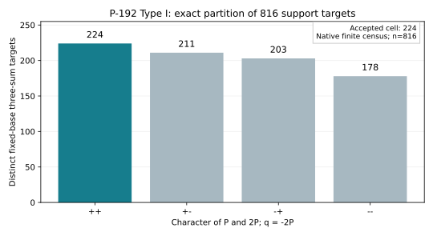

# P-192 Type I conditioned three-sum support

The native census found **224 accepted targets among 816 distinct fixed-base three-sum targets**. Its four character cells have counts `++: 224`, `+-: 211`, `-+: 203`, and `--: 178`. For a known scalar `a`, the sampled collector queries `P=aG` and its quotient target is `q=-2P=a(-2G)`. Conditioning on the two fiber characters changes the eligible three-sum support from 816 to 224 targets. The native replay of the 64 frozen accepted known-scalar queries verified every scalar equation and produced zero matches; the separate relation verifier records zero useful rank.

This run uses standard NIST P-192 over the prime field `p=6277101735386680763835789423207666416083908700390324961279` and prime subgroup order `r=6277101735386680763835789423176059013767194773182842284081`. The 16 quotient points are a frozen coordinate export from the previously verified Type I base (`type_i_base_points_legacy_fixture.json`, SHA-256 `3984b55b793305b30beaf18918209282bce80d444c96217cd6143c7d9470d409`). The sextic character polynomial and accepted-set lower bound come from `type_i_character_density.json`, SHA-256 `fd0a47cf4aecf736b1852d133fd384e30d9584114761bac6495f803d4210ca29`. Both are in the parent study directory. The native program validates every point on P-192 and checks its order divides `r`, then enumerates all unordered triples, checks uniqueness, evaluates the sextic and its independently recorded cubic factorization, and checks `q=-2P` for each target. It also replays the 64 accepted scalar values from the frozen collector receipt, checks both characters, verifies `q=a(-2G)`, and finds zero support hits. Its [JSON receipt](../../type_i_conditioned_support_native.json) and [raw log](../../type_i_conditioned_support_native.log) record the result. A prior direct `F_(p^3)`-fiber character replay reached the same four counts; its frozen [source and outputs](preliminary_python/) are retained as preliminary Python evidence. The 16 base classes and 64 sampled queries also have separate degree-three residual-pair and scalar-equation replay certificates in the parent study.

Under uniform sampling from accepted nonzero scalars, the certified accepted-set lower bound is `L=1569275433846670190958947353987675545133315652035359680560`, so the hit probability is at most `224/L < 2^-182`. This is a derived exact finite-support bound, not a sampled rate. Lean checks the arithmetic inequality in `P192ExtensionCover.p192_conditioned_support_integer_certificate`; the concrete elliptic support enumeration remains a native computation with independent legacy replay. A generic fixed-origin Jacobian normal form and a larger relation collector remain separate implementation tasks.

The index-calculus scoreboard, progress timeline, and WeakCurves atlas were checked. This finite-support refinement changes none of their current status labels or end-to-end results, so their graphs are left unchanged; the new study-local chart above is the graph for this run.

Execution was on Darwin arm64 with Rust/Cargo 1.93.1. The run began on 2026-10-15 at 08:17 UTC from git head `ecb238fd9eef5ed6f699a609c803e41dc74e4ef9`; this report and the new native source were uncommitted at launch. The command was `cargo run --release --offline --manifest-path research/p192_extension_cover_20261012/native_support/Cargo.toml -- research/p192_extension_cover_20261012/type_i_base_points_legacy_fixture.json research/p192_extension_cover_20261012/type_i_character_density.json research/p192_extension_cover_20261012/type_i_geom_character_collector.json research/p192_extension_cover_20261012/type_i_conditioned_support_native.json`. It exited 0. The matching `cargo test --release --offline --manifest-path research/p192_extension_cover_20261012/native_support/Cargo.toml` ran two tests and passed ([raw test log](native_test.log)). The broader repository `cargo test --release --lib` was attempted; rustc stopped on `No space left on device` ([raw failure log](root_release_test_failed.log)), so that check is unverified rather than a code failure. No CPU isolation or wall-time comparison was attempted for this finite census. The [plot source](plot_support.py) reads recorded counts only; the [PDF](report.pdf) embeds the same SVG.
