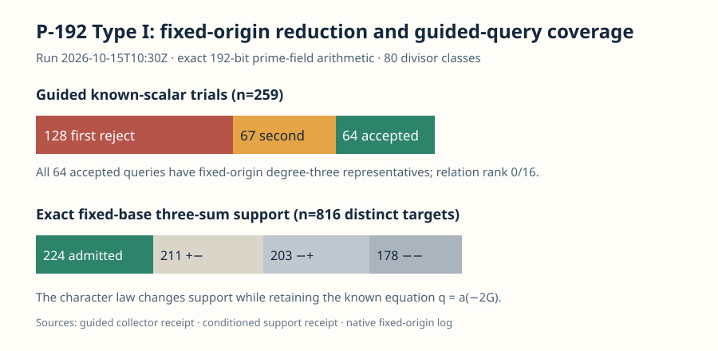

# P-192 Type I fixed-origin Jacobian reduction and guided collector

**Result.** All 16 exact quotient-coordinate base classes and all 64 accepted character-guided known-scalar queries have a degree-three divisor representative over the standard P-192 prime field relative to the same three-point origin. Two cubic sections of the smooth plane quartic construct each representative. Native PARI replays 160 cubic-section cuts, residual coordinates, and the second cubic's rank-nine interpolation. The guided collector admits 64 of 259 frozen scalar trials and finds zero three-sum relations and rank 0/16 against the fixed base.

The curve is the P-192 Type I descended nonhyperelliptic genus-three plane quartic in [the branch report](../../BRANCH_CONTINUATION.md), over (p=6277101735386680763835789423207666416083908700390324961279), with (r=6277101735386680763835789423176059013767194773182842284081). Its three elliptic quotient coordinates are supplied by [the frozen quotient receipt](../../type_i_quotient_base_probe.json). The 64 query points satisfy the known equation (q=a(-2G,-2G,-2G)), with the scalar list and rejection counts in [the frozen guided receipt](../../type_i_geom_character_collector.json). This is a local correctness run; its elapsed time is not an isolated performance measurement.

For a prior degree-three pair ([B-A]) and fixed effective origin (T) of degree three, choose a cubic (G) cutting (B+T+U), where (deg U=6). The rank-nine interpolation through (A+U) gives a cubic (F) cutting (A+U+D), where (deg D=3). Both cubics are sections of (mathcal O_C(3)), so ([D-T]=[B-A]). [Lean theorem `fixed_origin_cubic_class_identity`](../../lean/CrossRatio.lean) checks the cancellation under the explicit section equalities. Its `#print axioms` line reports only `propext`; the concrete section divisors are checked by finite-field arithmetic outside Lean.

The [native replay](../../type_i_fixed_origin_native.gp) reads the [frozen decimal input](../../type_i_fixed_origin_native_input.gp). It checks the two resultants of each of the 80 cases, factors out the known divisors, derives the residual (y)-coordinate by quotient-ring gcd, verifies squarefreeness and disjointness, and derives the second cubic from a rank-nine matrix. The [raw log](../../type_i_fixed_origin_native.log) ends with `NATIVE_FIXED_ORIGIN_PASS base=16 guided=64 cuts=160 prime_bits=192`. The [coefficient receipt](../../type_i_fixed_origin_reduction.json) records each (D) as triangular (x/y) polynomials. Preliminary Sage source snapshots are archived as [text](preliminary_sage/) with their original [producer log](../../type_i_fixed_origin_reduction.log), [verifier log](../../type_i_fixed_origin_verification.log), and checked launcher runtime records. They supplied candidate coefficients; native replay is the acceptance check. The native input is a decimal transcription of the prior cubic-pair and plane-quartic receipts plus those candidate coefficients. It can be rerun without Python or Sage.

The character predicate admits 224 of the fixed base's 816 distinct three-sum targets, as [native enumeration](../../type_i_conditioned_support_native.json) records. The frozen 259 trials split into 128 first-fiber rejections, 67 second-fiber rejections, and 64 acceptances. All 64 accepted queries have representatives (D-T), and none meets the fixed base's three-sum support. The certified accepted-scalar lower bound in the branch report yields the per-accepted-query ideal-uniform support bound (224/L<2^{-182}). This criterion applies to this collector policy; larger bases and other relation laws have separate coverage and cost requirements.

Reproduce from the repository root with `gp -q research/p192_extension_cover_20261012/type_i_fixed_origin_native.gp`; its log must contain no PARI `***` error and must end with the pass marker. From `research/p192_extension_cover_20261012/lean`, run `lake env lean CrossRatio.lean` and inspect the named theorem's `#print axioms` line. The preliminary Sage logs remain frozen and are not rerun by the native path.

The result supplies fixed-origin representatives for these 80 classes. A generic plane-quartic Jacobian group law, a larger usable factor base, useful relation rank, final linear algebra, and target descent remain the next implementation and measurement steps. The present collector's rank is exactly zero for its frozen 16-class base and 64 accepted queries.
