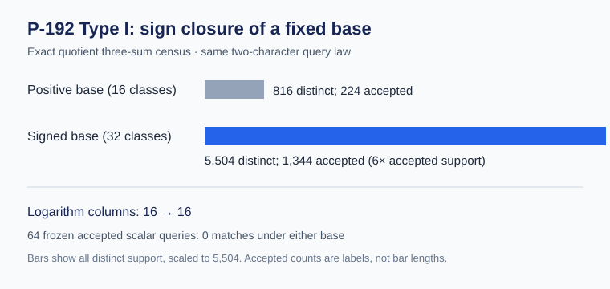

# P-192 Type I signed-base three-sum census

**Result.** Adding the negatives of the 16 fixed Type I quotient classes gives 32 signed classes but retains only 16 logarithm columns. Exact native enumeration finds 5,504 distinct three-sum targets, of which 1,344 satisfy the established two-character geometric query law. The positive-only base had 816 and 224, respectively, so accepted support grows exactly sixfold. Independent PARI elliptic arithmetic reproduces all four counts. The same 64 frozen accepted known-scalar queries give zero signed-base matches and rank 0/16.

For each previously reduced class \([D_i-T]\), include its negative \([T-D_i]\). Both are explicit degree-three divisor *pairs* over \(\mathbb F_p\); the negative classes have not yet been reduced to a single positive degree-three divisor relative to the same origin. In the elliptic quotient, the signed set is \(\{\pm B_i:0\le i<16\}\). A signed triple gives a row with coefficients in \(\{-3,-2,-1,0,1,2,3\}\) on the original 16 columns. [Lean's signed-three-sum theorem](../../lean/SignedBase.lean) proves the homomorphism equation for arbitrary additive groups and a signed index set \(\mathrm{Fin}(B)\times\mathrm{Bool}\). It uses the same unsigned index for both signs; its axiom audit reports only `propext`. The concrete P-192 quotient and divisor geometry is checked by the existing receipts and native arithmetic, not encoded in that Lean theorem.

The [Rust census](../../native_support/src/bin/signed_base.rs) reads the frozen [base fixture](../../type_i_base_points_legacy_fixture.json), [character-density receipt](../../type_i_character_density.json), and [64-query receipt](../../type_i_geom_character_collector.json). It verifies P-192 curve and subgroup membership, opposite points, the identity \(q=-2P\), all 5,984 unordered signed triples, both characters on every distinct target, and all 64 frozen query scalars. Of the 5,984 triples, 512 contain a visible \(B_i-B_i\) cancellation and collapse to 32 singleton targets. The remaining 5,472 triples have distinct targets, disjoint from those 32, giving 5,504 total. The exact character cells are `++: 1344`, `+-: 1416`, `-+: 1392`, and `--: 1352`. The [JSON receipt](../../type_i_signed_base_support.json) retains source and input SHA-256 digests; the [run log](../../type_i_signed_base_support.log) records the executable. The [run manifest](RUN.json) fixes the source, binary, input, command, host, and result hashes. The independent [PARI replay](../../type_i_signed_base_independent.gp) uses [decimal-transcribed input](../../type_i_signed_base_gp_input.gp) and a separate elliptic implementation; its [log](../../type_i_signed_base_independent.log) ends with `SIGNED_BASE_INDEPENDENT_PASS`. Two earlier GP parser attempts and their errors remain in the adjacent `failed` logs.

Under the previously certified uniform distribution on accepted nonzero scalars, its accepted-count lower bound is \(L=1569275433846670190958947353987675545133315652035359680560\). The new fixed-support hit bound is \(1344/L<2^{-179}\), versus \(224/L<2^{-182}\) for the positive base. Lean checks the exact sixfold arithmetic and the new integer inequality in `signed_p192_accepted_support_ratio` and `signed_p192_hit_integer_certificate`. This is an exact finite-support bound for this policy, not a measured success rate or a claim about another sampler's target multiplicity. All 64 accepted queries preserve \(q=a(-2G)\); none lies in the signed three-sum support. With no verified relation rows, the measured incidence rank is zero. The extra signed entries do not increase the relation-matrix column count, but they do increase the triple lookup and arithmetic work; no online speed comparison has been measured.

Reproduce from the repository root with `CARGO_TARGET_DIR=/private/tmp/p192-signed-cargo cargo run --release --offline --manifest-path research/p192_extension_cover_20261012/native_support/Cargo.toml --bin signed_base -- research/p192_extension_cover_20261012/type_i_base_points_legacy_fixture.json research/p192_extension_cover_20261012/type_i_character_density.json research/p192_extension_cover_20261012/type_i_geom_character_collector.json research/p192_extension_cover_20261012/type_i_signed_base_support.json`, followed by `gp -q research/p192_extension_cover_20261012/type_i_signed_base_independent.gp`. The [native test log](native_test.log) records four passed tests across both binaries. From `research/p192_extension_cover_20261012/lean`, run `lake build SignedBase && lake env leanchecker --fresh --verbose SignedBase && lake env lean SignedBase.lean`; the [build](../../lean/signed-base-build-20261015.log), [fresh replay](../../lean/signed-base-fresh-20261015.log), and [axiom audit](../../lean/signed-base-lean-20261015.log) are retained. These runs are correctness and support diagnostics on the local host; they are not isolated wall-time benchmarks.

The next geometry step is to apply the existing two-cubic fixed-origin reduction to each of the 16 negative pairs and independently replay the resulting sections. The next collector experiment must freeze a larger base and query sample, measure ordinary-query matches and useful rank, and charge the increased signed-triple indexing cost. Its candidate ID remains unresolved until the exact base points, signed folding, solver, and full pipeline are fixed.
